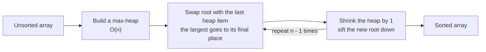

# Heap Sort: Concept

> Sort with a heap: build a max-heap, then repeatedly move the largest item to the end. `O(n log n)` time, `O(1)` extra space. Know the idea, and why it is not the default sort.

#### 1. What Is It?

**Heap sort** sorts an array in place using a **max-heap**.

1. **Build** a max-heap from the array (`O(n)`).
2. **Repeat `n − 1` times:** swap the root (the largest) with the **last item of the heap part**, shrink the heap by one, and sift the new root down.

After each round, the largest remaining item sits in its final place at the end.

**Where it fits:** `O(n log n)` in the worst case, **no extra memory**, but **not stable** and slower in practice than quicksort (poor cache use). Interviews ask about it as a concept and as a comparison with merge sort and quicksort.

#### 2. How It Works

```text
array [5, 3, 8, 1, 9]
1. build max-heap:                 [9, 5, 8, 1, 3]
2. swap root with the last:        [3, 5, 8, 1 | 9]     9 is final.  sift down 3 in the first 4:  [8, 5, 3, 1 | 9]
3. swap root with the last of 4:   [1, 5, 3 | 8, 9]     8 is final.  sift down 1 in the first 3:  [5, 1, 3 | 8, 9]
4. swap root with the last of 3:   [3, 1 | 5, 8, 9]     5 is final.  sift down 3 in the first 2:  [3, 1 | 5, 8, 9]
5. swap root with the last of 2:   [1 | 3, 5, 8, 9]     done
result: [1, 3, 5, 8, 9]
```



**Why a max-heap for ascending order?** The largest item is moved to the end, so the array fills from the back.

**Comparison**

| | Heap sort | Merge sort | Quicksort |
|---|---|---|---|
| Time (worst) | `O(n log n)` | `O(n log n)` | `O(n²)` |
| Time (average) | `O(n log n)` | `O(n log n)` | `O(n log n)` |
| Extra space | **`O(1)`** | `O(n)` | `O(log n)` |
| Stable | no | **yes** | no |
| Cache friendly | no | yes | **yes** |

#### 3. Brute Force vs Optimized

| Approach | Time | Space |
|---|---|---|
| Selection sort (find max each time) | `O(n²)` | `O(1)` |
| **Heap sort** (find max with a heap) | `O(n log n)` | `O(1)` |
| Using a separate `PriorityQueue` | `O(n log n)` | `O(n)` extra |

Heap sort is selection sort where "find the max" costs `O(log n)` instead of `O(n)`.

```kotlin
// Selection sort: the O(n^2) idea that heap sort speeds up
fun selectionSort(a: IntArray) {
    for (end in a.size - 1 downTo 1) {
        var maxIdx = 0
        for (i in 1..end) if (a[i] > a[maxIdx]) maxIdx = i
        val t = a[end]; a[end] = a[maxIdx]; a[maxIdx] = t
    }
}
```

#### 4. Kotlin Code

```kotlin
// Heap sort, in place, ascending
fun heapSort(a: IntArray) {
    val n = a.size
    for (i in n / 2 - 1 downTo 0) siftDownMax(a, n, i)        // 1. build a max-heap
    for (end in n - 1 downTo 1) {
        val t = a[0]; a[0] = a[end]; a[end] = t               // 2. largest goes to its final place
        siftDownMax(a, end, 0)                                // 3. restore the heap in a[0 until end]
    }
}

fun siftDownMax(a: IntArray, size: Int, start: Int) {
    var i = start
    while (true) {
        val l = 2 * i + 1
        val r = 2 * i + 2
        var largest = i
        if (l < size && a[l] > a[largest]) largest = l
        if (r < size && a[r] > a[largest]) largest = r
        if (largest == i) return
        val t = a[i]; a[i] = a[largest]; a[largest] = t
        i = largest
    }
}
```

Checks: `val a = intArrayOf(5, 3, 8, 1, 9); heapSort(a)` → `[1, 3, 5, 8, 9]`. `heapSort(intArrayOf(2, 2, 1, 1))` → `[1, 1, 2, 2]`. `heapSort(intArrayOf())` and `heapSort(intArrayOf(7))` leave the array unchanged. Already sorted `[1, 2, 3]` → `[1, 2, 3]`. Reverse sorted `[3, 2, 1]` → `[1, 2, 3]`. `selectionSort` gives the same results.

#### 5. Complexity

| | Time | Space |
|---|---|---|
| Build the heap | `O(n)` | `O(1)` |
| `n − 1` sift downs | `O(n log n)` | `O(1)` |
| Total | **`O(n log n)`** in every case | **`O(1)`** |

#### 6. Common Mistakes

1. **Using a min-heap** and expecting an ascending sort in place. (A min-heap gives a descending array with this method.)
2. **Sifting down in the whole array** instead of `a[0 until end]` (the sorted tail must stay untouched).
3. **Forgetting that heap sort is not stable.**
4. **Saying it is the fastest sort.** In practice quicksort is faster.
5. **Building the heap with `n` inserts** (`O(n log n)` extra). Use bottom-up heapify.

#### 7. Say This in the Interview

1. "Heap sort builds a max-heap in `O(n)`, then repeatedly swaps the root to the end and sifts down. It's `O(n log n)` in every case with `O(1)` extra space."
2. "It's not stable, and it has worse cache behaviour than quicksort, so it's rarely the first choice. It's useful when I need guaranteed `O(n log n)` without extra memory."
3. "It's the same as selection sort, except finding the maximum costs `O(log n)`."

#### 8. Quick Check

1. Which heap type gives an ascending in-place heap sort?
2. Is heap sort stable?
3. What is its extra space?

<details>
<summary>Answers</summary>

1. A **max**-heap.
2. No.
3. `O(1)`.

</details>

#### 9. Related LeetCode Questions

| # | Question | Idea |
|---|---|---|
| 912 | [Sort an Array](https://leetcode.com/problems/sort-an-array/) (Medium) | implement heap sort |
| 215 | [Kth Largest Element in an Array](https://leetcode.com/problems/kth-largest-element-in-an-array/) (Medium) | partial heap sort |
| 75 | [Sort Colors](https://leetcode.com/problems/sort-colors/) (Medium) | other in-place sort ideas |
| 148 | [Sort List](https://leetcode.com/problems/sort-list/) (Medium) | merge sort comparison |
| 976 | [Largest Perimeter Triangle](https://leetcode.com/problems/largest-perimeter-triangle/) (Easy) | sort or max-heap |
