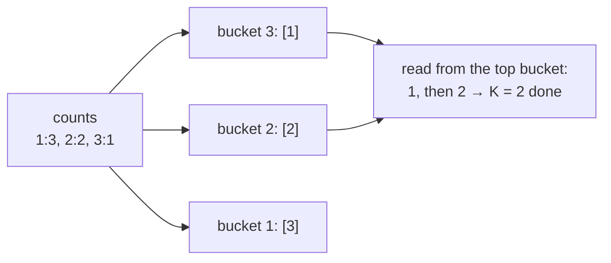

# Top K Frequent Elements

> Count first, then pick the top `K` by count. A heap of size `K` or a bucket sort. The "words" version adds a tie-break rule.

#### 1. What Is It?

Given an array, return the `K` **most frequent** elements. A close cousin, **Top K Frequent Words**, breaks ties **alphabetically**.

**Signals:** "most frequent", "top K frequent", "K most common", "K least frequent".

#### 2. How It Works

Two steps: **(1) count** with a hash map, **(2) pick the top `K`** counts.

```text
nums = [1, 1, 1, 2, 2, 3], K = 2
counts: {1: 3, 2: 2, 3: 1}
```

**Method A: min-heap of size `K` on the counts**

```text
heap holds up to K entries, ordered by count (smallest count on top)
add 1(3) → {1}      add 2(2) → {2, 1}      add 3(1) → size 3 > 2 → remove the smallest count (3) → {2, 1}
answer: 1 and 2
```

**Method B: bucket sort** (best when counts are small). The count of any item is at most `n`, so make `n + 1` buckets, where bucket `c` holds the items that appear exactly `c` times. Read buckets from the highest count down until you have `K` items.



| Method | Time | Space |
|---|---|---|
| Sort the counts | `O(n log n)` | `O(n)` |
| Min-heap of size `K` | `O(n log K)` | `O(n)` |
| Bucket sort | `O(n)` | `O(n)` |
| Quickselect on counts | `O(n)` average | `O(n)` |

**Top K Frequent Words (tie-break).** Sort by **count descending, then word ascending**. With a **min-heap** that keeps the best `K`, the "worst" item must be on top: **lower count first, and for equal counts the lexicographically larger word first**. At the end, poll everything and reverse.

#### 3. Brute Force vs Optimized

| Approach | Time | Space |
|---|---|---|
| Count, sort all entries by count | `O(n log n)` | `O(n)` |
| Count + heap of size `K` | `O(n log K)` | `O(n)` |
| Count + bucket sort | `O(n)` | `O(n)` |

```kotlin
// Brute force: count, then sort all entries
fun topKFrequentSort(nums: IntArray, k: Int): IntArray {
    val count = HashMap<Int, Int>()
    for (x in nums) count[x] = (count[x] ?: 0) + 1
    return count.entries.sortedByDescending { it.value }.take(k).map { it.key }.toIntArray()
}
```

#### 4. Kotlin Code

```kotlin
import java.util.PriorityQueue

// Top K Frequent Elements (LeetCode 347): heap
fun topKFrequent(nums: IntArray, k: Int): IntArray {
    val count = HashMap<Int, Int>()
    for (x in nums) count[x] = (count[x] ?: 0) + 1
    val heap = PriorityQueue<Int>(compareBy<Int> { count[it]!! })     // least frequent on top
    for (x in count.keys) {
        heap.add(x)
        if (heap.size > k) heap.poll()
    }
    return IntArray(heap.size) { heap.poll() }.reversedArray()        // most frequent first
}

// Top K Frequent Elements: bucket sort, O(n)
fun topKFrequentBuckets(nums: IntArray, k: Int): IntArray {
    val count = HashMap<Int, Int>()
    for (x in nums) count[x] = (count[x] ?: 0) + 1
    val buckets = Array(nums.size + 1) { mutableListOf<Int>() }       // index = frequency
    for ((value, freq) in count) buckets[freq].add(value)
    val result = mutableListOf<Int>()
    for (freq in nums.size downTo 1) {
        for (v in buckets[freq]) {
            result.add(v)
            if (result.size == k) return result.toIntArray()
        }
    }
    return result.toIntArray()
}

// Top K Frequent Words (LeetCode 692): count desc, then word asc
fun topKFrequentWords(words: Array<String>, k: Int): List<String> {
    val count = HashMap<String, Int>()
    for (w in words) count[w] = (count[w] ?: 0) + 1
    // the "worst" candidate is on top: lower count, or the same count with the larger word
    val heap = PriorityQueue<String>(compareBy<String> { count[it]!! }.thenByDescending { it })
    for (w in count.keys) {
        heap.add(w)
        if (heap.size > k) heap.poll()
    }
    val result = ArrayList<String>()
    while (heap.isNotEmpty()) result.add(heap.poll())
    result.reverse()
    return result
}
```

Checks: `topKFrequent(intArrayOf(1, 1, 1, 2, 2, 3), 2)` → `[1, 2]`. `topKFrequent(intArrayOf(1), 1)` → `[1]`. `topKFrequentBuckets(intArrayOf(1, 1, 1, 2, 2, 3), 2)` → `[1, 2]`. `topKFrequentSort(...)` → `[1, 2]`. `topKFrequentWords(arrayOf("i", "love", "leetcode", "i", "love", "coding"), 2)` → `["i", "love"]` (both appear twice, `"i"` is alphabetically first). `topKFrequentWords(arrayOf("the", "day", "is", "sunny", "the", "the", "the", "sunny", "is", "is"), 4)` → `["the", "is", "sunny", "day"]`.

For the first words example: counts are `i:2, love:2, leetcode:1, coding:1`. The heap keeps the best 2. `"love"` is the worse of the two count-2 words (larger alphabetically), so it sits above `"i"`. Polling gives `love, i`, and reversing gives `["i", "love"]`.

#### 5. Complexity

| | Time | Space |
|---|---|---|
| Count | `O(n)` | `O(u)` for `u` distinct items |
| Heap of size `K` | `O(u log K)` | `O(K)` |
| Bucket sort | `O(n)` | `O(n)` |
| Words: heap with string compare | `O(u log K · L)` for word length `L` | `O(u)` |

#### 6. Common Mistakes

1. **Putting every distinct item in a max-heap** instead of capping a min-heap at `K`.
2. **Heap on the values instead of the counts.**
3. **Returning the heap's polling order** without reversing (it is least frequent first).
4. **Words:** forgetting the alphabetical tie-break, or using the wrong direction.
5. **Bucket sort:** an array of size `n` instead of `n + 1` (a single value can appear `n` times).
6. **Sorting the whole map** when `K` is small (fine, but slower than needed).

#### 7. Say This in the Interview

1. "First I count with a hash map in `O(n)`. Then I keep a min-heap of size `K` ordered by count, so the least frequent candidate is on top and gets evicted first: `O(n log K)`."
2. "If I want `O(n)`, I use bucket sort: the frequency is at most `n`, so I put each element in the bucket of its count and read from the highest bucket."
3. "For words, equal counts are ordered alphabetically, so the comparator must carry that tie-break."

#### 8. Quick Check

1. Top 1 frequent in `[4, 4, 5]`?
2. Which heap type, and ordered by what?
3. Why `n + 1` buckets?

<details>
<summary>Answers</summary>

1. `[4]`.
2. A **min**-heap ordered by **count**.
3. Frequencies go from 1 to `n`, so the largest index needed is `n`.

</details>

#### 9. Related LeetCode Questions

| # | Question | Idea |
|---|---|---|
| 347 | [Top K Frequent Elements](https://leetcode.com/problems/top-k-frequent-elements/) (Medium) | count + heap or buckets |
| 692 | [Top K Frequent Words](https://leetcode.com/problems/top-k-frequent-words/) (Medium) | tie-break |
| 451 | [Sort Characters By Frequency](https://leetcode.com/problems/sort-characters-by-frequency/) (Medium) | count + max-heap |
| 1636 | [Sort Array by Increasing Frequency](https://leetcode.com/problems/sort-array-by-increasing-frequency/) (Easy) | sort by count then value |
| 973 | [K Closest Points to Origin](https://leetcode.com/problems/k-closest-points-to-origin/) (Medium) | same pattern, distance |
| 215 | [Kth Largest Element in an Array](https://leetcode.com/problems/kth-largest-element-in-an-array/) (Medium) | note 9 |
