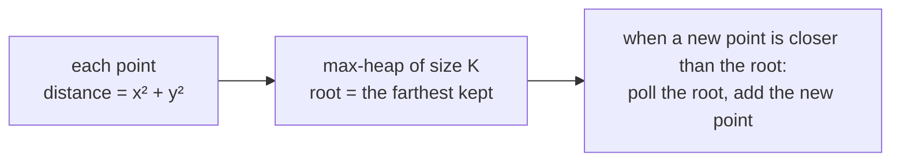

# K Closest Elements / Points

> "Closest" means "smallest distance". Compute a distance for each item, then keep the `K` smallest with a **max**-heap of size `K`.

#### 1. What Is It?

| Question | Items | Distance |
|---|---|---|
| **K Closest Points to Origin** (973) | points `(x, y)` | `x² + y²` (no square root needed) |
| **Find K Closest Elements** (658) | a sorted array and a target `x` | `|a[i] − x|` |

**Signals:** "K closest", "nearest K", "K nearest to a target".

#### 2. How It Works

**Use the squared distance.** Comparing `x² + y²` gives the same order as comparing `√(x² + y²)`, and it avoids floating-point work.

**Max-heap of size `K` on distance.** The root is the **farthest** of the `K` closest so far. When a new point is closer than the root, replace the root.

```text
points = [[3, 3], [5, -1], [-2, 4]], K = 2
distances: 18, 26, 20
add (3,3) d=18 → {18}      add (5,-1) d=26 → {26, 18}      add (-2,4) d=20 → size 3 → remove the largest (26) → {20, 18}
answer: (3,3) and (-2,4)
```



**Find K Closest Elements (sorted array).** The same heap works, with the tie rule: for equal distance, the **smaller value** is closer. Use a max-heap ordered by `(distance, value)`; the "worst" item has the larger distance, or equal distance and the larger value. Then sort the `K` survivors. (Faster: binary search + two pointers, `O(log n + K)`.)

```text
arr = [1, 2, 3, 4, 5], K = 4, x = 3        distances 2, 1, 0, 1, 2
keep 4 smallest: drop one distance-2 item. 5 is "worse" than 1 (same distance, larger value) → drop 5
answer [1, 2, 3, 4]
```

#### 3. Brute Force vs Optimized

| Approach | Time | Space |
|---|---|---|
| Sort all by distance, take `K` | `O(n log n)` | `O(n)` |
| **Max-heap of size `K`** | `O(n log K)` | `O(K)` |
| Quickselect on distances | `O(n)` average | `O(1)` |
| (sorted array) binary search + two pointers | `O(log n + K)` | `O(1)` |

```kotlin
// Brute force: sort by squared distance
fun kClosestSort(points: Array<IntArray>, k: Int): Array<IntArray> =
    points.sortedBy { it[0] * it[0] + it[1] * it[1] }.take(k).toTypedArray()
```

#### 4. Kotlin Code

```kotlin
import java.util.PriorityQueue

// K Closest Points to Origin (LeetCode 973)
fun kClosest(points: Array<IntArray>, k: Int): Array<IntArray> {
    fun dist(p: IntArray) = p[0] * p[0] + p[1] * p[1]
    val heap = PriorityQueue<IntArray>(compareByDescending<IntArray> { dist(it) })   // farthest on top
    for (p in points) {
        heap.add(p)
        if (heap.size > k) heap.poll()                                              // drop the farthest
    }
    return heap.toTypedArray()
}

// Find K Closest Elements (LeetCode 658): heap with a tie rule
fun findClosestElements(arr: IntArray, k: Int, x: Int): List<Int> {
    // worst on top: larger distance, or the same distance and the larger value
    val heap = PriorityQueue<Int>(
        compareByDescending<Int> { Math.abs(it - x) }.thenByDescending { it }
    )
    for (v in arr) {
        heap.add(v)
        if (heap.size > k) heap.poll()
    }
    return heap.sorted()
}

// Same question, faster: binary search for the left edge of the window of size k
fun findClosestElementsBinary(arr: IntArray, k: Int, x: Int): List<Int> {
    var lo = 0
    var hi = arr.size - k
    while (lo < hi) {
        val mid = lo + (hi - lo) / 2
        if (x - arr[mid] > arr[mid + k] - x) lo = mid + 1 else hi = mid
    }
    return arr.slice(lo until lo + k)
}
```

Checks: `kClosest(arrayOf(intArrayOf(3, 3), intArrayOf(5, -1), intArrayOf(-2, 4)), 2)` returns the points `(3, 3)` and `(-2, 4)` (order not guaranteed). `kClosest(arrayOf(intArrayOf(1, 3), intArrayOf(-2, 2)), 1)` → `[[-2, 2]]` (distances 10 and 8). `findClosestElements(intArrayOf(1, 2, 3, 4, 5), 4, 3)` → `[1, 2, 3, 4]`. `findClosestElements(intArrayOf(1, 1, 2, 3, 4, 5), 4, -1)` → `[1, 1, 2, 3]`. `findClosestElementsBinary(intArrayOf(1, 2, 3, 4, 5), 4, 3)` → `[1, 2, 3, 4]`. `kClosestSort(...)` agrees with `kClosest`.

#### 5. Complexity

| | Time | Space |
|---|---|---|
| Heap of size `K` | `O(n log K)` | `O(K)` |
| Sort by distance | `O(n log n)` | `O(n)` |
| Binary search window | `O(log(n − K) + K)` | `O(1)` extra |

#### 6. Common Mistakes

1. **Using `sqrt`** (floating-point, slow, risk of equal-looking values). Compare squared distances.
2. **Overflow:** `x * x` can overflow `Int` for large coordinates. Use `Long`.
3. **A min-heap of size `n`** instead of a max-heap of size `K`.
4. **No tie rule** in "K Closest Elements". Equal distance means the **smaller** value wins.
5. **Returning the heap order** for the sorted-array version (it must be sorted).
6. **`K > n`:** return everything.

#### 7. Say This in the Interview

1. "I compare squared distances to avoid `sqrt`. A max-heap of size `K` keeps the `K` closest: the root is the farthest of them and gets replaced by any closer point. `O(n log K)`."
2. "For a sorted array I can do better: binary search for the start of the window of size `K`, in `O(log n + K)`."
3. "I'd use `Long` for the squared distance if the coordinates can be large."

#### 8. Quick Check

1. Which heap and why?
2. For `K` closest to `x = 3`, are `1` and `5` equally close? Which one wins?
3. Is `dist = x² + y²` enough to decide the order?

<details>
<summary>Answers</summary>

1. A **max**-heap of size `K`, so the farthest candidate is on top and is replaced first.
2. Yes, both are 2 away. The **smaller** value (`1`) wins.
3. Yes, squaring is monotonic for non-negative values, so the order is the same as for the real distance.

</details>

#### 9. Related LeetCode Questions

| # | Question | Idea |
|---|---|---|
| 973 | [K Closest Points to Origin](https://leetcode.com/problems/k-closest-points-to-origin/) (Medium) | max-heap, squared distance |
| 658 | [Find K Closest Elements](https://leetcode.com/problems/find-k-closest-elements/) (Medium) | heap or binary search |
| 215 | [Kth Largest Element in an Array](https://leetcode.com/problems/kth-largest-element-in-an-array/) (Medium) | same size-`K` rule |
| 1471 | [The k Strongest Values in an Array](https://leetcode.com/problems/the-k-strongest-values-in-an-array/) (Medium) | distance from the median |
| 347 | [Top K Frequent Elements](https://leetcode.com/problems/top-k-frequent-elements/) (Medium) | note 18 |
