# Meeting Rooms: Scheduling with a Heap

> "How many rooms do I need?" Sort by start time and keep a min-heap of **end times** of the rooms in use.

#### 1. What Is It?

| Question | Goal | Method |
|---|---|---|
| **Meeting Rooms** (252) | can one person attend all meetings? | sort by start, check overlaps |
| **Meeting Rooms II** (253) | the **minimum number of rooms** | sort by start + **min-heap of end times** |
| **Car Pooling** (1094) | never exceed the capacity | sort by start + min-heap of drop-off points |

**Signals:** "minimum number of rooms / platforms / machines", "overlapping intervals", "at most K at the same time", "schedule on the fewest resources".

#### 2. How It Works

**Meeting Rooms II.** Sort meetings by start time. The heap holds the **end time of every room currently in use**. For each meeting:

- If the **earliest-ending** room is free (`heap.peek() <= start`), **reuse it**: pop its end time.
- Push this meeting's end time.

The **heap size** at the end is the number of rooms (it equals the maximum overlap).

```text
meetings: [0,30], [5,10], [15,20]     sorted by start
[0,30]:  heap {30}                      rooms in use: 1
[5,10]:  earliest end 30 > 5 → need a new room → heap {10, 30}        2 rooms
[15,20]: earliest end 10 <= 15 → reuse that room: pop 10, push 20 → heap {20, 30}
answer: heap size = 2
```



```mermaid
gantt
    title Meetings and rooms
    dateFormat X
    axisFormat %s
    section Room 1
    Meeting 0-30 : 0, 30
    section Room 2
    Meeting 5-10 : 5, 10
    Meeting 15-20 : 15, 20
```

**Why the earliest-ending room?** If any room is free, the one that ends earliest is the best candidate. If even that one is busy, no room is free, so a new one is needed.

**Other ways**

| Way | Time | Note |
|---|---|---|
| Heap of end times | `O(n log n)` | the usual answer |
| Sort starts and ends separately, two pointers | `O(n log n)` | no heap, same result (sweep line) |
| Difference array (small time range) | `O(n + range)` | Car Pooling with times up to 1000 |

**Meeting Rooms I.** Sort by start. If any meeting starts before the previous one ends, the answer is `false`.

#### 3. Brute Force vs Optimized

| Approach | Time | Space |
|---|---|---|
| For each meeting count how many others overlap its start | `O(n²)` | `O(1)` |
| Sort + min-heap of end times | `O(n log n)` | `O(n)` |
| Sort starts and ends, two pointers | `O(n log n)` | `O(n)` |

```kotlin
// Brute force: the answer is the largest number of meetings alive at any start time
fun minMeetingRoomsBrute(intervals: Array<IntArray>): Int {
    var best = 0
    for (a in intervals) {
        var count = 0
        for (b in intervals) if (b[0] <= a[0] && a[0] < b[1]) count++
        best = maxOf(best, count)
    }
    return best
}
```

#### 4. Kotlin Code

```kotlin
import java.util.PriorityQueue

// Meeting Rooms (LeetCode 252)
fun canAttendMeetings(intervals: Array<IntArray>): Boolean {
    val sorted = intervals.sortedBy { it[0] }
    for (i in 1 until sorted.size) {
        if (sorted[i][0] < sorted[i - 1][1]) return false
    }
    return true
}

// Meeting Rooms II (LeetCode 253)
fun minMeetingRooms(intervals: Array<IntArray>): Int {
    val sorted = intervals.sortedBy { it[0] }
    val ends = PriorityQueue<Int>()                         // end times of rooms in use
    for (m in sorted) {
        if (ends.isNotEmpty() && ends.peek() <= m[0]) ends.poll()    // reuse a free room
        ends.add(m[1])
    }
    return ends.size
}

// Same answer without a heap: sort starts and ends separately
fun minMeetingRoomsSweep(intervals: Array<IntArray>): Int {
    val starts = intervals.map { it[0] }.sorted()
    val ends = intervals.map { it[1] }.sorted()
    var rooms = 0
    var maxRooms = 0
    var e = 0
    for (s in starts) {
        if (s >= ends[e]) e++ else rooms++                   // a meeting ended, or we need one more room
        maxRooms = maxOf(maxRooms, rooms)
    }
    return maxOf(maxRooms, if (intervals.isEmpty()) 0 else 1)
}

// Car Pooling (LeetCode 1094): trips = [passengers, from, to]
fun carPooling(trips: Array<IntArray>, capacity: Int): Boolean {
    val sorted = trips.sortedBy { it[1] }
    val dropOffs = PriorityQueue<IntArray>(compareBy<IntArray> { it[0] })   // [to, passengers]
    var load = 0
    for (t in sorted) {
        while (dropOffs.isNotEmpty() && dropOffs.peek()[0] <= t[1]) load -= dropOffs.poll()[1]
        load += t[0]
        if (load > capacity) return false
        dropOffs.add(intArrayOf(t[2], t[0]))
    }
    return true
}
```

Checks: `minMeetingRooms(arrayOf(intArrayOf(0, 30), intArrayOf(5, 10), intArrayOf(15, 20)))` → `2`. `minMeetingRooms(arrayOf(intArrayOf(7, 10), intArrayOf(2, 4)))` → `1`. `minMeetingRooms(arrayOf(intArrayOf(1, 5), intArrayOf(5, 8)))` → `1` (a meeting may start exactly when another ends). `minMeetingRooms(arrayOf())` → `0`. `minMeetingRoomsBrute(...)` and `minMeetingRoomsSweep(...)` give the same answers. `canAttendMeetings(arrayOf(intArrayOf(0, 30), intArrayOf(5, 10), intArrayOf(15, 20)))` → `false`; `canAttendMeetings(arrayOf(intArrayOf(7, 10), intArrayOf(2, 4)))` → `true`. `carPooling(arrayOf(intArrayOf(2, 1, 5), intArrayOf(3, 3, 7)), 4)` → `false`, and with capacity `5` → `true`.

Trace of `minMeetingRoomsSweep` on the first example: starts `[0, 5, 15]`, ends `[10, 20, 30]`. `s=0`: `0 >= 10`? no → rooms 1. `s=5`: `5 >= 10`? no → rooms 2. `s=15`: `15 >= 10`? yes → `e` moves on, rooms stay 2. Max is 2.

#### 5. Complexity

| | Time | Space |
|---|---|---|
| Meeting Rooms I | `O(n log n)` | `O(1)` |
| Meeting Rooms II (heap) | `O(n log n)` | `O(n)` |
| Meeting Rooms II (sweep) | `O(n log n)` | `O(n)` |
| Car Pooling (heap) | `O(n log n)` | `O(n)` |

#### 6. Common Mistakes

1. **Not sorting by start time.**
2. **Using `<` instead of `<=`** when a meeting may start the moment another ends (`peek() <= start`).
3. **Using a max-heap.** The room that frees up first (smallest end) is the one to check.
4. **Pushing the start time** instead of the end time.
5. **Returning `maxRooms` computed wrongly in the sweep** (forgetting the first meeting).
6. **Car Pooling:** releasing passengers at `to > from` instead of `to <= from` (passengers leave **at** their stop).

#### 7. Say This in the Interview

1. "I sort the meetings by start time and keep a min-heap of the end times of the rooms in use. If the earliest-ending room is free for the new meeting, I reuse it. Otherwise I add a room."
2. "The heap size at the end is the answer, and it equals the maximum number of overlapping meetings. `O(n log n)`."
3. "An alternative with no heap: sort the starts and the ends separately and sweep through them."

#### 8. Quick Check

1. Meetings `[1,3]`, `[3,5]`: how many rooms?
2. What does the heap store?
3. What is the minimum number of rooms if every meeting overlaps with every other?

<details>
<summary>Answers</summary>

1. `1`. The second starts exactly when the first ends.
2. The end times of the rooms in use.
3. `n` (one room per meeting).

</details>

#### 9. Related LeetCode Questions

| # | Question | Idea |
|---|---|---|
| 252 | [Meeting Rooms](https://leetcode.com/problems/meeting-rooms/) (Easy, premium) | sort, check overlap |
| 253 | [Meeting Rooms II](https://leetcode.com/problems/meeting-rooms-ii/) (Medium, premium) | min-heap of end times |
| 1094 | [Car Pooling](https://leetcode.com/problems/car-pooling/) (Medium) | free alternative to 253 |
| 2402 | [Meeting Rooms III](https://leetcode.com/problems/meeting-rooms-iii/) (Hard) | two heaps: free rooms and busy rooms |
| 1353 | [Maximum Number of Events That Can Be Attended](https://leetcode.com/problems/maximum-number-of-events-that-can-be-attended/) (Medium) | min-heap of end days |
| 56 | [Merge Intervals](https://leetcode.com/problems/merge-intervals/) (Medium) | sort by start |
