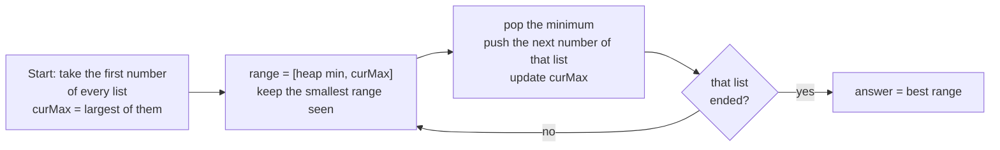

# Smallest / Largest Range Problems

> "The smallest range that contains one number from each list." A K-way merge heap, plus one extra variable: the current **maximum**.

#### 1. What Is It?

You have `K` sorted lists. Find the **smallest range `[a, b]`** such that every list has at least one number inside it. (LeetCode 632.)

**Signals:** "smallest range covering elements from K lists", "range that contains one from each", "minimize max − min".

A similar idea appears in questions about the **difference between the largest and smallest** of a chosen set of items.

#### 2. How It Works

Pick **one number from each list**. The range of that choice is `[min, max]` of the chosen numbers. We want to minimise `max − min`.

- Keep a **min-heap** with the **current chosen number of each list** (so the heap root is the current `min`).
- Track the **current maximum** (`curMax`) of the chosen numbers.
- The range is `[heap.peek(), curMax]`. Record it if it is smaller than the best range.
- **Advance the list whose number is the minimum**: pop it and push the next number from that list (update `curMax` if needed). The minimum can only grow, so this is the only move that can shrink the range.
- **Stop** when one list has no next number (the minimum can no longer move).



```text
lists: A = [4,10,15,24,26]   B = [0,9,12,20]   C = [5,18,22,30]
start: heap {4A, 0B, 5C}  curMax = 5     range [0, 5]  size 5      best [0,5]
pop 0 (B) → push 9      heap {4,9,5}   curMax 9      range [4, 9]   size 5  (not smaller)
pop 4 (A) → push 10     heap {10,9,5}  curMax 10     range [5, 10]  size 5
pop 5 (C) → push 18     heap {10,9,18} curMax 18     range [9, 18]  size 9
pop 9 (B) → push 12     heap {10,12,18} curMax 18    range [10, 18] size 8
pop 10 (A) → push 15    heap {15,12,18} curMax 18    range [12, 18] size 6
pop 12 (B) → push 20    heap {15,20,18} curMax 20    range [15, 20] size 5
pop 15 (A) → push 24    heap {24,20,18} curMax 24    range [18, 24] size 6
pop 18 (C) → push 22    heap {24,20,22} curMax 24    range [20, 24] size 4  ← new best
pop 20 (B) → list B has no next → stop
answer [20, 24]
```

#### 3. Brute Force vs Optimized

| Approach | Time | Space |
|---|---|---|
| Merge all numbers with their list id, sort, then a sliding window that covers all lists | `O(N log N)` | `O(N)` |
| **Min-heap of the current choice from each list** | `O(N log K)` | `O(K)` |
| Try every combination of one number per list | `O(L^K)` | |

```kotlin
// Brute force: sort all (value, list) pairs and slide a window that covers every list
fun smallestRangeBrute(lists: List<List<Int>>): IntArray {
    val pairs = mutableListOf<IntArray>()
    for ((i, list) in lists.withIndex()) for (v in list) pairs.add(intArrayOf(v, i))
    pairs.sortBy { it[0] }
    val need = lists.size
    val have = IntArray(lists.size)
    var covered = 0
    var left = 0
    var bestL = 0
    var bestR = Int.MAX_VALUE
    for (right in pairs.indices) {
        if (have[pairs[right][1]]++ == 0) covered++
        while (covered == need) {
            if (pairs[right][0].toLong() - pairs[left][0] < bestR.toLong() - bestL) {
                bestL = pairs[left][0]; bestR = pairs[right][0]
            }
            if (--have[pairs[left][1]] == 0) covered--
            left++
        }
    }
    return intArrayOf(bestL, bestR)
}
```

#### 4. Kotlin Code

```kotlin
import java.util.PriorityQueue

// Smallest Range Covering Elements from K Lists (LeetCode 632)
fun smallestRange(lists: List<List<Int>>): IntArray {
    val heap = PriorityQueue<IntArray>(compareBy<IntArray> { it[0] })      // [value, list index, position]
    var curMax = Int.MIN_VALUE
    for ((i, list) in lists.withIndex()) {
        heap.add(intArrayOf(list[0], i, 0))
        curMax = maxOf(curMax, list[0])
    }
    var bestL = Int.MIN_VALUE / 2
    var bestR = Int.MAX_VALUE / 2
    while (true) {
        val (value, listIndex, pos) = heap.poll()
        if (curMax - value < bestR - bestL) { bestL = value; bestR = curMax }   // a smaller range
        if (pos + 1 == lists[listIndex].size) break                              // one list ran out
        val next = lists[listIndex][pos + 1]
        heap.add(intArrayOf(next, listIndex, pos + 1))
        curMax = maxOf(curMax, next)
    }
    return intArrayOf(bestL, bestR)
}
```

Checks: `smallestRange(listOf(listOf(4, 10, 15, 24, 26), listOf(0, 9, 12, 20), listOf(5, 18, 22, 30)))` → `[20, 24]`. `smallestRange(listOf(listOf(1, 2, 3), listOf(1, 2, 3), listOf(1, 2, 3)))` → `[1, 1]`. `smallestRange(listOf(listOf(5)))` → `[5, 5]`. `smallestRangeBrute(...)` gives `[20, 24]` on the first example.

(Assume no list is empty, as in the problem.)

#### 5. Complexity

| | Time | Space |
|---|---|---|
| Heap version | `O(N log K)` for `N` total numbers | `O(K)` |
| Sort + sliding window | `O(N log N)` | `O(N)` |

#### 6. Common Mistakes

1. **Forgetting `curMax`.** The heap only knows the minimum.
2. **Advancing the wrong list** (it must be the list of the **minimum**).
3. **Not stopping** when a list runs out. Continuing would use a number from a finished list.
4. **Initial best range** set to `Int.MAX_VALUE` and then computing `bestR − bestL` with overflow. Use halves, `Long`, or compare differently.
5. **Updating `curMax` only when it grows** is correct. Do not recompute it from the heap.
6. **Ties:** if two ranges have the same size, the problem asks for the smaller start. The strict `<` keeps the first one found, which has the smaller start.

#### 7. Say This in the Interview

1. "I take one number from each list. A min-heap gives me the smallest chosen number, and I track the largest. That pair is a valid range."
2. "To shrink the range I must raise the minimum, so I advance only the list that gave the minimum. I stop when that list is exhausted."
3. "Every number is pushed once, so it's `O(N log K)` with `O(K)` extra space."

#### 8. Quick Check

1. For `[[1,5],[2,3]]`, what is the smallest range?
2. Why advance the list with the **minimum** and not the maximum?
3. When does the loop stop?

<details>
<summary>Answers</summary>

1. `[1, 2]`: take `1` from the first list and `2` from the second. The range size is 1. (`[2, 3]` also has size 1, but the smaller start wins.)
2. The range shrinks only if the minimum goes up. Advancing the list with the maximum cannot make the range smaller.
3. As soon as the list that supplied the minimum has no next number.

</details>

#### 9. Related LeetCode Questions

| # | Question | Idea |
|---|---|---|
| 632 | [Smallest Range Covering Elements from K Lists](https://leetcode.com/problems/smallest-range-covering-elements-from-k-lists/) (Hard) | heap + current max |
| 23 | [Merge k Sorted Lists](https://leetcode.com/problems/merge-k-sorted-lists/) (Hard) | the K-way merge base (note 10) |
| 1675 | [Minimize Deviation in Array](https://leetcode.com/problems/minimize-deviation-in-array/) (Hard) | max-heap + track the minimum |
| 1439 | [Find the Kth Smallest Sum of a Matrix With Sorted Rows](https://leetcode.com/problems/find-the-kth-smallest-sum-of-a-matrix-with-sorted-rows/) (Hard) | merge row by row |
| 910 | [Smallest Range II](https://leetcode.com/problems/smallest-range-ii/) (Medium) | sort, then min and max |
