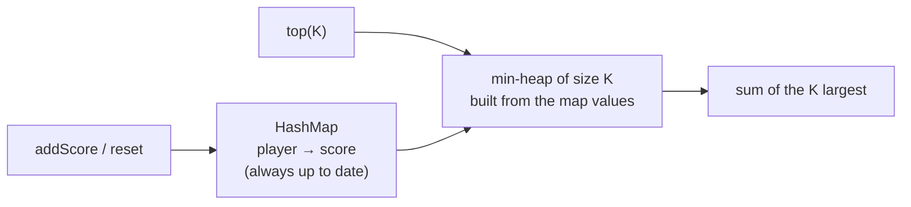

# Heap + HashMap Pattern

> The map stores the **current truth** (counts, scores). The heap picks the **best** quickly. Together they answer "top K of a changing collection".

#### 1. What Is It?

A heap is fast at "give me the best", but it cannot look up or update an item by key. A hash map is fast at "find this key", but it cannot give the best. Use **both**:

| Structure | Job |
|---|---|
| **HashMap** | key → current value (count, score, deadline) in `O(1)` |
| **Heap** | the best entries in `O(log n)` |

**Signals:** "top K frequent", "leaderboard", "most recent / most popular", "scores that change", "design a ... with top K".

You have already seen this in **Top K Frequent** (note 18): count with a map, then use the heap. This note shows it in a **design** question where the values keep changing.

#### 2. How It Works

**Leaderboard (LeetCode 1244).** Operations:

- `addScore(playerId, score)`: add `score` to the player's total.
- `top(K)`: the sum of the `K` highest totals.
- `reset(playerId)`: set that player's score back to 0.

```text
addScore(1,73) (2,56) (3,39) (4,51) (5,4)      scores {1:73, 2:56, 3:39, 4:51, 5:4}
top(1) = 73
reset(1)  reset(2)                             scores {1:0, 2:0, 3:39, 4:51, 5:4}
addScore(2,51)                                 scores {1:0, 2:51, 3:39, 4:51, 5:4}
top(3) = 51 + 51 + 39 = 141
```

- `addScore` and `reset` use the **map**, `O(1)`.
- `top(K)` builds a **min-heap of size `K`** over the map's values: `O(n log K)`.

We do **not** keep the heap alive between calls. The map is the single source of truth, and a fresh heap is built when needed. This avoids the problem that a heap cannot update an existing entry.



**When you do need a live heap** (very frequent `top(1)` queries, for example), push a **new entry** every time a value changes, and when you pop, **ignore entries that no longer match the map** (lazy deletion, note 23).

#### 3. Brute Force vs Optimized

| Operation | Brute force | Map + heap |
|---|---|---|
| `addScore` | `O(1)` with a map | `O(1)` |
| `top(K)` | sort all scores: `O(n log n)` | heap of size `K`: `O(n log K)` |
| `reset` | `O(1)` | `O(1)` |

```kotlin
// Brute force top(K): sort every score
fun topBrute(scores: Map<Int, Int>, k: Int): Int =
    scores.values.sortedDescending().take(k).sum()
```

#### 4. Kotlin Code

```kotlin
import java.util.PriorityQueue

// Design A Leaderboard (LeetCode 1244, premium)
class Leaderboard {
    private val scores = HashMap<Int, Int>()

    fun addScore(playerId: Int, score: Int) {
        scores[playerId] = (scores[playerId] ?: 0) + score
    }

    fun top(k: Int): Int {
        val heap = PriorityQueue<Int>()                       // min-heap of the K largest scores
        for (s in scores.values) {
            heap.add(s)
            if (heap.size > k) heap.poll()
        }
        return heap.sum()
    }

    fun reset(playerId: Int) {
        scores[playerId] = 0
    }
}

// Heap + map with lazy deletion: always read the current most frequent value
class MostFrequentTracker {
    private val count = HashMap<Int, Int>()
    private val heap = PriorityQueue<IntArray>(compareByDescending<IntArray> { it[0] })   // [count, value]

    fun add(x: Int) {
        val c = (count[x] ?: 0) + 1
        count[x] = c
        heap.add(intArrayOf(c, x))                            // a new entry; the old one becomes stale
    }

    fun mostFrequent(): Int {
        while (heap.peek()[0] != count[heap.peek()[1]]) heap.poll()   // drop stale entries
        return heap.peek()[1]
    }
}
```

Checks: after `addScore(1, 73)`, `addScore(2, 56)`, `addScore(3, 39)`, `addScore(4, 51)`, `addScore(5, 4)`: `top(1)` → `73`. After `reset(1)`, `reset(2)`, `addScore(2, 51)`: `top(3)` → `141`. `topBrute(...)` gives the same numbers. `MostFrequentTracker`: add `5`, `7`, `7` → `mostFrequent()` → `7`. Then add `5`, `5` → `mostFrequent()` → `5` (count 3 beats 2).

Trace of the tracker: after `5, 7, 7, 5, 5`, the heap holds entries `(1,5) (1,7) (2,7) (2,5) (3,5)`. The top is `(3,5)`, and `count[5] = 3`, so it matches: answer `5`. If the top were `(2,7)` while `count[7]` is now 3, it would be stale and removed.

#### 5. Complexity

| | Time | Space |
|---|---|---|
| `Leaderboard.addScore` / `reset` | `O(1)` | `O(n)` map |
| `Leaderboard.top(K)` | `O(n log K)` | `O(K)` |
| `MostFrequentTracker.add` | `O(log n)` | `O(n)` heap entries |
| `MostFrequentTracker.mostFrequent` | `O(log n)` amortised | |

#### 6. Common Mistakes

1. **Updating an item inside the heap.** `PriorityQueue` cannot do that. Add a new entry or rebuild.
2. **Keeping the heap and the map out of sync.**
3. **Not skipping stale entries** when polling.
4. **`top(K)` with a max-heap of all `n` scores** (`O(n log n)`). A min-heap of size `K` is better.
5. **Forgetting that `reset` changes the score** to `0` but keeps the player.
6. **Storing the live count inside the heap entry** and never comparing with the map.

#### 7. Say This in the Interview

1. "The map holds each player's current score, so updates are `O(1)`. For `top(K)` I build a min-heap of size `K` over the map values, which is `O(n log K)`."
2. "A heap can't update an arbitrary entry, so if I need a live heap I push a new entry on every change and skip stale entries when I pop."
3. "If `top` is called very often and updates are rare, I'd keep the heap. If updates are frequent, I'd rebuild on demand."

#### 8. Quick Check

1. Why not update the score inside the heap?
2. What is the cost of `top(K)` in `Leaderboard`?
3. How do you detect a stale heap entry?

<details>
<summary>Answers</summary>

1. `PriorityQueue` has no decrease/increase-key. `remove(x)` is `O(n)`.
2. `O(n log K)`.
3. Compare the entry's value with the current value in the map. If they differ, it is stale.

</details>

#### 9. Related LeetCode Questions

| # | Question | Idea |
|---|---|---|
| 347 | [Top K Frequent Elements](https://leetcode.com/problems/top-k-frequent-elements/) (Medium) | count + heap |
| 1244 | [Design A Leaderboard](https://leetcode.com/problems/design-a-leaderboard/) (Medium, premium) | map + heap on demand |
| 355 | [Design Twitter](https://leetcode.com/problems/design-twitter/) (Medium) | map of users + heap to merge feeds |
| 895 | [Maximum Frequency Stack](https://leetcode.com/problems/maximum-frequency-stack/) (Hard) | counts + a stack per frequency |
| 692 | [Top K Frequent Words](https://leetcode.com/problems/top-k-frequent-words/) (Medium) | count + heap with a tie rule |
| 2349 | [Design a Number Container System](https://leetcode.com/problems/design-a-number-container-system/) (Medium) | map + min-heap with lazy deletion |
