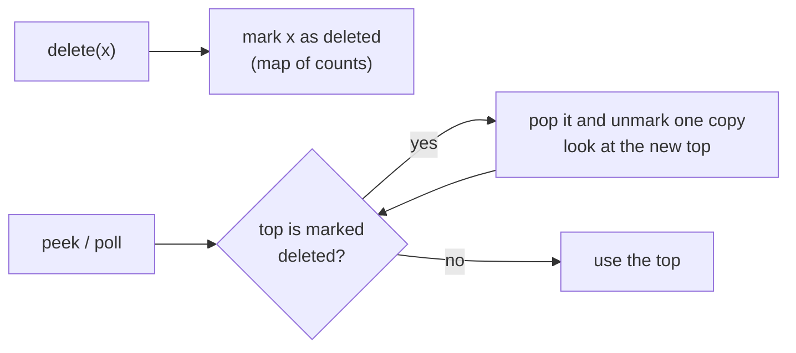

# Lazy Deletion with Heap

> A heap cannot remove an arbitrary item quickly. So don't remove it: **mark it as dead, and throw it away when it reaches the top.**

#### 1. What Is It?

`PriorityQueue.remove(x)` costs `O(n)` (it searches the whole array). A heap also has no "update priority". **Lazy deletion** avoids both:

- To **delete** an item: record it as deleted (in a map or set). Leave it in the heap.
- To **update** an item: add a **new** entry, and treat the old entry as deleted.
- When you `peek` or `poll`: while the top item is marked deleted (or stale), **pop and ignore it**.

**Signals:** "remove an element from a heap", "update a priority", "Dijkstra with a priority queue", "sliding window median", "tasks that can be cancelled".

#### 2. How It Works



```text
add 5, 3, 8               heap {3, 5, 8}      live = 3
delete(3)                 deleted {3: 1}      live = 2       (3 is still inside the heap)
peek():   top is 3 → it is marked deleted → pop it           heap {5, 8}
          top is 5 → fine → return 5
poll():   returns 5       live = 1
```

**Use a count** (not a simple set) in the "deleted" map, because the same value may be in the heap several times.

**Stale entries** are the same idea for **updates**. In Dijkstra, a node may be pushed several times with different distances. When you poll an entry whose distance is **bigger than the best known** (`d > dist[node]`), it is stale: skip it.

**Cost.** Every entry is pushed once and popped once, so the total work stays `O(n log n)` even though dead entries stay inside for a while. The heap may hold more entries than there are live items.

#### 3. Brute Force vs Optimized

| Approach | Delete | Update | Note |
|---|---|---|---|
| `pq.remove(x)` | `O(n)` | `O(n)` (remove + add) | simple, slow |
| Rebuild the heap without `x` | `O(n)` | `O(n)` | slow |
| **Lazy deletion** | `O(1)` mark, `O(log n)` later | `O(log n)` | the standard trick |
| Indexed heap with position map | `O(log n)` | `O(log n)` | more code |

```kotlin
import java.util.PriorityQueue

// Brute force: remove(x) searches the whole heap
fun deleteBrute(heap: PriorityQueue<Int>, x: Int) { heap.remove(x) }       // O(n)
```

#### 4. Kotlin Code

```kotlin
import java.util.PriorityQueue

// A min-heap that supports delete(x) with lazy deletion. delete(x) assumes x is in the heap.
class LazyMinHeap {
    private val heap = PriorityQueue<Int>()
    private val deleted = HashMap<Int, Int>()                  // value -> how many copies are marked deleted
    var size = 0
        private set

    fun add(x: Int) { heap.add(x); size++ }

    fun delete(x: Int) {
        deleted[x] = (deleted[x] ?: 0) + 1
        size--
    }

    private fun clean() {
        while (heap.isNotEmpty()) {
            val top = heap.peek()
            val c = deleted[top] ?: 0
            if (c == 0) break
            deleted[top] = c - 1
            heap.poll()                                         // drop a dead copy
        }
    }

    fun peek(): Int { clean(); return heap.peek() }

    fun poll(): Int { clean(); size--; return heap.poll() }
}

// Dijkstra: stale entries are skipped instead of updated
fun dijkstra(n: Int, edges: Array<IntArray>, start: Int): IntArray {
    val graph = Array(n) { mutableListOf<IntArray>() }                 // node -> [neighbour, weight]
    for ((a, b, w) in edges) { graph[a].add(intArrayOf(b, w)); graph[b].add(intArrayOf(a, w)) }
    val dist = IntArray(n) { Int.MAX_VALUE }
    dist[start] = 0
    val heap = PriorityQueue<IntArray>(compareBy<IntArray> { it[0] })  // [distance, node]
    heap.add(intArrayOf(0, start))
    while (heap.isNotEmpty()) {
        val (d, u) = heap.poll()
        if (d > dist[u]) continue                                      // stale: a shorter path was found already
        for ((v, w) in graph[u]) {
            if (d + w < dist[v]) {
                dist[v] = d + w
                heap.add(intArrayOf(dist[v], v))                       // push a NEW entry, do not update
            }
        }
    }
    return dist
}
```

Checks: `LazyMinHeap`: add `5`, `3`, `8`, then `delete(3)` → `size` → `2`. `peek()` → `5`. `poll()` → `5`. `size` → `1`. `poll()` → `8`. Adding a value twice and deleting it once: add `4`, `4`, `delete(4)`, then `peek()` → `4` and `size` → `1`.

`dijkstra(4, arrayOf(intArrayOf(0, 1, 4), intArrayOf(0, 2, 1), intArrayOf(1, 3, 2), intArrayOf(2, 3, 3), intArrayOf(1, 2, 2)), 0)` → `[0, 3, 1, 4]`. Here node `1` is first pushed with distance `4` (via `0 → 1`), then with `3` (via `0 → 2 → 1`). The entry `(4, 1)` is stale when it comes out (`4 > dist[1] = 3`), so it is skipped.

#### 5. Complexity

| | Time | Space |
|---|---|---|
| `add` | `O(log n)` | |
| `delete` (mark) | `O(1)` | |
| `peek` / `poll` | `O(log n)` amortised | |
| Heap holds | | `O(n)` including dead entries |
| Dijkstra with stale skipping | `O((V + E) log V)` | `O(V + E)` |

#### 6. Common Mistakes

1. **Using `pq.remove(x)`** in a loop (`O(n²)` overall).
2. **A set instead of a count** for deleted values, which breaks when a value appears more than once.
3. **Forgetting to clean** before `peek()`, and returning a dead item.
4. **Adjusting `size` wrongly.** `size` must count live items, not heap entries.
5. **Deleting something that is not in the heap** (the counts drift).
6. **Not skipping stale entries in Dijkstra** (still correct, but slower).

#### 7. Say This in the Interview

1. "`PriorityQueue.remove` is `O(n)`, so I'll use lazy deletion: mark the item as deleted, and discard it when it reaches the top."
2. "For priority updates I push a new entry and skip the old one when I see that it's stale."
3. "Each entry is pushed and popped once, so the total cost stays `O(n log n)`."

#### 8. Quick Check

1. What does `peek()` do first in `LazyMinHeap`?
2. Why store a count of deleted copies?
3. In Dijkstra, what does `if (d > dist[u]) continue` do?

<details>
<summary>Answers</summary>

1. It removes dead items from the top (`clean()`), then reads the top.
2. The same value can be in the heap more than once, and only some copies may be deleted.
3. It skips an old entry whose distance is worse than the best known distance for that node.

</details>

#### 9. Related LeetCode Questions

| # | Question | Idea |
|---|---|---|
| 743 | [Network Delay Time](https://leetcode.com/problems/network-delay-time/) (Medium) | Dijkstra with stale entries |
| 239 | [Sliding Window Maximum](https://leetcode.com/problems/sliding-window-maximum/) (Hard) | heap + lazy deletion by index (note 24) |
| 480 | [Sliding Window Median](https://leetcode.com/problems/sliding-window-median/) (Hard) | two heaps + lazy deletion |
| 1438 | [Longest Continuous Subarray With Absolute Diff Less Than or Equal to Limit](https://leetcode.com/problems/longest-continuous-subarray-with-absolute-diff-less-than-or-equal-to-limit/) (Medium) | two heaps, drop old indexes |
| 2349 | [Design a Number Container System](https://leetcode.com/problems/design-a-number-container-system/) (Medium) | min-heap per number |
| 1912 | [Design Movie Rental System](https://leetcode.com/problems/design-movie-rental-system/) (Hard) | heaps with deletion |
