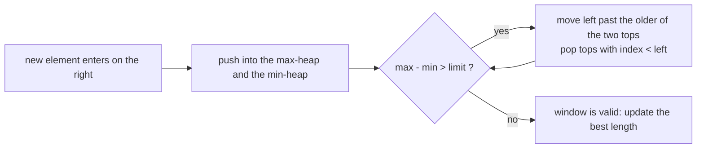

# Heap + Sliding Window

> A window moves along the array. A heap gives its maximum or minimum, and **lazy deletion by index** removes the items that left the window.

#### 1. What Is It?

For a sliding window you often need the **max / min** of the current window. A heap can give that, but items **leave** the window and a heap cannot delete them quickly. Fix: store `(value, index)` and **discard top entries whose index is outside the window**.

| Question | Heap use |
|---|---|
| **Sliding Window Maximum** (239) | max-heap of `(value, index)` |
| **Longest Subarray with Absolute Diff ≤ Limit** (1438) | a max-heap and a min-heap over the window |
| **Sliding Window Median** (480) | two heaps + lazy deletion |

**Signals:** "maximum / minimum in every window of size K", "window with a limit on max − min", "median of every window".

#### 2. How It Works

**Sliding Window Maximum (heap).** For each new index `i`:

1. Push `(nums[i], i)` in a max-heap.
2. Once the window is full (`i >= k − 1`): while the top's index is `<= i − k`, it has left the window: pop it.
3. The top is the maximum of the window.

```text
nums = [1, 3, -1, -3, 5, 3, 6, 7], k = 3
i=2: heap top (3, idx1)  idx1 > 2-3 → ok               → window max 3
i=3: push (-3,3); top (3,1): idx1 <= 3-3=0? no → 3
i=4: push (5,4);  top (5,4) → 5
i=5: push (3,5);  top (5,4): idx4 <= 2? no → 5
i=6: push (6,6);  top (6,6) → 6
i=7: push (7,7);  top (7,7) → 7
result [3, 3, 5, 5, 6, 7]
```

Compare with the **monotonic deque** from the Queue folder: `O(n)`, no stale entries. The heap is `O(n log n)` but is easier to extend to "limit on max − min" and other variants.

**Limit on max − min (LeetCode 1438).** Keep a max-heap and a min-heap of `(value, index)` for the window. While `max − min > limit`, move `left` to just after the **older** of the two top indexes, then pop every top entry whose index is before `left`.



**Sliding Window Median.** Two heaps (note 12) for the lower and upper half, with a map of "to be removed" values (note 23). Each step: add the new number, mark the outgoing number as deleted, rebalance by counting only live items, clean the tops. It is a Hard question; know the idea.

#### 3. Brute Force vs Optimized

| Problem | Brute force | Better |
|---|---|---|
| Window maximum | scan each window: `O(n · k)` | heap `O(n log n)`, deque `O(n)` |
| Longest subarray, limit | check every subarray: `O(n²)` | two heaps `O(n log n)` |

```kotlin
// Brute force: scan every window
fun maxSlidingWindowBrute(nums: IntArray, k: Int): IntArray =
    IntArray(nums.size - k + 1) { i -> (i until i + k).maxOf { nums[it] } }
```

#### 4. Kotlin Code

```kotlin
import java.util.PriorityQueue

// Sliding Window Maximum (LeetCode 239): heap with lazy deletion by index
fun maxSlidingWindowHeap(nums: IntArray, k: Int): IntArray {
    val heap = PriorityQueue<IntArray>(compareByDescending<IntArray> { it[0] })   // [value, index]
    val result = IntArray(nums.size - k + 1)
    for (i in nums.indices) {
        heap.add(intArrayOf(nums[i], i))
        if (i >= k - 1) {
            while (heap.peek()[1] <= i - k) heap.poll()               // the top left the window
            result[i - k + 1] = heap.peek()[0]
        }
    }
    return result
}

// Longest Continuous Subarray With Absolute Diff <= Limit (LeetCode 1438)
fun longestSubarray(nums: IntArray, limit: Int): Int {
    val maxHeap = PriorityQueue<IntArray>(compareByDescending<IntArray> { it[0] })
    val minHeap = PriorityQueue<IntArray>(compareBy<IntArray> { it[0] })
    var left = 0
    var best = 0
    for (right in nums.indices) {
        maxHeap.add(intArrayOf(nums[right], right))
        minHeap.add(intArrayOf(nums[right], right))
        while (maxHeap.peek()[0] - minHeap.peek()[0] > limit) {
            left = minOf(maxHeap.peek()[1], minHeap.peek()[1]) + 1     // drop everything up to the older top
            while (maxHeap.peek()[1] < left) maxHeap.poll()
            while (minHeap.peek()[1] < left) minHeap.poll()
        }
        best = maxOf(best, right - left + 1)
    }
    return best
}
```

Checks: `maxSlidingWindowHeap(intArrayOf(1, 3, -1, -3, 5, 3, 6, 7), 3)` → `[3, 3, 5, 5, 6, 7]`. `maxSlidingWindowHeap(intArrayOf(1), 1)` → `[1]`. `maxSlidingWindowBrute(...)` gives the same. `longestSubarray(intArrayOf(8, 2, 4, 7), 4)` → `2`. `longestSubarray(intArrayOf(10, 1, 2, 4, 7, 2), 5)` → `4`. `longestSubarray(intArrayOf(4, 2, 2, 2, 4, 4, 2, 2), 0)` → `3`.

Trace of `longestSubarray([8, 2, 4, 7], 4)`: `right=0`: window `[8]`, diff 0, best 1. `right=1`: add `2`, max 8, min 2, diff 6 > 4. The older top is index 0 (the `8`) → `left = 1`, pop `(8,0)` from the max-heap. Window `[2]`, best 1. `right=2`: add `4`, diff `4 - 2 = 2`, length 2, best 2. `right=3`: add `7`, max 7, min 2, diff 5 > 4 → `left = min(3, 1) + 1 = 2`, pop `(2,1)` from the min-heap → min is 4, diff 3, length 2. Answer 2.

#### 5. Complexity

| | Time | Space |
|---|---|---|
| Window max with a heap | `O(n log n)` | `O(n)` |
| Window max with a deque | `O(n)` | `O(k)` |
| Two heaps for the limit problem | `O(n log n)` | `O(n)` |
| Brute force | `O(n · k)` | `O(1)` |

#### 6. Common Mistakes

1. **Storing only values** in the heap, so you cannot tell if the top has left the window.
2. **Popping only once** instead of looping `while` the top is outside the window.
3. **Off-by-one in the window test:** the top is outside when `index <= i − k`.
4. **Moving `left` incorrectly** in the limit problem (it must jump past the older of the two tops).
5. **Using the heap size as the window size.** The heap contains dead entries.
6. **Reading `peek()` on an empty heap** (it cannot be empty here, because the newest item is always inside).

#### 7. Say This in the Interview

1. "I push `(value, index)` into a max-heap. When I read the top, if its index has left the window I pop it and look again, so the top is always inside the window."
2. "It's `O(n log n)`. A monotonic deque makes it `O(n)`, but the heap approach extends easily to problems like a limit on max minus min."
3. "For the median of every window I need two heaps and lazy deletion, because heaps cannot remove arbitrary elements."

#### 8. Quick Check

1. Window size 3 at `i = 5`. Which indexes are inside the window?
2. Why does the heap store the index?
3. When is a top entry stale?

<details>
<summary>Answers</summary>

1. `3, 4, 5`. An entry is outside if its index is `<= 5 − 3 = 2`.
2. To know whether the entry is still in the current window.
3. When its index is `<= i − k`.

</details>

#### 9. Related LeetCode Questions

| # | Question | Idea |
|---|---|---|
| 239 | [Sliding Window Maximum](https://leetcode.com/problems/sliding-window-maximum/) (Hard) | heap by index, or a deque |
| 1438 | [Longest Continuous Subarray With Absolute Diff Less Than or Equal to Limit](https://leetcode.com/problems/longest-continuous-subarray-with-absolute-diff-less-than-or-equal-to-limit/) (Medium) | two heaps |
| 480 | [Sliding Window Median](https://leetcode.com/problems/sliding-window-median/) (Hard) | two heaps + lazy deletion |
| 1696 | [Jump Game VI](https://leetcode.com/problems/jump-game-vi/) (Medium) | window maximum for DP |
| 1425 | [Constrained Subsequence Sum](https://leetcode.com/problems/constrained-subsequence-sum/) (Hard) | window maximum for DP |
| 643 | [Maximum Average Subarray I](https://leetcode.com/problems/maximum-average-subarray-i/) (Easy) | fixed window, no heap |
