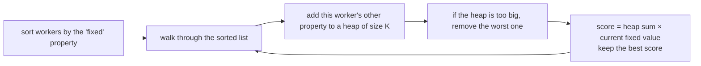

# Multiple Heaps / Advanced Two-Heaps Patterns

> The hard questions: **sort by one key, keep a heap on another**. The sort fixes one constraint, and the heap keeps the best group for the other.

#### 1. What Is It?

Some problems pick a **group of `K` items** to maximise a **product or ratio** of two properties. The trick:

1. **Sort** the items by the first property (so it is fixed as you walk through them).
2. Keep a **heap of size `K`** of the second property, so the group is always the best `K` seen so far.

| Question | Sort by | Heap keeps |
|---|---|---|
| **Maximum Performance of a Team** (1383) | efficiency, descending | the `K` largest speeds (min-heap) |
| **Minimum Cost to Hire K Workers** (857) | wage / quality ratio, ascending | the `K` smallest qualities (max-heap) |
| **IPO** (502), note 12 | capital | profits of affordable projects |
| **Maximum Subsequence Score** (2542) | `nums2`, descending | the `K` largest `nums1` (min-heap) |

**Signals:** "choose at most K ... to maximise (sum × min)", "team", "ratio", "performance", "minimum cost to hire".

#### 2. How It Works

**Maximum Performance of a Team.** Performance = `(sum of speeds) × (minimum efficiency)`. Choose at most `K` engineers.

- **Sort by efficiency, highest first.** When you reach an engineer, they have the **lowest efficiency in the team** so far, so the minimum efficiency is **known**: it is theirs.
- Now you only want the **largest sum of speeds**. Keep a **min-heap of speeds of size `K`**. If it grows past `K`, remove the smallest speed.
- At each step: `performance = speedSum × currentEfficiency`. Keep the best.

```text
speed      = [2, 10, 3, 1, 5, 8]
efficiency = [5,  4, 3, 9, 7, 2]       K = 2
sorted by efficiency desc: (eff 9, speed 1), (7, 5), (5, 2), (4, 10), (3, 3), (2, 8)

eff 9: heap {1}        sum 1    perf 1 × 9 = 9
eff 7: heap {1, 5}     sum 6    perf 6 × 7 = 42
eff 5: heap {1,2,5} → drop 1 → {2, 5}  sum 7    perf 7 × 5 = 35
eff 4: add 10 → {2,5,10} → drop 2 → {5, 10}  sum 15   perf 15 × 4 = 60   ← best
eff 3: add 3 → drop 3 → {5, 10}  sum 15   perf 45
eff 2: add 8 → drop 5 → {8, 10}  sum 18   perf 36
answer 60
```



**Minimum Cost to Hire K Workers.** Every hired worker is paid in proportion to quality, and at least their minimum wage. The pay rate for the group is the **largest wage/quality ratio** in it. Sort by ratio ascending: the current worker has the **highest ratio** so far, so the group's rate is **known**. Keep the `K` **smallest** qualities (a **max**-heap, remove the largest). Cost = `rate × sum of qualities`.

#### 3. Brute Force vs Optimized

| Approach | Time | Note |
|---|---|---|
| Try every group of `K` | `O(C(n, K))` | exponential |
| Fix the "bottleneck" worker, then pick the best `K − 1` others | `O(n² log n)` | correct, slow |
| **Sort + heap of size `K`** | **`O(n log n)`** | the standard answer |

```kotlin
// Brute force idea for Maximum Performance: treat each engineer's efficiency as the team minimum,
// and take the K fastest among those with efficiency >= theirs. O(n^2 log n).
fun maxPerformanceBrute(n: Int, speed: IntArray, efficiency: IntArray, k: Int): Long {
    var best = 0L
    for (i in 0 until n) {
        val team = (0 until n).filter { efficiency[it] >= efficiency[i] }
            .map { speed[it] }.sortedDescending().take(k)
        best = maxOf(best, team.sumOf { it.toLong() } * efficiency[i])
    }
    return best
}
```

#### 4. Kotlin Code

```kotlin
import java.util.PriorityQueue

// Maximum Performance of a Team (LeetCode 1383)
fun maxPerformance(n: Int, speed: IntArray, efficiency: IntArray, k: Int): Int {
    val order = (0 until n).sortedByDescending { efficiency[it] }
    val heap = PriorityQueue<Int>()                         // min-heap of speeds, size <= k
    var speedSum = 0L
    var best = 0L
    for (i in order) {
        speedSum += speed[i]
        heap.add(speed[i])
        if (heap.size > k) speedSum -= heap.poll()           // drop the slowest
        best = maxOf(best, speedSum * efficiency[i])         // efficiency[i] is the team minimum
    }
    return (best % 1_000_000_007L).toInt()
}

// Minimum Cost to Hire K Workers (LeetCode 857)
fun mincostToHireWorkers(quality: IntArray, wage: IntArray, k: Int): Double {
    val order = quality.indices.sortedBy { wage[it].toDouble() / quality[it] }
    val heap = PriorityQueue<Int>(compareByDescending<Int> { it })    // max-heap of qualities, size <= k
    var qualitySum = 0
    var best = Double.MAX_VALUE
    for (i in order) {
        qualitySum += quality[i]
        heap.add(quality[i])
        if (heap.size > k) qualitySum -= heap.poll()          // drop the highest quality
        if (heap.size == k) best = minOf(best, qualitySum * (wage[i].toDouble() / quality[i]))
    }
    return best
}
```

Checks: `maxPerformance(6, intArrayOf(2, 10, 3, 1, 5, 8), intArrayOf(5, 4, 3, 9, 7, 2), 2)` → `60`. `maxPerformance(6, intArrayOf(2, 10, 3, 1, 5, 8), intArrayOf(5, 4, 3, 9, 7, 2), 3)` → `68`. `maxPerformance(6, intArrayOf(2, 10, 3, 1, 5, 8), intArrayOf(5, 4, 3, 9, 7, 2), 4)` → `72`. `mincostToHireWorkers(intArrayOf(10, 20, 5), intArrayOf(70, 50, 30), 2)` → `105.0`. `mincostToHireWorkers(intArrayOf(3, 1, 10, 10, 1), intArrayOf(4, 8, 2, 2, 7), 3)` → about `30.67`.

#### 5. Complexity

| | Time | Space |
|---|---|---|
| Sort | `O(n log n)` | `O(n)` |
| Heap work | `O(n log K)` | `O(K)` |
| Total | `O(n log n)` | `O(n)` |

#### 6. Common Mistakes

1. **Sorting by the wrong property** or in the wrong direction.
2. **Using the wrong heap type.** If you keep the `K` largest speeds, the heap is a **min**-heap. If you keep the `K` smallest qualities, it is a **max**-heap.
3. **Computing the product before dropping** the extra item (the group has `K + 1` members).
4. **`Int` overflow** in `speedSum * efficiency`. Use `Long`, and take the modulo only at the end.
5. **Not checking the group size** (`heap.size == k`) in the hiring problem. Fewer than `K` workers is not a valid group.
6. **Integer division** for the wage ratio. Use `Double`.

#### 7. Say This in the Interview

1. "If I sort by efficiency in descending order, the current engineer is the minimum efficiency of any team made from the engineers seen so far. That fixes one factor of the product."
2. "Then I only need the largest speed sum among at most `K` engineers, so I keep a min-heap of speeds capped at `K`."
3. "That's `O(n log n)` for the sort and `O(n log K)` for the heap."

#### 8. Quick Check

1. Why sort by efficiency descending?
2. Which heap type keeps the `K` largest speeds?
3. Why use `Long` for the performance value?

<details>
<summary>Answers</summary>

1. The current engineer then has the smallest efficiency in the team, so the minimum is known without searching.
2. A **min**-heap (its root is the smallest of the `K`, the first to be dropped).
3. The sum of speeds times the efficiency can exceed the `Int` range.

</details>

#### 9. Related LeetCode Questions

| # | Question | Idea |
|---|---|---|
| 502 | [IPO](https://leetcode.com/problems/ipo/) (Hard) | locked heap + available heap |
| 857 | [Minimum Cost to Hire K Workers](https://leetcode.com/problems/minimum-cost-to-hire-k-workers/) (Hard) | sort by ratio + max-heap |
| 1383 | [Maximum Performance of a Team](https://leetcode.com/problems/maximum-performance-of-a-team/) (Hard) | sort by efficiency + min-heap |
| 2542 | [Maximum Subsequence Score](https://leetcode.com/problems/maximum-subsequence-score/) (Medium) | same pattern |
| 2462 | [Total Cost to Hire K Workers](https://leetcode.com/problems/total-cost-to-hire-k-workers/) (Medium) | two heaps of candidates |
| 295 | [Find Median from Data Stream](https://leetcode.com/problems/find-median-from-data-stream/) (Hard) | the basic two-heaps design |
