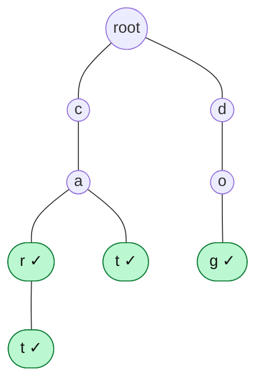

# Trie Fundamentals

> A **trie** (prefix tree) stores words letter by letter in a tree, so all words with the same beginning **share the same path**. It makes "does any word start with ...?" very fast.

#### 1. What Is It?

A **trie** is a tree where:

- each **edge** is one character,
- each **path from the root** spells a prefix,
- a flag on a node marks "a word **ends** here".

The root is empty. Words that share a beginning share nodes.

**Why it matters in interviews:** autocomplete, spell check, dictionary search, word games (Word Search II), IP routing, "longest common prefix", and "maximum XOR" (binary trie). A `HashSet` can tell you if a whole word exists, but it cannot answer **prefix** questions quickly. A trie can.

**Signals:** "prefix", "starts with", "autocomplete", "dictionary of words", "words in a grid", "wildcard `.` search", "longest common prefix".

#### 2. How It Works

*A trie holding `car`, `cart`, `cat`, `dog`. A ✓ marks the end of a word.*



- `car` and `cart` share the path `c → a → r`. `cart` just adds one node `t`.
- `ca` is a **prefix** but not a word (no ✓ on `a`).
- `car` is both a word **and** a prefix of `cart`. That is why the end flag matters.

**The three core operations** (each walks one character per step):

| Operation | Walk | Result |
|---|---|---|
| `insert(word)` | follow or create nodes, mark the last as an end | |
| `search(word)` | follow the path, must exist **and** be marked as an end | exact word |
| `startsWith(prefix)` | follow the path, only needs to exist | prefix |

**Trie vs other structures**

| | `HashSet<String>` | Sorted list + binary search | **Trie** |
|---|---|---|---|
| Exact word lookup | `O(L)` (hash the word) | `O(L log n)` | `O(L)` |
| Prefix lookup | `O(n · L)` scan | `O(L log n)` | **`O(L)`** |
| Words with a prefix | scan all | binary search + scan | walk + DFS |
| Memory | words only | words only | **more** (a node per character) |

`L` is the word length, `n` the number of words. The trie cost does **not** depend on `n`.

#### 3. Brute Force vs Optimized

| Question | Brute force | Trie |
|---|---|---|
| Is there a word starting with `p`? | check every word: `O(n · L)` | walk `p`: `O(L)` |
| Longest common prefix of `n` words | compare all words | walk while there is exactly one child |
| Words from a dictionary found in a grid | search each word separately | one search for all words (note 9) |

```kotlin
// Brute force prefix search: scan every word
fun startsWithBrute(words: List<String>, prefix: String): Boolean =
    words.any { it.startsWith(prefix) }                          // O(n * L)
```

#### 4. Kotlin Code

```kotlin
class TrieNode {
    val next = arrayOfNulls<TrieNode>(26)                       // one slot per letter 'a'..'z'
    var isEnd = false
}

class Trie {
    private val root = TrieNode()

    fun insert(word: String) {
        var node = root
        for (c in word) {
            val i = c - 'a'
            if (node.next[i] == null) node.next[i] = TrieNode()
            node = node.next[i]!!
        }
        node.isEnd = true
    }

    private fun find(s: String): TrieNode? {
        var node = root
        for (c in s) node = node.next[c - 'a'] ?: return null
        return node
    }

    fun search(word: String): Boolean = find(word)?.isEnd == true
    fun startsWith(prefix: String): Boolean = find(prefix) != null
}
```

Checks (insert `car`, `cart`, `cat`, `dog`): `search("car")` → `true`. `search("ca")` → `false` (a prefix, not a word). `startsWith("ca")` → `true`. `search("cart")` → `true`. `search("cow")` → `false`. `startsWith("d")` → `true`. `startsWith("x")` → `false`. `startsWithBrute(listOf("car", "cart", "cat", "dog"), "ca")` → `true`. This is *Implement Trie* (LeetCode 208). Each part is explained in notes 2 to 7.

#### 5. Complexity

| | Time | Space |
|---|---|---|
| `insert`, `search`, `startsWith` | `O(L)` | |
| Build a trie of `n` words | `O(n · L)` | `O(n · L · 26)` worst case with array children |
| Brute force prefix check | `O(n · L)` | |

#### 6. Common Mistakes

1. **`search` returning true for a prefix.** It must check `isEnd`.
2. **Forgetting `isEnd`** after the last insert character.
3. **Not handling characters outside `a..z`** (the array index crashes). Use a `HashMap` for children (note 2).
4. **Using a trie when a `HashSet` is enough** (no prefix questions).
5. **Forgetting memory.** A node with 26 slots costs a lot when words share little.
6. **Mixing the root with a character.** The root represents the empty string.

#### 7. Say This in the Interview

1. "A trie stores words character by character, so words with a common prefix share a path. Insert, search and prefix lookup are all `O(L)`, independent of how many words are stored."
2. "A hash set answers exact lookups, but a prefix check needs a scan of all words. A trie makes it `O(L)`."
3. "The trade-off is memory: one node per character, and each node holds up to 26 child links."

#### 8. Quick Check

1. After inserting only `apple`, what do `search("app")` and `startsWith("app")` return?
2. How many nodes (excluding the root) does a trie of `car`, `cart`, `cat` have?
3. Why is a trie better than a `HashSet` for autocomplete?

<details>
<summary>Answers</summary>

1. `false` and `true`.
2. `5`: `c, a, r, t` (for `cart`, which includes `car`) plus the second `t` under `a` for `cat`.
3. A `HashSet` cannot find words by prefix without scanning everything. A trie walks the prefix and then lists only the matching words.

</details>

#### 9. Related LeetCode Questions

| # | Question | Idea |
|---|---|---|
| 208 | [Implement Trie (Prefix Tree)](https://leetcode.com/problems/implement-trie-prefix-tree/) (Medium) | insert, search, startsWith |
| 14 | [Longest Common Prefix](https://leetcode.com/problems/longest-common-prefix/) (Easy) | walk while one child |
| 648 | [Replace Words](https://leetcode.com/problems/replace-words/) (Medium) | shortest prefix root |
| 211 | [Design Add and Search Words Data Structure](https://leetcode.com/problems/design-add-and-search-words-data-structure/) (Medium) | wildcard `.` |
| 1268 | [Search Suggestions System](https://leetcode.com/problems/search-suggestions-system/) (Medium) | autocomplete |
| 212 | [Word Search II](https://leetcode.com/problems/word-search-ii/) (Hard) | trie + DFS |
