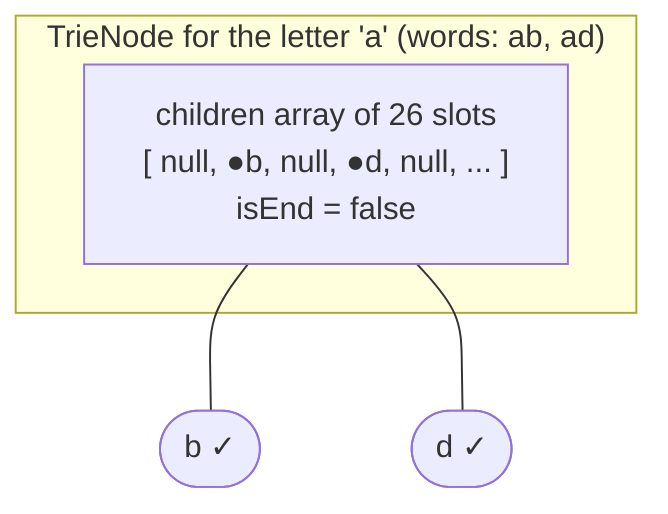

# TrieNode Structure

> A trie node is just a table of children plus an end flag. The one design choice is **how to store the children**: a fixed array or a hash map.

#### 1. What Is It?

A **`TrieNode`** holds:

- **children**: the next nodes, one per possible next character,
- **`isEnd`**: whether a word ends at this node.

(Optional extras: a **count** of words passing through, the **word** itself at an end node, or a **parent** pointer.)

The character itself is not stored in the node. It is the **position** (array index) or **key** (map key) in the parent's children table.

#### 2. How It Works



**Two ways to store children**

| | Array `arrayOfNulls<TrieNode>(26)` | `HashMap<Char, TrieNode>` |
|---|---|---|
| Lookup | `O(1)`, index `c - 'a'` | `O(1)` average |
| Memory per node | always 26 slots, even if empty | only the children that exist |
| Alphabet | fixed (`a..z`) | any characters (upper case, digits, Unicode) |
| Speed | faster (no hashing) | slightly slower |
| Order of children | alphabetical for free (DFS gives sorted words) | arbitrary (sort keys if needed) |
| Best for | lowercase letters, speed, sorted output | large or unknown alphabets, sparse tries |

**Rule of thumb:** lowercase `a..z` in an interview → **array**. Unknown characters → **map**.

**Memory estimate.** A trie of `N` total characters has up to `N` nodes. With an array of 26 references (about 8 bytes each with pointer compression, more without), that is roughly 100 to 200 bytes per node. A map-based node is smaller when it has few children. Say this trade-off aloud.

**Useful extra fields**

| Field | Use |
|---|---|
| `count` / `pass` | number of words passing through (prefix counting, note 14) |
| `word: String?` | the full word at an end node (Word Search II, note 9) |
| `parent` | walk up to build a word or to delete (note 11) |

#### 3. Brute Force vs Optimized

| Choice | Pros | Cons |
|---|---|---|
| Array of 26 | fast, simple, sorted traversal | wastes memory |
| Map | compact for sparse nodes, any alphabet | hashing cost, no built-in order |
| Compressed trie (radix tree) | merges single-child chains | complex, not asked in interviews |

```kotlin
// Memory-hungry baseline: a map from every possible prefix to a flag
val prefixes = HashSet<String>()
fun insertAllPrefixes(word: String) { for (i in 1..word.length) prefixes.add(word.substring(0, i)) }   // O(L^2) time and space
```

The trie stores each prefix **once** as a node, so it needs `O(L)` per word, not `O(L²)`.

#### 4. Kotlin Code

```kotlin
// Version A: array children (lowercase letters)
class TrieNodeArray {
    val next = arrayOfNulls<TrieNodeArray>(26)
    var isEnd = false
}

// Version B: map children (any character)
class TrieNodeMap {
    val next = HashMap<Char, TrieNodeMap>()
    var isEnd = false
}

class TrieMap {
    private val root = TrieNodeMap()

    fun insert(word: String) {
        var node = root
        for (c in word) node = node.next.getOrPut(c) { TrieNodeMap() }     // create if missing
        node.isEnd = true
    }

    fun search(word: String): Boolean {
        var node = root
        for (c in word) node = node.next[c] ?: return false
        return node.isEnd
    }

    fun startsWith(prefix: String): Boolean {
        var node = root
        for (c in prefix) node = node.next[c] ?: return false
        return true
    }
}

// With extras: count of words passing through, and the full word at the end
class TrieNodeFull {
    val next = arrayOfNulls<TrieNodeFull>(26)
    var isEnd = false
    var pass = 0                 // how many inserted words go through this node
    var word: String? = null     // the word that ends here, if any
}
```

Checks (`TrieMap`): insert `"Hi5"` → `search("Hi5")` → `true`, `search("hi5")` → `false` (case matters), `startsWith("Hi")` → `true`. With `TrieNodeArray`, inserting `"Hi5"` would crash, because `'H' - 'a'` is negative and `'5' - 'a'` is out of range. `insertAllPrefixes("cart")` adds `c, ca, car, cart` (10 characters in total), while a trie would use 4 nodes.

#### 5. Complexity

| | Array children | Map children |
|---|---|---|
| Child lookup | `O(1)` | `O(1)` average |
| Memory per node | `26` references | one entry per real child |
| Total nodes | at most the total characters `N` | at most `N` |
| Total memory | up to `O(26 · N)` | `O(N)` |

#### 6. Common Mistakes

1. **Using the array version for upper-case, digits or Unicode.** The index goes out of range.
2. **Storing the character in the node** and also in the table (not needed).
3. **Creating all 26 children immediately** (`Array(26) { TrieNode() }`). Create them only when needed, or the trie explodes in size.
4. **Forgetting `isEnd`** because the node "exists".
5. **Assuming order with a `HashMap`.** Iteration order is not alphabetical.
6. **Ignoring memory** when the interviewer asks about 10 million words.

#### 7. Say This in the Interview

1. "Each node has a table of children and an end flag. For lowercase letters I use an array of 26 for speed. For a general alphabet I use a hash map to save memory."
2. "I create a child only when a word needs it, so the trie only has as many nodes as there are distinct prefixes."
3. "If I need prefix counts or the word itself, I add a field to the node."

#### 8. Quick Check

1. How do you find the child for the letter `'d'` in an array node?
2. When is a `HashMap` of children better?
3. What does the root node represent?

<details>
<summary>Answers</summary>

1. `node.next['d' - 'a']`, which is index `3`.
2. When the alphabet is large or unknown, or the trie is sparse.
3. The empty string (the start of every word).

</details>

#### 9. Related LeetCode Questions

| # | Question | Idea |
|---|---|---|
| 208 | [Implement Trie (Prefix Tree)](https://leetcode.com/problems/implement-trie-prefix-tree/) (Medium) | array node |
| 211 | [Design Add and Search Words Data Structure](https://leetcode.com/problems/design-add-and-search-words-data-structure/) (Medium) | node + DFS |
| 1804 | [Implement Trie II (Prefix Tree)](https://leetcode.com/problems/implement-trie-ii-prefix-tree/) (Medium, premium) | counts in the node |
| 677 | [Map Sum Pairs](https://leetcode.com/problems/map-sum-pairs/) (Medium) | a value stored in the node |
| 212 | [Word Search II](https://leetcode.com/problems/word-search-ii/) (Hard) | the word stored in the node |
