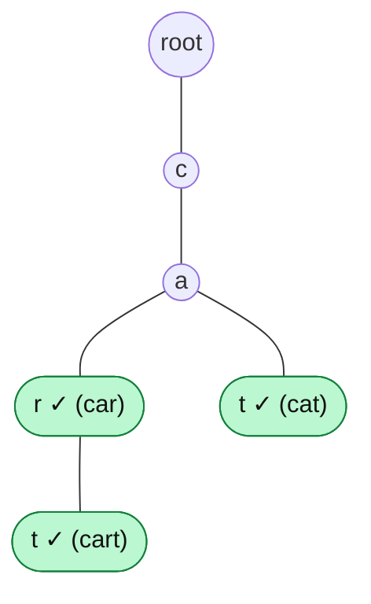

# Insert Word

> Walk down the trie one letter at a time. **Reuse** a node when it exists, **create** it when it does not, and mark the last node as the end of a word.

#### 1. What Is It?

**Insert** adds a word to the trie. It is the only way words get in, and every other operation depends on the paths it builds.

**Signals:** "build a dictionary", "add words", "preprocess the words so queries are fast".

#### 2. How It Works

Insert `car`, then `cart`, then `cat`:

```text
insert "car":   root → create c → create a → create r ✓        3 new nodes
insert "cart":  root → c exists → a exists → r exists → create t ✓    1 new node  (and r keeps its ✓)
insert "cat":   root → c exists → a exists → create t ✓        1 new node
```



**Algorithm**

```text
node = root
for each character ch in word:
    if node has no child for ch: create a new node for ch
    node = child for ch
node.isEnd = true
```

**Notes**

- Inserting the same word twice changes nothing (the nodes exist and `isEnd` is already true).
- Inserting a **prefix of an existing word** creates no node. It only sets `isEnd` on an existing node (`car` after `cart`).
- Inserting the **empty string** marks the **root** as an end (decide if you allow it).
- Cost: the number of **new** nodes is `L − (length of the shared prefix)`.

#### 3. Brute Force vs Optimized

| Approach | Time to insert a word | Time to answer a prefix query later |
|---|---|---|
| Add to a `List` / `HashSet` | `O(L)` | `O(n · L)` scan |
| Add every prefix to a `HashSet` | `O(L²)` | `O(L)` |
| **Trie insert** | `O(L)` | `O(L)` |

```kotlin
// Brute force: store every prefix of the word. O(L^2) time and memory per word.
fun insertPrefixes(set: HashSet<String>, word: String) {
    for (i in 1..word.length) set.add(word.substring(0, i))
}
```

#### 4. Kotlin Code

```kotlin
class TrieNode {
    val next = arrayOfNulls<TrieNode>(26)
    var isEnd = false
}

class Trie {
    val root = TrieNode()
    var nodeCount = 0                                   // for the demo: nodes created, excluding the root

    fun insert(word: String) {
        var node = root
        for (c in word) {
            val i = c - 'a'
            if (node.next[i] == null) {
                node.next[i] = TrieNode()               // create only if missing
                nodeCount++
            }
            node = node.next[i]!!
        }
        node.isEnd = true
    }

    // Recursive version of the same idea
    fun insertRecursive(node: TrieNode, word: String, index: Int) {
        if (index == word.length) { node.isEnd = true; return }
        val i = word[index] - 'a'
        if (node.next[i] == null) { node.next[i] = TrieNode(); nodeCount++ }
        insertRecursive(node.next[i]!!, word, index + 1)
    }
}
```

Checks: `val t = Trie()`. `t.insert("car")` → `nodeCount` is `3`. `t.insert("cart")` → `4`. `t.insert("cat")` → `5`. `t.insert("car")` again → still `5`. `t.insert("a")` → `6`. A second trie using `insertRecursive(t2.root, "car", 0)` gives `nodeCount` `3`. `insertPrefixes(set, "car")` adds `c`, `ca`, `car`.

#### 5. Complexity

| | Time | Space |
|---|---|---|
| Insert one word of length `L` | `O(L)` | `O(L)` new nodes at most |
| Insert `n` words | `O(n · L)` | `O(n · L)` worst case |
| Recursive version | `O(L)` | `O(L)` call stack |

#### 6. Common Mistakes

1. **Not setting `isEnd`** on the last node.
2. **Overwriting an existing child** with a new node (`node.next[i] = TrieNode()` without the null check). This destroys the words below.
3. **Creating a node even when it exists.**
4. **Resetting `isEnd` to false** when inserting a prefix of an existing word.
5. **Wrong index** (`c - 'A'` instead of `c - 'a'`, or upper-case input).
6. **Moving `node` before creating the child**, so the new node is lost.

#### 7. Say This in the Interview

1. "I walk from the root. For each character I reuse the child if it exists, otherwise I create it. After the last character I set `isEnd`. It is `O(L)`."
2. "Words with a common prefix share nodes, so inserting `cart` after `car` creates only one new node."
3. "If a word is already there, insert changes nothing, so it is safe to repeat."

#### 8. Quick Check

1. How many new nodes does inserting `apple` create after `app` is in the trie?
2. What does inserting `app` after `apple` change?
3. What is the time to insert `n` words of length `L`?

<details>
<summary>Answers</summary>

1. `2` (`l` and `e`). `a`, `p`, `p` already exist.
2. Only `isEnd` on the second `p` node. No new nodes.
3. `O(n · L)`.

</details>

#### 9. Related LeetCode Questions

| # | Question | Idea |
|---|---|---|
| 208 | [Implement Trie (Prefix Tree)](https://leetcode.com/problems/implement-trie-prefix-tree/) (Medium) | insert + search |
| 211 | [Design Add and Search Words Data Structure](https://leetcode.com/problems/design-add-and-search-words-data-structure/) (Medium) | `addWord` |
| 648 | [Replace Words](https://leetcode.com/problems/replace-words/) (Medium) | insert the roots |
| 720 | [Longest Word in Dictionary](https://leetcode.com/problems/longest-word-in-dictionary/) (Medium) | insert all words |
| 1268 | [Search Suggestions System](https://leetcode.com/problems/search-suggestions-system/) (Medium) | insert products |
