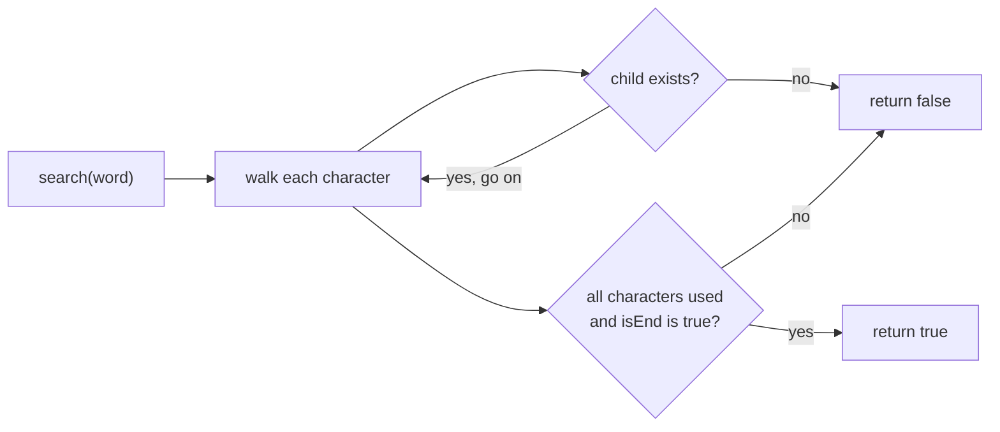

# Search Word

> Follow the path for the word. It must **exist** and the last node must be **marked as an end**.

#### 1. What Is It?

**Search** answers: "Is this **exact word** in the trie?"

Two conditions, both needed:

1. Every character has a matching child (the **path exists**).
2. The last node has **`isEnd = true`** (a word **ends** there).

If only the first holds, the string is a **prefix** of some word, not a word itself.

**Signals:** "does the dictionary contain the word", "exact match", "valid word".

#### 2. How It Works

Trie containing `car`, `cart`, `cat`:

```text
search "car":    c ✓ → a ✓ → r ✓,  r.isEnd = true      → TRUE
search "ca":     c ✓ → a ✓,        a.isEnd = false     → FALSE   (a prefix, not a word)
search "cow":    c ✓ → o ✗                              → FALSE   (path breaks)
search "cartoon":c ✓ → a ✓ → r ✓ → t ✓ → o ✗           → FALSE
```



**Algorithm**

```text
node = root
for each character ch in word:
    if node has no child for ch: return false
    node = child for ch
return node.isEnd
```

`startsWith` (note 5) is the same walk, with `return true` instead of `return node.isEnd`.

#### 3. Brute Force vs Optimized

| Approach | Time per search |
|---|---|
| Scan a list of words | `O(n · L)` |
| `HashSet<String>` | `O(L)` |
| **Trie** | `O(L)` |

For **exact** search alone, a `HashSet` is just as good and simpler. The trie pays off when you also need **prefix** queries.

```kotlin
// Brute force: scan a list
fun searchBrute(words: List<String>, word: String): Boolean = word in words     // O(n * L)
```

#### 4. Kotlin Code

```kotlin
class TrieNode {
    val next = arrayOfNulls<TrieNode>(26)
    var isEnd = false
}

class Trie {
    private val root = TrieNode()

    fun insert(word: String) {
        var node = root
        for (c in word) {
            val i = c - 'a'
            if (node.next[i] == null) node.next[i] = TrieNode()
            node = node.next[i]!!
        }
        node.isEnd = true
    }

    fun search(word: String): Boolean {
        var node = root
        for (c in word) {
            node = node.next[c - 'a'] ?: return false       // the path breaks
        }
        return node.isEnd                                   // a word must END here
    }
}
```

Checks (insert `car`, `cart`, `cat`): `search("car")` → `true`. `search("cart")` → `true`. `search("ca")` → `false`. `search("cow")` → `false`. `search("cartoon")` → `false`. `search("")` → `false` (the root is not marked, unless you inserted `""`). `searchBrute(listOf("car", "cart", "cat"), "cat")` → `true`.

#### 5. Complexity

| | Time | Space |
|---|---|---|
| `search` | `O(L)` | `O(1)` |

The time depends only on the **length of the word**, not on how many words are stored.

#### 6. Common Mistakes

1. **Returning `true` when the path exists** but `isEnd` is false (prefix vs word).
2. **Returning `isEnd` of a null node** (crash). Return `false` as soon as a child is missing.
3. **Searching an empty string** without deciding what it should return.
4. **Case problems:** `"Car"` is not `"car"`. Normalise or use a map.
5. **Using `==` on strings in a loop** instead of walking the trie.
6. **Forgetting that a deleted word** may leave the path in place (note 11).

#### 7. Say This in the Interview

1. "I follow the word one character at a time. If a child is missing I return false. At the end I check `isEnd`, because a path can exist only as a prefix of a longer word."
2. "It is `O(L)`, independent of the number of words."
3. "For exact lookup alone a hash set is simpler. I use a trie because I also need prefix queries."

#### 8. Quick Check

1. With only `apple` inserted, does `search("app")` return true?
2. What does `search` return if the path breaks?
3. What is its time?

<details>
<summary>Answers</summary>

1. No. The path exists, but the second `p` has `isEnd = false`.
2. `false` immediately.
3. `O(L)`.

</details>

#### 9. Related LeetCode Questions

| # | Question | Idea |
|---|---|---|
| 208 | [Implement Trie (Prefix Tree)](https://leetcode.com/problems/implement-trie-prefix-tree/) (Medium) | `search` |
| 211 | [Design Add and Search Words Data Structure](https://leetcode.com/problems/design-add-and-search-words-data-structure/) (Medium) | `search` with `.` |
| 676 | [Implement Magic Dictionary](https://leetcode.com/problems/implement-magic-dictionary/) (Medium) | search with one change |
| 1032 | [Stream of Characters](https://leetcode.com/problems/stream-of-characters/) (Hard) | trie of reversed words |
| 720 | [Longest Word in Dictionary](https://leetcode.com/problems/longest-word-in-dictionary/) (Medium) | check every prefix is a word |
