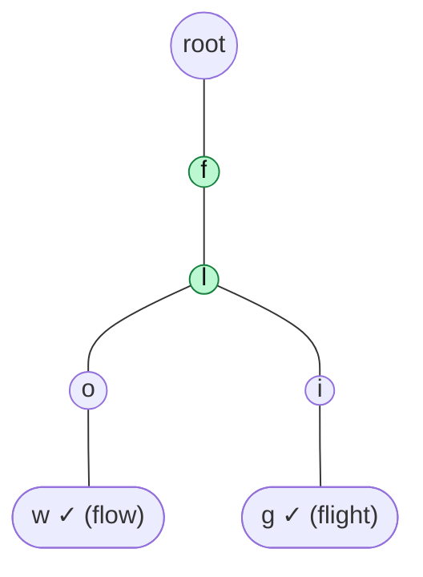

# Prefix Search / startsWith

> The reason tries exist. The same walk as `search`, but you only need the **path to exist**.

#### 1. What Is It?

**`startsWith(prefix)`** answers: "Is there **any** word in the trie that begins with this prefix?"

- It succeeds if you can follow the whole prefix.
- It does **not** need `isEnd`. The prefix itself does not have to be a word.

Once you have the **node at the end of the prefix**, many more questions become easy: count the words below it, list them, check one child, and so on.

**Signals:** "starts with", "prefix", "common prefix", "autocomplete", "words beginning with".

#### 2. How It Works

Trie with `car`, `cart`, `cat`, `dog`:

```text
startsWith "ca":   c ✓ → a ✓                      → TRUE   (cart, car, cat all start with "ca")
startsWith "cat":  c ✓ → a ✓ → t ✓                → TRUE   (cat is also a word)
startsWith "cx":   c ✓ → x ✗                      → FALSE
startsWith "":     the root                       → TRUE   (every word starts with the empty prefix)
```

**A shared helper.** Write one function `findNode(prefix)` that returns the node at the end of the prefix, or `null`. Then:

```text
search(word)      = findNode(word)?.isEnd == true
startsWith(prefix) = findNode(prefix) != null
```

**Longest Common Prefix of many words (LeetCode 14).** Insert all words. Start at the root and keep going **while the current node has exactly one child and is not the end of a word**. The path you walked is the longest common prefix.



Words `flower`, `flow`, `flight`: after `f → l` the node has **two** children (`o` and `i`), so the common prefix is `fl`.

(For this one question, simply comparing the first and last word after sorting is also `O(n log n · L)`, or compare character by character in `O(n · L)`. The trie is the general tool.)

#### 3. Brute Force vs Optimized

| Approach | Time |
|---|---|
| `words.any { it.startsWith(prefix) }` | `O(n · L)` |
| Add every prefix to a `HashSet` | `O(1)` query, but `O(total L²)` memory |
| **Trie walk** | `O(L)` query, `O(total L)` memory |

```kotlin
fun startsWithBrute(words: List<String>, prefix: String): Boolean =
    words.any { it.startsWith(prefix) }
```

#### 4. Kotlin Code

```kotlin
class TrieNode {
    val next = arrayOfNulls<TrieNode>(26)
    var isEnd = false
    var childCount = 0
}

class Trie {
    private val root = TrieNode()

    fun insert(word: String) {
        var node = root
        for (c in word) {
            val i = c - 'a'
            if (node.next[i] == null) { node.next[i] = TrieNode(); node.childCount++ }
            node = node.next[i]!!
        }
        node.isEnd = true
    }

    // The node at the end of the prefix, or null
    private fun findNode(prefix: String): TrieNode? {
        var node = root
        for (c in prefix) node = node.next[c - 'a'] ?: return null
        return node
    }

    fun search(word: String): Boolean = findNode(word)?.isEnd == true

    fun startsWith(prefix: String): Boolean = findNode(prefix) != null

    // Longest common prefix of all inserted words
    fun longestCommonPrefix(): String {
        val sb = StringBuilder()
        var node = root
        while (node.childCount == 1 && !node.isEnd) {
            val i = node.next.indexOfFirst { it != null }
            sb.append('a' + i)
            node = node.next[i]!!
        }
        return sb.toString()
    }
}
```

Checks (insert `car`, `cart`, `cat`, `dog`): `startsWith("ca")` → `true`. `startsWith("cat")` → `true`. `startsWith("cx")` → `false`. `startsWith("")` → `true`. `search("ca")` → `false`. A trie with `flower`, `flow`, `flight`: `longestCommonPrefix()` → `"fl"`. A trie with `dog`, `racecar`, `car`: `longestCommonPrefix()` → `""` (the root has two children). A trie with only `abc`: `longestCommonPrefix()` → `"abc"`. A trie with `ab` and `abc`: `longestCommonPrefix()` → `"ab"` (stops at the end of the word `ab`).

#### 5. Complexity

| | Time | Space |
|---|---|---|
| `startsWith` | `O(L)` | `O(1)` |
| `longestCommonPrefix` | `O(L)` for the answer length | `O(1)` extra |
| Build the trie for LCP | `O(total characters)` | `O(total characters)` |

#### 6. Common Mistakes

1. **Checking `isEnd` in `startsWith`.** That turns it into `search`.
2. **Treating the empty prefix as false.** By convention it is true when the trie is non-empty (decide and state it).
3. **Longest common prefix:** not stopping at a node where a word ends (`ab` and `abc` share only `ab`).
4. **Not stopping when the node has more than one child.**
5. **Rewriting the same loop twice** instead of one `findNode` helper.
6. **Case or character mismatch** crashing the array index.

#### 7. Say This in the Interview

1. "`startsWith` walks the prefix and returns true if every character exists. It doesn't check `isEnd`. That is `O(L)` no matter how many words there are."
2. "I keep a `findNode` helper that returns the node at the end of a prefix. `search` and `startsWith` both use it, and so do counting and autocomplete."
3. "For the longest common prefix, I walk down while the node has exactly one child and is not a word end."

#### 8. Quick Check

1. After inserting `apple`, what does `startsWith("appl")` return?
2. How many children does the root have in a trie of `car`, `cat`, `dog`?
3. Longest common prefix of `ab` and `abc`?

<details>
<summary>Answers</summary>

1. `true`.
2. `2` (`c` and `d`).
3. `"ab"`.

</details>

#### 9. Related LeetCode Questions

| # | Question | Idea |
|---|---|---|
| 208 | [Implement Trie (Prefix Tree)](https://leetcode.com/problems/implement-trie-prefix-tree/) (Medium) | `startsWith` |
| 14 | [Longest Common Prefix](https://leetcode.com/problems/longest-common-prefix/) (Easy) | walk while one child |
| 1268 | [Search Suggestions System](https://leetcode.com/problems/search-suggestions-system/) (Medium) | prefix then list |
| 648 | [Replace Words](https://leetcode.com/problems/replace-words/) (Medium) | shortest prefix that is a word |
| 1065 | [Index Pairs of a String](https://leetcode.com/problems/index-pairs-of-a-string/) (Easy, premium) | match words at each start |
