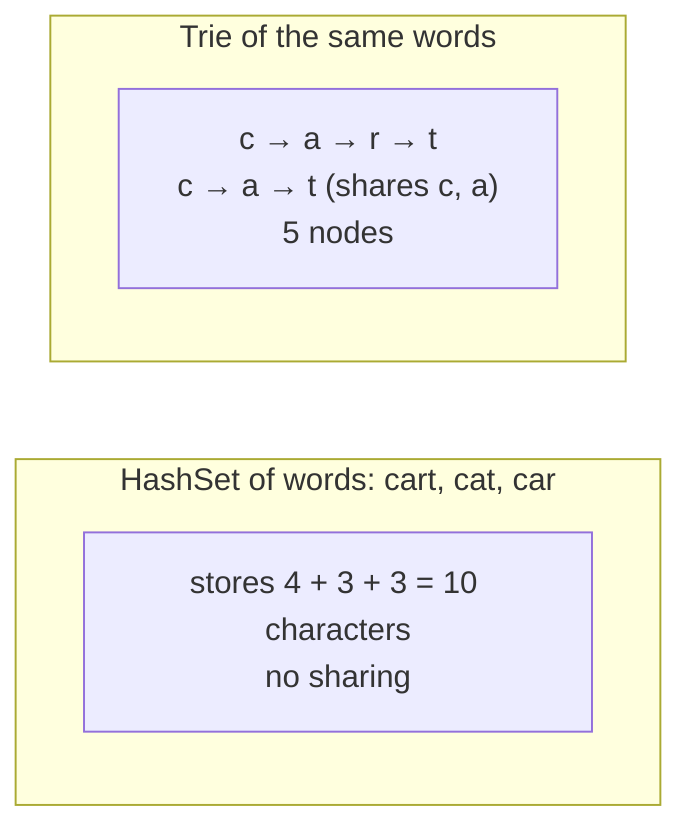

# Trie Operations & Complexity

> All main trie operations cost `O(L)`, the length of the word. The cost you must also discuss is **memory**.

#### 1. What Is It?

A summary of what a trie can do, what it costs, and when it is the right tool.

| Operation | Time | Notes |
|---|---|---|
| `insert(word)` | `O(L)` | creates at most `L` nodes |
| `search(word)` | `O(L)` | exact match, needs `isEnd` |
| `startsWith(prefix)` | `O(L)` | path must exist |
| `delete(word)` | `O(L)` | optional pruning (note 11) |
| Count words with a prefix | `O(L)` | with a `pass` counter (note 14) |
| List all words with a prefix | `O(L + size of the subtree)` | DFS below the prefix node |
| Wildcard search (`.`) | up to `O(26^L)` worst, usually far less | DFS (note 13) |

`L` = the length of the word or prefix. **The time does not depend on the number of words `n`.**

#### 2. How It Works

**Why `O(L)`?** Each step moves one level down one array slot or map entry. There are `L` characters, so `L` steps. Nothing is compared against other words.

**Space.** A trie has at most one node per character inserted:

```text
total nodes ≤ sum of the lengths of all words     (words with shared prefixes use fewer)
memory ≈ nodes × (size of one node)
```

- Array children: each node has 26 slots, so even a node with one child pays for 26.
- Map children: each node pays only for the children it has.



**When to choose a trie**

| Need | Pick |
|---|---|
| exact lookup only | `HashSet` |
| many prefix queries, autocomplete | **Trie** |
| sorted words / range of words | sorted list or `TreeSet` |
| words in a grid (many words at once) | **Trie + DFS** |
| bitwise maximum XOR | **binary trie** |
| memory is very tight | sorted array + binary search, or a compressed trie |

#### 3. Brute Force vs Optimized

| Query | Brute force | Trie |
|---|---|---|
| Does any word start with `p`? | `O(n · L)` | `O(L)` |
| Count words that start with `p` | `O(n · L)` | `O(L)` with counters |
| List words that start with `p` | `O(n · L)` | `O(L + output)` |
| Build the structure | `O(n)` for a list | `O(n · L)` |

```kotlin
// Brute force: count words with a prefix by scanning
fun countWithPrefixBrute(words: List<String>, prefix: String): Int =
    words.count { it.startsWith(prefix) }                        // O(n * L) per query
```

If you ask **many** prefix questions, the one-time `O(n · L)` build is repaid quickly.

#### 4. Kotlin Code

```kotlin
class TrieNode {
    val next = arrayOfNulls<TrieNode>(26)
    var isEnd = false
}

class Trie {
    private val root = TrieNode()
    private var nodes = 1                                    // counts the root

    fun insert(word: String) {
        var node = root
        for (c in word) {
            val i = c - 'a'
            if (node.next[i] == null) { node.next[i] = TrieNode(); nodes++ }
            node = node.next[i]!!
        }
        node.isEnd = true
    }

    fun nodeCount(): Int = nodes
}

// Number of nodes a trie needs vs the characters stored in a plain list
fun charactersOf(words: List<String>): Int = words.sumOf { it.length }
```

Checks: insert `cart`, `cat`, `car` → `nodeCount()` → `6` (the root plus `c, a, r, t` plus the second `t` under `a`), while `charactersOf(listOf("cart", "cat", "car"))` → `10`. Insert `abc`, `xyz` (no shared prefix) → `nodeCount()` → `7` (root plus 6). `countWithPrefixBrute(listOf("cart", "cat", "car"), "ca")` → `3`.

#### 5. Complexity

| | Time | Space |
|---|---|---|
| Insert / search / startsWith | `O(L)` | `O(1)` extra |
| Build for `n` words | `O(n · L)` | `O(n · L)` nodes at most |
| Memory with array nodes | | `O(26 · n · L)` worst case |
| Memory with map nodes | | `O(n · L)` |

#### 6. Common Mistakes

1. **Saying the time is `O(n)`** or `O(log n)`. It is `O(L)`.
2. **Ignoring memory** (array nodes with 26 slots).
3. **Using a trie when a `HashSet` is enough.**
4. **Forgetting the build cost** when comparing with scanning.
5. **Assuming wildcard search is `O(L)`.** It can branch.
6. **Believing a trie always saves memory.** It saves when many words share prefixes. For random strings it can use more than a hash set.

#### 7. Say This in the Interview

1. "Insert, search and prefix queries are `O(L)`, the length of the word, and don't depend on the number of words."
2. "The cost is memory: up to one node per character, and with array children each node has 26 slots. A map-based node saves memory when it is sparse."
3. "If I only need exact matches I'd use a hash set. I choose a trie when prefix queries matter."

#### 8. Quick Check

1. The time to check a prefix of length 5 in a trie of a million words?
2. How many nodes are needed for `ab`, `ac` (plus the root)?
3. When does a trie use less memory than a hash set?

<details>
<summary>Answers</summary>

1. `O(5)`, about 5 steps.
2. `3` nodes (`a`, `b`, `c`), or `4` if you count the root.
3. When many words share long prefixes.

</details>

#### 9. Related LeetCode Questions

| # | Question | Idea |
|---|---|---|
| 208 | [Implement Trie (Prefix Tree)](https://leetcode.com/problems/implement-trie-prefix-tree/) (Medium) | the core operations |
| 1804 | [Implement Trie II (Prefix Tree)](https://leetcode.com/problems/implement-trie-ii-prefix-tree/) (Medium, premium) | counts |
| 2416 | [Sum of Prefix Scores of Strings](https://leetcode.com/problems/sum-of-prefix-scores-of-strings/) (Hard) | counters on nodes |
| 14 | [Longest Common Prefix](https://leetcode.com/problems/longest-common-prefix/) (Easy) | walk the trie |
| 676 | [Implement Magic Dictionary](https://leetcode.com/problems/implement-magic-dictionary/) (Medium) | branching search |
