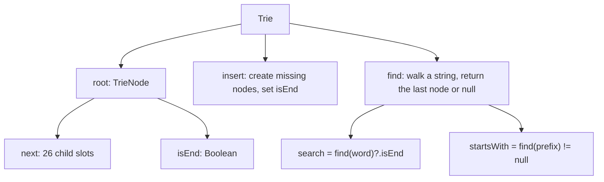

# Trie Implementation

> The version to write in an interview. Short, correct, and with `search` and `startsWith` sharing one helper.

#### 1. What Is It?

The standard interview implementation of *Implement Trie (Prefix Tree)* (LeetCode 208):

| Method | Meaning |
|---|---|
| `insert(word)` | add a word |
| `search(word)` | true if the exact word was inserted |
| `startsWith(prefix)` | true if any inserted word starts with the prefix |

It combines notes 2 to 6 into one class you can write from memory in about 3 minutes.

#### 2. How It Works



**Order of writing it (a checklist)**

1. `TrieNode` with `next` (array of 26) and `isEnd`.
2. `Trie` holds a `root`.
3. `insert`: loop, create if null, move, set `isEnd`.
4. `find`: loop, return `null` if missing, else the node.
5. `search` and `startsWith` one-liners on top of `find`.

**Variants you may be asked for**

| Variant | Change |
|---|---|
| Any characters | `HashMap<Char, TrieNode>` children |
| Count words with a prefix | `pass` counter per node (note 14) |
| Delete | prune nodes (note 11) |
| Autocomplete | DFS below the prefix node (note 12) |
| Store the word at the end | `word: String?` in the node (note 9) |

#### 3. Brute Force vs Optimized

| Approach | `insert` | `search` | `startsWith` |
|---|---|---|---|
| List of words | `O(1)` | `O(n · L)` | `O(n · L)` |
| `HashSet` of words | `O(L)` | `O(L)` | `O(n · L)` |
| **Trie** | `O(L)` | `O(L)` | `O(L)` |

```kotlin
// Brute force with a list: the same interface, much slower queries
class ListTrie {
    private val words = mutableListOf<String>()
    fun insert(word: String) { words.add(word) }
    fun search(word: String): Boolean = words.contains(word)               // O(n * L)
    fun startsWith(prefix: String): Boolean = words.any { it.startsWith(prefix) }   // O(n * L)
}
```

#### 4. Kotlin Code

```kotlin
// Implement Trie (Prefix Tree) (LeetCode 208)
class Trie {
    private class Node {
        val next = arrayOfNulls<Node>(26)
        var isEnd = false
    }

    private val root = Node()

    fun insert(word: String) {
        var node = root
        for (c in word) {
            val i = c - 'a'
            if (node.next[i] == null) node.next[i] = Node()
            node = node.next[i]!!
        }
        node.isEnd = true
    }

    private fun find(s: String): Node? {
        var node = root
        for (c in s) node = node.next[c - 'a'] ?: return null
        return node
    }

    fun search(word: String): Boolean = find(word)?.isEnd == true

    fun startsWith(prefix: String): Boolean = find(prefix) != null
}

// General alphabet version (any characters)
class TrieAny {
    private class Node {
        val next = HashMap<Char, Node>()
        var isEnd = false
    }

    private val root = Node()

    fun insert(word: String) {
        var node = root
        for (c in word) node = node.next.getOrPut(c) { Node() }
        node.isEnd = true
    }

    private fun find(s: String): Node? {
        var node = root
        for (c in s) node = node.next[c] ?: return null
        return node
    }

    fun search(word: String): Boolean = find(word)?.isEnd == true
    fun startsWith(prefix: String): Boolean = find(prefix) != null
}
```

Checks (the LeetCode example): `val t = Trie()`, `t.insert("apple")`, `t.search("apple")` → `true`, `t.search("app")` → `false`, `t.startsWith("app")` → `true`, `t.insert("app")`, `t.search("app")` → `true`. `TrieAny`: `insert("Hello World")`, `search("Hello World")` → `true`, `startsWith("Hello ")` → `true`, `search("hello world")` → `false`. `ListTrie` gives the same answers for the lowercase example.

#### 5. Complexity

| | Time | Space |
|---|---|---|
| `insert`, `search`, `startsWith` | `O(L)` | |
| Whole trie | | `O(total characters · 26)` array, `O(total characters)` map |

#### 6. Common Mistakes

1. **`search` without `isEnd`.**
2. **A new node created on every step** (overwrites existing children).
3. **Forgetting to move `node`** after creating a child.
4. **Duplicated code** in `search` and `startsWith` (write `find` once).
5. **The array version with upper-case input.**
6. **Making the node class public and mutable by callers** (minor, but mention a `private` node class).

#### 7. Say This in the Interview

1. "A node has 26 child slots and an end flag. `insert` creates missing nodes along the word. A private `find` returns the node at the end of a string, so `search` is `find(word)?.isEnd` and `startsWith` is `find(prefix) != null`."
2. "Everything is `O(L)`."
3. "For a different alphabet, I swap the array for a `HashMap<Char, Node>`."

#### 8. Quick Check

1. What does `find("zz")` return in an empty trie?
2. Which one-liner is `search`, and which is `startsWith`?
3. What changes for upper-case and lower-case letters?

<details>
<summary>Answers</summary>

1. `null`.
2. `search(word) = find(word)?.isEnd == true`, `startsWith(prefix) = find(prefix) != null`.
3. The array needs 52 slots (or use a `HashMap`).

</details>

#### 9. Related LeetCode Questions

| # | Question | Idea |
|---|---|---|
| 208 | [Implement Trie (Prefix Tree)](https://leetcode.com/problems/implement-trie-prefix-tree/) (Medium) | this note |
| 1804 | [Implement Trie II (Prefix Tree)](https://leetcode.com/problems/implement-trie-ii-prefix-tree/) (Medium, premium) | counts and erase |
| 211 | [Design Add and Search Words Data Structure](https://leetcode.com/problems/design-add-and-search-words-data-structure/) (Medium) | wildcard |
| 648 | [Replace Words](https://leetcode.com/problems/replace-words/) (Medium) | use the trie |
| 720 | [Longest Word in Dictionary](https://leetcode.com/problems/longest-word-in-dictionary/) (Medium) | trie or sort |
| 677 | [Map Sum Pairs](https://leetcode.com/problems/map-sum-pairs/) (Medium) | values in nodes |
