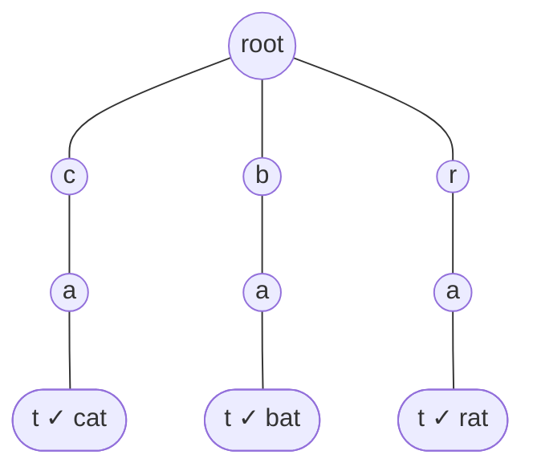

# Word Dictionary / Prefix Matching

> Use the trie to match **prefixes of a longer string** against a dictionary: replace words by their shortest root, find the longest buildable word, or sum values under a prefix.

#### 1. What Is It?

Three classic dictionary questions, all one trie walk:

| Question | Goal | Trie idea |
|---|---|---|
| **Replace Words** (648) | replace each word by the **shortest dictionary root** that is its prefix | walk the word; stop at the **first** node with `isEnd` |
| **Longest Word in Dictionary** (720) | longest word that can be built one letter at a time from other words | only walk through nodes that are word ends |
| **Map Sum Pairs** (677) | sum of the values of all keys with a given prefix | store a value at end nodes, sum the subtree (or keep a running sum on each node) |

**Signals:** "dictionary of roots", "replace with the shortest", "every prefix is also a word", "sum of values with prefix".

#### 2. How It Works

**Replace Words.** Roots `["cat", "bat", "rat"]`, sentence `"the cattle was rattled by the battery"` becomes `"the cat was rat by the bat"`.



```text
word "cattle":  c → a → t (isEnd!) → stop here, replace by "cat"
word "was":     w has no child in the root → keep "was"
```

**Longest Word in Dictionary.** A word counts only if **every one of its prefixes is also a word**. Insert all words. DFS from the root, **only into children that are word ends**. The deepest path (the lexicographically smallest on ties) is the answer.

```text
words: w, wo, wor, worl, world, banana         →  "world"
(banana is not buildable: "b", "ba", "ban" ... are not words)
```

**Map Sum Pairs.** `insert(key, val)` sets the value of a key (an **overwrite** if the key exists). `sum(prefix)` adds all values of keys under the prefix. Keep a `HashMap<String, Int>` of current values, and on each node a running `total` of the values passing through it. When a key is overwritten, add only the **difference** (`new − old`) to every node on its path.

```text
insert("apple", 3)   path totals: a=3 ap=3 app=3 appl=3 apple=3
insert("app", 2)     path totals: a=5 ap=5 app=5
sum("ap") = 5
insert("apple", 5)   difference +2 → a=7 ap=7 app=7 appl=5 apple=5
sum("ap") = 7
```

#### 3. Brute Force vs Optimized

| Problem | Brute force | Trie |
|---|---|---|
| Replace Words | for each word, try every root with `startsWith`: `O(W · R · L)` | walk the trie: `O(W · L)` |
| Longest Word | for each word check all prefixes in a set: `O(total L²)` | DFS over end nodes: `O(total L)` |
| Map Sum | scan all keys for each query: `O(n · L)` | running totals: `O(L)` |

```kotlin
// Brute force Replace Words: try every root
fun replaceWordsBrute(roots: List<String>, sentence: String): String =
    sentence.split(" ").joinToString(" ") { word ->
        roots.filter { word.startsWith(it) }.minByOrNull { it.length } ?: word
    }
```

#### 4. Kotlin Code

```kotlin
class Node {
    val next = arrayOfNulls<Node>(26)
    var isEnd = false
}

// Replace Words (LeetCode 648)
fun replaceWords(dictionary: List<String>, sentence: String): String {
    val root = Node()
    for (w in dictionary) {
        var node = root
        for (c in w) {
            if (node.next[c - 'a'] == null) node.next[c - 'a'] = Node()
            node = node.next[c - 'a']!!
        }
        node.isEnd = true
    }
    fun shortestRoot(word: String): String {
        var node = root
        for ((i, c) in word.withIndex()) {
            node = node.next[c - 'a'] ?: return word          // no root matches
            if (node.isEnd) return word.substring(0, i + 1)   // the first (shortest) root
        }
        return word
    }
    return sentence.split(" ").joinToString(" ") { shortestRoot(it) }
}

// Longest Word in Dictionary (LeetCode 720)
fun longestWord(words: Array<String>): String {
    val root = Node()
    for (w in words) {
        var node = root
        for (c in w) {
            if (node.next[c - 'a'] == null) node.next[c - 'a'] = Node()
            node = node.next[c - 'a']!!
        }
        node.isEnd = true
    }
    var best = ""
    fun dfs(node: Node, path: StringBuilder) {
        if (path.length > best.length) best = path.toString()      // first found at a length is lexicographically smallest
        for (i in 0 until 26) {
            val child = node.next[i] ?: continue
            if (!child.isEnd) continue                              // every prefix must be a word
            path.append('a' + i)
            dfs(child, path)
            path.deleteCharAt(path.length - 1)
        }
    }
    dfs(root, StringBuilder())
    return best
}

// Map Sum Pairs (LeetCode 677)
class MapSum {
    private class TNode {
        val next = arrayOfNulls<TNode>(26)
        var total = 0                                              // sum of values of keys passing through
    }

    private val root = TNode()
    private val values = HashMap<String, Int>()

    fun insert(key: String, value: Int) {
        val delta = value - (values[key] ?: 0)                     // overwrite: add only the change
        values[key] = value
        var node = root
        for (c in key) {
            if (node.next[c - 'a'] == null) node.next[c - 'a'] = TNode()
            node = node.next[c - 'a']!!
            node.total += delta
        }
    }

    fun sum(prefix: String): Int {
        var node = root
        for (c in prefix) node = node.next[c - 'a'] ?: return 0
        return node.total
    }
}
```

Checks: `replaceWords(listOf("cat", "bat", "rat"), "the cattle was rattled by the battery")` → `"the cat was rat by the bat"`. `replaceWords(listOf("a", "b", "c"), "aadsfasf absbs bbab cadsfafs")` → `"a a b c"`. `replaceWordsBrute(...)` gives the same. `longestWord(arrayOf("w", "wo", "wor", "worl", "world"))` → `"world"`. `longestWord(arrayOf("a", "banana", "app", "appl", "ap", "apply", "apple"))` → `"apple"` (`apply` has the same length, but `apple` is smaller alphabetically). `MapSum`: `insert("apple", 3)`, `sum("ap")` → `3`, `insert("app", 2)`, `sum("ap")` → `5`, `insert("apple", 5)` (overwrite), `sum("ap")` → `7`.

#### 5. Complexity

| | Time | Space |
|---|---|---|
| Replace Words | build `O(total root chars)`, then `O(total sentence chars)` | `O(total root chars)` |
| Longest Word | `O(total chars)` | `O(total chars)` |
| Map Sum | `insert` `O(L)`, `sum` `O(L)` | `O(total chars)` |

#### 6. Common Mistakes

1. **Replace Words:** returning the **longest** matching root instead of the shortest (stop at the first `isEnd`).
2. **Longest Word:** following nodes that are not word ends.
3. **Longest Word:** ignoring the alphabetical tie-break. Visiting children `a..z` in order and using a strict `>` handles it.
4. **Map Sum:** adding the full value again on overwrite (double counting). Add only the difference.
5. **Map Sum:** returning `0` vs failing when the prefix is missing. Return `0`.
6. **Splitting a sentence** and forgetting to join with a single space.

#### 7. Say This in the Interview

1. "For each word I walk the trie and stop at the first node that ends a root. That is the shortest root, in `O(L)` per word."
2. "For the longest buildable word I only descend into children that are word ends, so every prefix is guaranteed to be a word."
3. "For Map Sum, each node keeps the total of the values below it, and on overwrite I add only the difference, so `sum` is just a walk of the prefix."

#### 8. Quick Check

1. Roots `a`, `ab`: which root replaces `abc`?
2. Is `"abc"` buildable from `["a", "abc"]`?
3. In Map Sum, what changes when `insert("app", 2)` is called twice with the same value?

<details>
<summary>Answers</summary>

1. `a` (the shortest).
2. No: `"ab"` is not in the list.
3. Nothing (the difference is `0`).

</details>

#### 9. Related LeetCode Questions

| # | Question | Idea |
|---|---|---|
| 648 | [Replace Words](https://leetcode.com/problems/replace-words/) (Medium) | first `isEnd` |
| 720 | [Longest Word in Dictionary](https://leetcode.com/problems/longest-word-in-dictionary/) (Medium) | descend through word ends |
| 677 | [Map Sum Pairs](https://leetcode.com/problems/map-sum-pairs/) (Medium) | running totals |
| 1233 | [Remove Sub-Folders from the Filesystem](https://leetcode.com/problems/remove-sub-folders-from-the-filesystem/) (Medium) | trie of path parts |
| 1065 | [Index Pairs of a String](https://leetcode.com/problems/index-pairs-of-a-string/) (Easy, premium) | match at each start |
| 1268 | [Search Suggestions System](https://leetcode.com/problems/search-suggestions-system/) (Medium) | note 12 |
