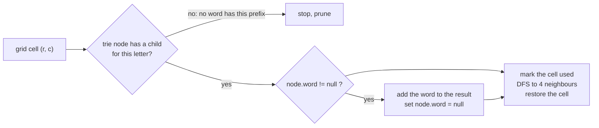

# Trie + DFS

> The famous combination: search **many words at once** in a grid. The trie tells the DFS when to **stop early**, so you never explore a path that no word can use.

#### 1. What Is It?

Some problems walk a **grid** (or a graph) and need to know if the path so far is a **prefix of any word** in a dictionary. A trie answers that in `O(1)` per step. The DFS then walks the grid and the trie **together**.

| Question | Idea |
|---|---|
| **Word Search II** (212) | find all dictionary words that can be traced in the grid |
| **Boggle**-style word games | same |
| **Palindrome Pairs**, **Concatenated Words** (472) | trie to check prefixes while splitting |

**Signals:** "find all words in a grid", "words from a dictionary", "board", "prefix pruning".

#### 2. How It Works

*Word Search I* (LeetCode 79) finds **one** word with DFS. For **many** words, doing it once per word repeats the same grid search over and over. **Word Search II** puts all words in **one trie** and does **one** DFS from each cell:

1. Move to the child of the current trie node that matches the grid letter. **If there is none, stop**: no word has this prefix.
2. If the trie node ends a word, **record the word** (and clear it, so it is not found twice).
3. Mark the cell as used (`#`), recurse in the 4 directions, then **restore** the cell (backtracking).



```text
board          words = ["oath", "pea", "eat", "rain"]
o a a n
e t a e        Trie: o-a-t-h✓,  p-e-a✓,  e-a-t✓,  r-a-i-n✓
i h k r        DFS from (0,0) 'o' → a (0,1) → t (1,1) → h (2,1): "oath" found
i f l v        DFS from (1,0) 'e' → a (0,1)… → t (1,1): "eat" found
               "pea" and "rain" cannot be traced: no path in the grid
result: ["oath", "eat"]
```

**Optimisations worth knowing**

- Store the **whole word at the end node** (`node.word`), so you do not rebuild it with a `StringBuilder`.
- **Set `node.word = null`** after finding a word, to avoid duplicates.
- **Prune** trie branches that have no words left (remove a leaf node after its last word is found). This helps a lot on big inputs.

#### 3. Brute Force vs Optimized

| Approach | Time | Note |
|---|---|---|
| Word Search I for **each** word | `O(W · m · n · 4^L)` | repeats the grid work for each word |
| **Trie + one DFS** | `O(m · n · 4^L)` | shares prefixes, prunes dead paths |

`W` = number of words, `m × n` = the grid, `L` = the longest word.

```kotlin
// Brute force: run a separate DFS for every word (this is LeetCode 79 in a loop)
fun existsInGrid(board: Array<CharArray>, word: String): Boolean {
    val rows = board.size
    val cols = board[0].size
    fun dfs(r: Int, c: Int, i: Int): Boolean {
        if (i == word.length) return true
        if (r !in 0 until rows || c !in 0 until cols || board[r][c] != word[i]) return false
        val saved = board[r][c]
        board[r][c] = '#'
        val found = dfs(r + 1, c, i + 1) || dfs(r - 1, c, i + 1) || dfs(r, c + 1, i + 1) || dfs(r, c - 1, i + 1)
        board[r][c] = saved
        return found
    }
    for (r in 0 until rows) for (c in 0 until cols) if (dfs(r, c, 0)) return true
    return false
}

fun findWordsBrute(board: Array<CharArray>, words: Array<String>): List<String> =
    words.filter { existsInGrid(board, it) }
```

#### 4. Kotlin Code

```kotlin
class TrieNode {
    val next = arrayOfNulls<TrieNode>(26)
    var word: String? = null                      // the full word if a word ends here
}

// Word Search II (LeetCode 212)
fun findWords(board: Array<CharArray>, words: Array<String>): List<String> {
    val root = TrieNode()
    for (w in words) {
        var node = root
        for (c in w) {
            if (node.next[c - 'a'] == null) node.next[c - 'a'] = TrieNode()
            node = node.next[c - 'a']!!
        }
        node.word = w
    }

    val rows = board.size
    val cols = board[0].size
    val result = mutableListOf<String>()

    fun dfs(r: Int, c: Int, parent: TrieNode) {
        if (r !in 0 until rows || c !in 0 until cols) return
        val letter = board[r][c]
        if (letter == '#') return                              // already used on this path
        val node = parent.next[letter - 'a'] ?: return         // no word has this prefix: prune
        val w = node.word
        if (w != null) { result.add(w); node.word = null }    // found, and avoid duplicates

        board[r][c] = '#'                                      // mark used
        dfs(r + 1, c, node)
        dfs(r - 1, c, node)
        dfs(r, c + 1, node)
        dfs(r, c - 1, node)
        board[r][c] = letter                                   // restore
    }

    for (r in 0 until rows) for (c in 0 until cols) dfs(r, c, root)
    return result
}
```

Board and words from the example (as `arrayOf(charArrayOf('o','a','a','n'), charArrayOf('e','t','a','e'), charArrayOf('i','h','k','r'), charArrayOf('i','f','l','v'))`):

Checks: `findWords(board, arrayOf("oath", "pea", "eat", "rain"))` → `["oath", "eat"]` (order may differ). On the board `[['a','b'],['c','d']]`: `findWords(..., arrayOf("abdc"))` → `["abdc"]` (path `a → b → d → c`), and `findWords(..., arrayOf("abcb"))` → `[]` (`b` and `c` are diagonal, not adjacent). `findWords(arrayOf(charArrayOf('a')), arrayOf("a"))` → `["a"]`. `findWordsBrute(board, arrayOf("oath", "pea", "eat", "rain"))` → `["oath", "eat"]`.

#### 5. Complexity

| | Time | Space |
|---|---|---|
| Build the trie | `O(total characters of the words)` | `O(total characters)` |
| DFS | `O(m · n · 3^L)` (after the first step there are at most 3 new directions) | `O(L)` stack |
| Brute force | `O(W · m · n · 3^L)` | `O(L)` |

#### 6. Common Mistakes

1. **Not restoring the cell** after the DFS.
2. **Not marking the cell as used** (a cell reused in one word).
3. **Reporting the same word twice.** Clear `node.word` after the first find.
4. **Rebuilding strings in the DFS** (slow). Store the word at the end node.
5. **Reading `board[r][c]` before the bounds check.**
6. **Running Word Search I for each word** (time limit exceeded on big inputs).
7. **Using the wrong index** for letters (`'#'` minus `'a'` is negative). Check `'#'` before indexing.

#### 7. Say This in the Interview

1. "Word Search II for each word separately repeats the grid search. I build one trie of all the words and run one DFS from each cell, moving in the trie alongside the grid."
2. "If the current trie node has no child for the next letter, I stop right away, because no word has this prefix. That prunes most of the search."
3. "I store the word at its end node so I can add it without rebuilding the string, and I clear it to avoid duplicates."

#### 8. Quick Check

1. Why use a trie and not a `HashSet` of words?
2. What does the DFS do when the trie has no child for the cell's letter?
3. Why restore the cell after the recursive calls?

<details>
<summary>Answers</summary>

1. A set cannot tell if a **prefix** can still become a word, so the DFS could not prune early.
2. It returns immediately (prune).
3. So other paths can use that cell again. Marking is only for the current path.

</details>

#### 9. Related LeetCode Questions

| # | Question | Idea |
|---|---|---|
| 79 | [Word Search](https://leetcode.com/problems/word-search/) (Medium) | one word, grid DFS |
| 212 | [Word Search II](https://leetcode.com/problems/word-search-ii/) (Hard) | trie + DFS |
| 472 | [Concatenated Words](https://leetcode.com/problems/concatenated-words/) (Hard) | trie + DFS on splits |
| 140 | [Word Break II](https://leetcode.com/problems/word-break-ii/) (Hard) | trie or set + backtracking |
| 1255 | [Maximum Score Words Formed by Letters](https://leetcode.com/problems/maximum-score-words-formed-by-letters/) (Hard) | backtracking |
| 1268 | [Search Suggestions System](https://leetcode.com/problems/search-suggestions-system/) (Medium) | DFS below a prefix (note 12) |
