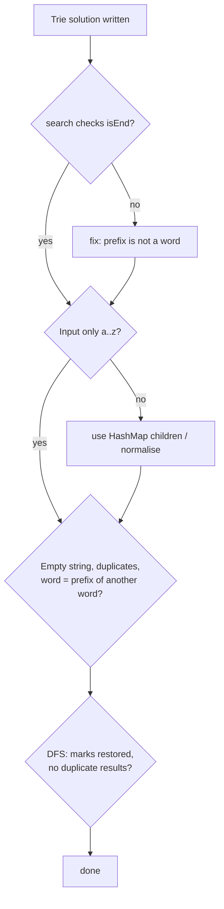

# Common Trie Edge Cases

> Read this before a trie interview and run through it at the end of every solution. Most trie bugs are here.

#### 1. What Is It?

These are the situations where trie solutions crash, return wrong results, or use too much memory. They fall into four groups:

1. **Prefix vs word** (`isEnd`),
2. **input problems** (empty strings, duplicates, case, characters outside `a..z`),
3. **structure problems** (overwriting nodes, memory, deletion),
4. **algorithm problems** (DFS state, backtracking, ordering).

#### 2. How It Works

**The checklist**

| # | Edge case | What goes wrong | Fix |
|---|---|---|---|
| 1 | Prefix is not a word (`app` when only `apple` exists) | `search` returns `true` | check `isEnd` |
| 2 | Word is also a prefix (`car` and `cart`) | inserting `car` after `cart` loses `isEnd` or creates nodes | set `isEnd` on the existing node |
| 3 | Empty string | `search("")` is `true` or `false`? | decide, and state it (usually `false`; `startsWith("")` true) |
| 4 | Duplicate words | counts double (in counter tries) | check `search` first, or use a set |
| 5 | Upper case, digits, spaces, Unicode | array index out of range | `HashMap` children, or normalise |
| 6 | `node.next[i] = TrieNode()` without a null check | overwrites an existing subtree | create only if `null` |
| 7 | Not moving to the child after creating it | the node chain stops | `node = node.next[i]!!` |
| 8 | Creating all 26 children eagerly | memory explosion | create lazily |
| 9 | Very long words | deep recursion (`StackOverflowError`) | iterative loops |
| 10 | Large dictionaries (millions of words) | memory | map children, compressed trie, or note it |
| 11 | Deleting a word | removes a prefix of another word | only unmark `isEnd`, prune only unused nodes (note 11) |
| 12 | Delete a word that does not exist | corrupts counts | check `search` first |
| 13 | DFS in a grid: cell not restored | missed words | restore after recursion |
| 14 | DFS: same word found twice | duplicates in the result | clear `node.word` or use a set |
| 15 | DFS: letter `'#'` used as an index | negative index | check the marker before indexing |
| 16 | Autocomplete order | not alphabetical with a map | iterate `a..z`, or sort |
| 17 | Wildcard `.` | exponential branching | prune with the trie, memoise if needed |
| 18 | Counting prefixes after delete | counters not decremented | decrement along the path |
| 19 | Shared static state between tests | old words remain | create a new trie per test |
| 20 | Binary trie with negative numbers | the sign bit | treat as 32-bit patterns, or handle the sign |



#### 3. Brute Force vs Optimized

| Habit | Better |
|---|---|
| `Array(26) { TrieNode() }` (all children created) | `arrayOfNulls<TrieNode>(26)`, create on demand |
| rebuilding a word while walking | store `word` in the end node |
| recursion for insert and search | simple loops |
| `substring` for every prefix | walk characters |

```kotlin
// Bad: creates 26 children per node, and each of those creates 26 more... (infinite recursion)
class BadNode { val next = Array(26) { BadNode() } }            // StackOverflowError when constructed
```

#### 4. Kotlin Code

```kotlin
class TrieNode {
    val next = arrayOfNulls<TrieNode>(26)
    var isEnd = false
}

class SafeTrie {
    private val root = TrieNode()
    private var hasEmpty = false

    private fun valid(s: String) = s.all { it in 'a'..'z' }

    // Returns false for words we cannot store
    fun insert(word: String): Boolean {
        if (!valid(word)) return false                         // upper case, digits, spaces
        if (word.isEmpty()) { hasEmpty = true; return true }   // the empty word is stored in a flag
        var node = root
        for (c in word) {
            val i = c - 'a'
            if (node.next[i] == null) node.next[i] = TrieNode()
            node = node.next[i]!!
        }
        node.isEnd = true
        return true
    }

    fun search(word: String): Boolean {
        if (!valid(word)) return false
        if (word.isEmpty()) return hasEmpty
        var node = root
        for (c in word) node = node.next[c - 'a'] ?: return false
        return node.isEnd
    }

    fun startsWith(prefix: String): Boolean {
        if (!valid(prefix)) return false
        var node = root
        for (c in prefix) node = node.next[c - 'a'] ?: return false
        return true
    }
}
```

Checks: `val t = SafeTrie()`. `t.insert("Hello")` → `false` (upper case rejected). `t.insert("cart")` → `true`. `t.search("car")` → `false`. `t.insert("car")` then `t.search("car")` → `true` and `t.search("cart")` → `true` (inserting a prefix keeps the longer word). `t.search("")` → `false`. `t.insert("")` → `true`, then `t.search("")` → `true`. `t.startsWith("")` → `true`. `t.search("c4t")` → `false`.

#### 5. Complexity

| Fix | Cost |
|---|---|
| Validation | `O(L)` per call |
| Lazy child creation | saves memory, no time cost |
| Iterative loops | `O(1)` extra space instead of `O(L)` |

#### 6. Common Mistakes

1. **Never testing a prefix that is not a word.**
2. **Never testing the empty string.**
3. **Assuming input is lowercase.**
4. **Overwriting existing children.**
5. **Eager creation of children.**
6. **Forgetting to restore the grid** in trie + DFS.
7. **Ignoring memory** when asked about a very large dictionary.

#### 7. Say This in the Interview

1. "Before finishing, I'll test: a prefix that isn't a word, a word that is a prefix of another word, the empty string, duplicates, and characters outside `a..z`."
2. "I create child nodes only when needed, so the trie doesn't blow up in size."
3. "If the alphabet is not just lowercase letters, I'd switch the children to a hash map."

#### 8. Quick Check

1. After inserting `cart`, does `search("car")` return true?
2. Why does `Array(26) { TrieNode() }` break?
3. What should `startsWith("")` return?

<details>
<summary>Answers</summary>

1. No. `car` is only a prefix.
2. Each node creates 26 children, each of which creates 26 more, forever (a stack overflow).
3. `true` (every word starts with the empty prefix), if the trie is non-empty.

</details>

#### 9. Related LeetCode Questions

| # | Question | Idea |
|---|---|---|
| 208 | [Implement Trie (Prefix Tree)](https://leetcode.com/problems/implement-trie-prefix-tree/) (Medium) | prefix vs word |
| 211 | [Design Add and Search Words Data Structure](https://leetcode.com/problems/design-add-and-search-words-data-structure/) (Medium) | wildcard branching |
| 212 | [Word Search II](https://leetcode.com/problems/word-search-ii/) (Hard) | restore state, no duplicates |
| 14 | [Longest Common Prefix](https://leetcode.com/problems/longest-common-prefix/) (Easy) | empty input |
| 720 | [Longest Word in Dictionary](https://leetcode.com/problems/longest-word-in-dictionary/) (Medium) | word = prefix cases |
