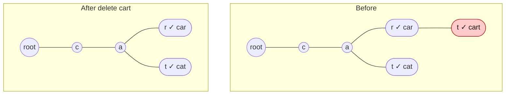

# Delete Word from Trie

> Deleting is the hardest trie operation. The rule: **unmark the word, then remove only the nodes that no other word needs.**

#### 1. What Is It?

**Delete** removes a word from the trie. Two things can be true after unmarking `isEnd`:

| Case | Example (trie has `car`, `cart`, `cat`) | What to do |
|---|---|---|
| **Word is a prefix of another word** | delete `car` (`cart` still needs `c → a → r`) | only set `isEnd = false` |
| **Word has a unique tail** | delete `cart` (the `t` under `r` is used only by `cart`) | unmark, then **remove nodes** going back up while they have no children and are not word ends |
| **Word does not exist** | delete `cow` | do nothing |

**Signals:** "remove a word from the dictionary", "Implement Trie II (erase)", "delete".

Many interview solutions only **unmark** `isEnd` (a **lazy** delete). That is correct for `search`, but leaves unused nodes (wasted memory). Pruning is the better answer.

#### 2. How It Works

Delete `cart` from `car`, `cart`, `cat`:



**Recursive method.** Go down to the last node. On the way back up, each call tells its parent "you can remove me" if the node has **no children** and is **not the end of another word**.

```text
remove(node, depth):
    if depth == word.length:
        node.isEnd = false
        return node has no children          // true → the parent may delete this node
    child = node.next[word[depth]]
    if remove(child, depth + 1):  node.next[word[depth]] = null
    return (not node.isEnd) and node has no children
```

```text
delete "cart":  remove goes c → a → r → t
   at t:  isEnd = false, t has no children → return true
   at r:  remove t. r.isEnd is true (car) → return false   (keep r)
   at a, c: nothing to remove
delete "car" (when cart exists):  at r: isEnd = false, r has child t → return false. Nothing is removed.
```

Always check that the word exists first (`search(word)`), or you may remove nodes that belong to nothing.

**Alternative:** keep a `pass` counter on each node (how many words go through it). On delete, decrement along the path and remove a node when its counter reaches 0. (This is how *Implement Trie II* works, note 14.)

#### 3. Brute Force vs Optimized

| Approach | Time | Space |
|---|---|---|
| Lazy: only unmark `isEnd` | `O(L)` | nodes stay (wasted memory) |
| Prune with the recursive method | `O(L)` | frees unused nodes |
| Rebuild the whole trie without the word | `O(total characters)` | |

```kotlin
// Rebuild: simplest idea, but O(total characters) per delete
fun deleteByRebuild(words: MutableSet<String>, word: String): Trie {
    words.remove(word)
    val t = Trie()
    for (w in words) t.insert(w)
    return t
}
```

#### 4. Kotlin Code

```kotlin
class TrieNode {
    val next = arrayOfNulls<TrieNode>(26)
    var isEnd = false
    fun hasChildren(): Boolean = next.any { it != null }
}

class Trie {
    private val root = TrieNode()

    fun insert(word: String) {
        var node = root
        for (c in word) {
            if (node.next[c - 'a'] == null) node.next[c - 'a'] = TrieNode()
            node = node.next[c - 'a']!!
        }
        node.isEnd = true
    }

    private fun find(s: String): TrieNode? {
        var node = root
        for (c in s) node = node.next[c - 'a'] ?: return null
        return node
    }

    fun search(word: String): Boolean = find(word)?.isEnd == true
    fun startsWith(prefix: String): Boolean = find(prefix) != null

    // Delete a word and prune the nodes that nothing else needs. Returns false if the word is not there.
    fun delete(word: String): Boolean {
        if (!search(word)) return false

        fun remove(node: TrieNode, depth: Int): Boolean {         // true = the caller may drop this node
            if (depth == word.length) {
                node.isEnd = false
                return !node.hasChildren()
            }
            val i = word[depth] - 'a'
            val child = node.next[i]!!
            if (remove(child, depth + 1)) node.next[i] = null
            return !node.isEnd && !node.hasChildren()
        }

        remove(root, 0)
        return true
    }
}
```

Checks (insert `car`, `cart`, `cat`): `delete("cow")` → `false`. `delete("cart")` → `true`; then `search("cart")` → `false`, `startsWith("cart")` → `false` (the node was removed), `search("car")` → `true`, `search("cat")` → `true`. Starting fresh with the same words, `delete("car")` → `true`; then `search("car")` → `false`, `search("cart")` → `true`, `startsWith("car")` → `true` (nothing removed, only `isEnd` changed). After deleting all three words, `startsWith("c")` → `false` (every node was pruned). `deleteByRebuild(mutableSetOf("car", "cart"), "cart")` → a trie where `search("cart")` is `false`.

#### 5. Complexity

| | Time | Space |
|---|---|---|
| `delete` | `O(L)` | `O(L)` recursion |
| `hasChildren` | `O(26)` | `O(1)` |
| Rebuild | `O(total chars)` | |

#### 6. Common Mistakes

1. **Removing a node that another word still uses** (`cart` deleted removes `r`, breaking `car`).
2. **Not checking that the word exists.**
3. **Removing the whole branch** instead of only unused nodes.
4. **Forgetting to unmark `isEnd`** when the word is a prefix of another word.
5. **Pruning the root** (it must always stay).
6. **Using `node.next.isEmpty()`** on a fixed array (it is never empty). Use `any { it != null }`.

#### 7. Say This in the Interview

1. "Deleting has two parts: unmark `isEnd`, then remove nodes on the way back up while they have no children and aren't the end of another word."
2. "If the word is a prefix of another word, I only unmark it and remove nothing."
3. "A simpler alternative is lazy deletion: only unmark `isEnd`. Search stays correct, but the unused nodes waste memory."

#### 8. Quick Check

1. What changes when you delete `car` while `cart` is stored?
2. What changes when you delete `cart` while `car` is stored?
3. Why check `search(word)` first?

<details>
<summary>Answers</summary>

1. Only `isEnd` on the `r` node becomes `false`.
2. The `t` node is removed. `r` stays because `car` still ends there.
3. Deleting a word that is not stored could remove nodes that other words need.

</details>

#### 9. Related LeetCode Questions

| # | Question | Idea |
|---|---|---|
| 1804 | [Implement Trie II (Prefix Tree)](https://leetcode.com/problems/implement-trie-ii-prefix-tree/) (Medium, premium) | `erase` with counters |
| 208 | [Implement Trie (Prefix Tree)](https://leetcode.com/problems/implement-trie-prefix-tree/) (Medium) | the base |
| 1233 | [Remove Sub-Folders from the Filesystem](https://leetcode.com/problems/remove-sub-folders-from-the-filesystem/) (Medium) | prune by prefix |
| 212 | [Word Search II](https://leetcode.com/problems/word-search-ii/) (Hard) | prune found words from the trie |
| 648 | [Replace Words](https://leetcode.com/problems/replace-words/) (Medium) | uses the trie |
