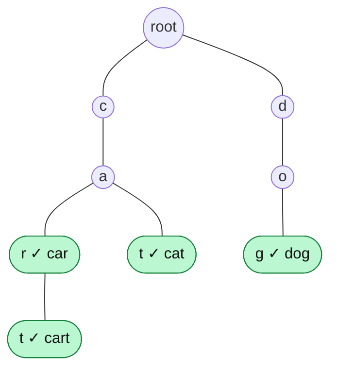
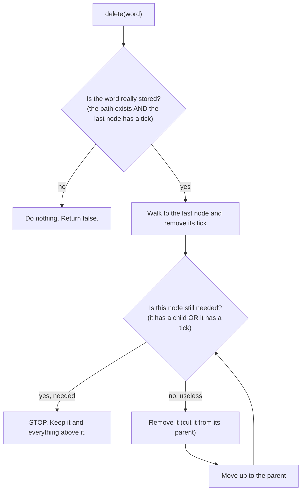
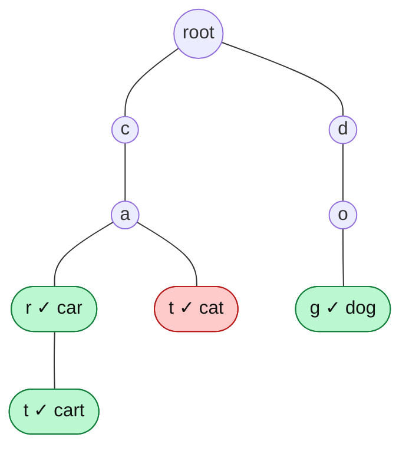
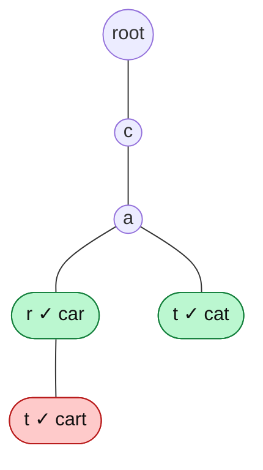
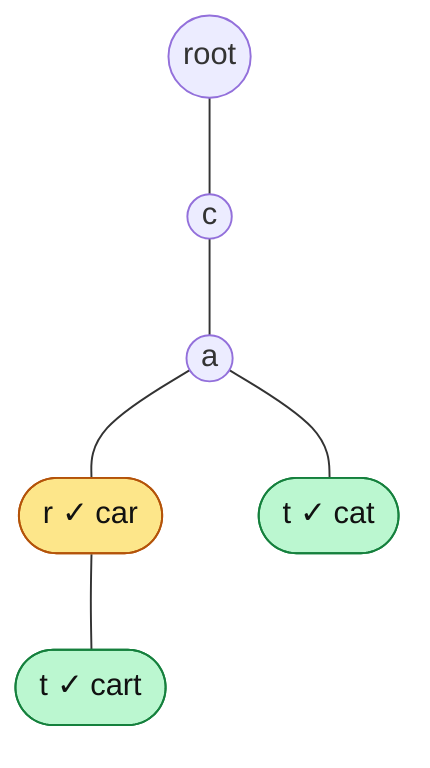
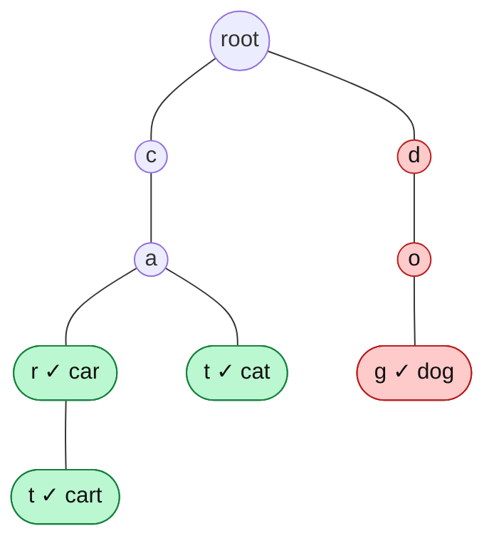
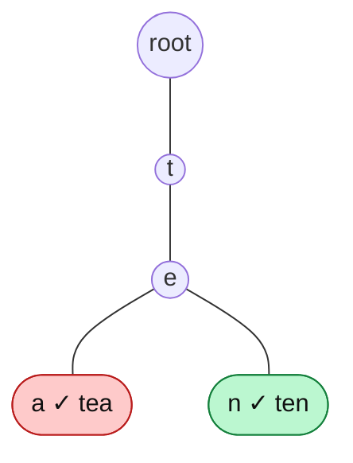

# Delete Word from Trie

> Deleting is the hardest trie operation, but it is only two steps: **(1) un-tick the word, then (2) clean up from the bottom, removing only the nodes that no other word needs.** Stop at the first node that is still needed.

#### 1. What Is It?

**Delete** removes one word from the trie.

**A simple way to picture it.** A trie is a road map. Every word is a **route** that starts at the root. Roads are **shared**: `car`, `cart` and `cat` all drive along the same `c → a` road before they split. A tick `✓` marks the place where a word ends (its destination).

```text
Deleting a word means:
  1. Remove the ✓ (the word is no longer a destination).
  2. Remove the road pieces that ONLY this word used, starting at the end and walking backwards.
     Stop at the first piece that another word still needs.
```

Why not just remove the whole route? Because other words may be using part of it. If you remove `c → a → r → t` to delete `cart`, you also destroy `car` and `cat`.

**Which node is "still needed"?** After walking back one step, ask two questions about the node:

| Question | If yes |
|---|---|
| Does it still have a **child**? (another word continues through it) | keep it |
| Does it have a **✓**? (another word ends here) | keep it |

If both answers are **no**, the node is useless and can be removed. If either is **yes**, stop: this node and everything above it stay.

**The situations you will meet** (we use the same trie for all of them):

| # | Situation | Example (trie has `car`, `cart`, `cat`, `dog`) | What happens |
|---|---|---|---|
| 1 | Word is **not stored** | `cow`, or `ca` (only a path, not a word) | nothing, return `false` |
| 2 | Word ends at a **leaf** that only it uses | `cat` | remove `t`, stop at `a` |
| 3 | Word is a **longer** word of a stored word | `cart` (`car` is also stored) | remove `t`, stop at `r` |
| 4 | Word is a **prefix** of another word | `car` (`cart` continues) | only remove the `✓`, nothing else |
| 5 | The **whole branch** belongs to this word | `dog` | remove `g`, `o`, `d` |
| 6 | Branch point in the middle | `tea` when `ten` is stored | remove `a`, stop at `e` |
| 7 | It is the **last word** | delete everything | trie becomes empty |
| 8 | Delete the **same word twice** | `cat`, `cat` | second one returns `false` |

**Signals in an interview:** "remove a word from the dictionary", "Implement Trie II (erase)", "delete", "unsubscribe a keyword".

Many solutions only **un-tick** the word (a **lazy** delete). That keeps `search` correct, but the unused nodes stay and waste memory. Cleaning them up (**pruning**) is the better answer.

#### 2. How It Works

**The trie we will use for every example:** the words `car`, `cart`, `cat`, `dog`.



It has **8 nodes** (not counting the root). We will watch this number: pruning should make it smaller.

**The decision flow** (read it top to bottom; it is the whole algorithm):



In the diagrams below, **red** means the node is **removed**, **amber** means only its tick is removed (the node stays), and **green** is an untouched word end.

---

**Case 1: the word is not stored (`cow`, `ca`).** Check first. Do nothing.

| Word | Why it is not stored | Result |
|---|---|---|
| `cow` | the path breaks: `c` exists, but `c` has no child `o` | `false`, trie unchanged |
| `ca` | the path exists (`c → a`), but `a` has **no tick**, so `ca` was never inserted as a word | `false`, trie unchanged |
| `cartoon` | longer than anything stored: the path breaks after `cart` | `false`, trie unchanged |

Note that `startsWith("ca")` is `true` while `delete("ca")` is `false`. A **prefix** and a **word** are different things.

---

**Case 2: delete `cat` (a leaf only it uses).**



| Step | Node | After un-ticking: has a child? has a tick? | Action |
|---|---|---|---|
| 1 | `t` (of `cat`) | no child, no tick | **remove** it |
| 2 | `a` | has child `r` (and `t`) | **STOP**, keep |

Result: **7 nodes**. `car` and `cart` are untouched.

---

**Case 3: delete `cart` (`car` is also stored).**



| Step | Node | Has a child? Has a tick? | Action |
|---|---|---|---|
| 1 | `t` (of `cart`) | no child, no tick | **remove** it |
| 2 | `r` | **has a tick** (it is the end of `car`) | **STOP**, keep |

Result: **7 nodes**. `search("cart")` is `false` and `startsWith("cart")` is also `false` (the node is gone). `car` still works.

---

**Case 4: delete `car` (it is a prefix of `cart`).** Only the tick goes.



| Step | Node | Has a child? Has a tick? | Action |
|---|---|---|---|
| 1 | `r` (end of `car`) | **has a child** `t` (the path to `cart`) | **STOP**, keep (only the tick was removed) |

Result: still **8 nodes**. `search("car")` → `false`, but `search("cart")` → `true` and `startsWith("car")` → `true`. This is the case that people forget.

---

**Case 5: delete `dog` (the whole branch is only for it).** The cleanup keeps going up.



| Step | Node | Has a child? Has a tick? | Action |
|---|---|---|---|
| 1 | `g` | no, no | **remove** |
| 2 | `o` | no (its only child `g` is gone), no tick | **remove** |
| 3 | `d` | no, no | **remove** |
| 4 | root | we never remove the root | stop |

Result: **5 nodes**. This shows the idea of "keep climbing while the node is useless".

---

**Case 6: delete `tea` when `ten` is stored (a branch point).** A different small trie: `tea`, `ten`.



| Step | Node | Has a child? Has a tick? | Action |
|---|---|---|---|
| 1 | `a` | no, no | **remove** |
| 2 | `e` | has child `n` | **STOP**, keep |

Result: 4 nodes become **3**. `ten` still works. The cleanup stops at the **branch point** `e`, where two words split.

---

**Case 7: the last word.** If you delete `car`, `cart`, `cat` and `dog` one by one, every node ends up removed. Only the root is left: **0 nodes**, and `startsWith("c")` is `false`.

**Case 8: delete the same word twice.** The first call returns `true`. The second finds that the word is no longer stored, so it returns `false` and changes nothing. That is also why the "is it stored?" check comes first.

---

**The algorithm in plain steps (with comments).**

```text
delete(word):
    if the word is not stored:            // path missing, or the last node has no tick
        return false                      // Case 1 and Case 8

    // 1. Walk down. Remember every node on the way (the "path").
    path = [root, node after 1st letter, node after 2nd letter, ..., last node]

    // 2. Un-tick the word.
    last node.isEnd = false               // Case 4 ends here if the node still has children

    // 3. Climb back up, from the last node to the first letter's node.
    for each node on the path, from the end going back:
        if node has a child OR node.isEnd:     // still needed
            stop                               // Cases 2, 3, 4, 6 stop here
        else:
            cut this node from its parent      // Case 5 keeps going

    return true
```

**An alternative way to write it (recursion).** Each call answers one question for its parent: *"May you remove me?"* A node says **yes** only if it has no tick and no children. The call at the bottom un-ticks the word and answers; each call above removes the child if the child said yes. The result is the same as the loop above.

**Another alternative (counters).** If your trie stores **counts** (how many copies of a word, and a `pass` count for each node), delete just subtracts `1` along the path and removes a node when its `pass` reaches `0`. This is how *Implement Trie II* works (note 14).

#### 3. Brute Force vs Optimized

| Approach | Time | What it leaves behind |
|---|---|---|
| **Lazy:** only remove the tick | `O(L)` | unused nodes stay (wasted memory, and `startsWith` still says `true`) |
| **Rebuild** the whole trie without the word | `O(total characters)` | a perfectly clean trie, but very slow |
| **Prune** (the algorithm above) | `O(L)` | nothing: only needed nodes remain |

```kotlin
// Lazy delete: the simplest version. search() is correct, but nodes stay in memory.
fun deleteLazy(word: String) {
    val node = find(word) ?: return          // path missing: nothing to do
    node.isEnd = false                       // just remove the tick
}

// Rebuild: the clean-up is automatic, but every delete costs O(total characters)
fun deleteByRebuild(words: MutableSet<String>, word: String): Trie {
    words.remove(word)                       // forget the word
    val t = Trie()
    for (w in words) t.insert(w)             // build a fresh trie from the remaining words
    return t
}
```

**Why lazy delete is not always enough.** After a lazy delete of `cart`, `search("cart")` is `false`, but `startsWith("cart")` is still `true` and the trie still has **8 nodes**. An autocomplete feature would walk into the dead branch for nothing. With pruning, `startsWith("cart")` is `false` and the trie has **7 nodes**.

**When lazy is fine:** words are rarely deleted, memory is not a concern, or you will rebuild the trie anyway (for example every night).

#### 4. Kotlin Code

*Checks come from running the same logic in Java on JDK 21. The Kotlin versions were not compiled.*

```kotlin
class TrieNode {
    val next = arrayOfNulls<TrieNode>(26)        // one slot per letter a-z (null = no such child)
    var isEnd = false                            // the tick: does a word end here?
    fun hasChildren(): Boolean = next.any { it != null }   // careful: the array is never "empty", so test for non-null
}

class Trie {
    private val root = TrieNode()

    fun insert(word: String) {
        var node = root
        for (c in word) {
            if (node.next[c - 'a'] == null) node.next[c - 'a'] = TrieNode()   // create the road piece if it is missing
            node = node.next[c - 'a']!!
        }
        node.isEnd = true                        // put the tick on the last node
    }

    // Walk the letters of s. Returns the last node, or null if the path breaks.
    private fun find(s: String): TrieNode? {
        var node = root
        for (c in s) node = node.next[c - 'a'] ?: return null
        return node
    }

    fun search(word: String): Boolean = find(word)?.isEnd == true   // path exists AND it has a tick
    fun startsWith(prefix: String): Boolean = find(prefix) != null  // path exists

    // ---------- DELETE (loop version: the easiest to follow) ----------
    // Returns true if the word was stored and is now removed, false if it was not stored.
    fun delete(word: String): Boolean {
        if (!search(word)) return false          // Case 1 and 8: not stored, do nothing

        // 1. Walk down and remember every node. path[i] is the node after the first i letters.
        val path = ArrayList<TrieNode>()
        var node = root
        path.add(node)                           // path[0] = root
        for (c in word) {
            node = node.next[c - 'a']!!          // safe: search() proved the path exists
            path.add(node)
        }

        // 2. Remove the tick. If the word was a prefix of another word (Case 4), this is all that happens.
        node.isEnd = false

        // 3. Climb back up. i = word.length is the last node, i = 1 is the node after the first letter.
        for (i in word.length downTo 1) {
            val cur = path[i]
            if (cur.isEnd || cur.hasChildren()) break          // still needed by another word: STOP
            path[i - 1].next[word[i - 1] - 'a'] = null         // useless: cut it from its parent
        }
        return true                              // (the root, path[0], is never removed)
    }

    // ---------- DELETE (recursive version: same result) ----------
    fun deleteRecursive(word: String): Boolean {
        if (!search(word)) return false

        // Returns true when the caller may remove this node ("I have no tick and no children").
        fun remove(node: TrieNode, depth: Int): Boolean {
            if (depth == word.length) {          // we reached the last node of the word
                node.isEnd = false               // remove the tick
                return !node.hasChildren()       // useless only if nothing continues below it
            }
            val i = word[depth] - 'a'
            val child = node.next[i]!!
            if (remove(child, depth + 1)) node.next[i] = null  // the child said "remove me": cut it
            return !node.isEnd && !node.hasChildren()          // can MY parent remove me?
        }

        remove(root, 0)
        return true
    }

    // Helper for the demos: how many nodes does the trie have (not counting the root)?
    fun nodeCount(): Int = countFrom(root) - 1
    private fun countFrom(n: TrieNode): Int = 1 + n.next.sumOf { if (it == null) 0 else countFrom(it) }
}
```

**Checks.** Build the trie with `car`, `cart`, `cat`, `dog` (8 nodes), and take a fresh copy for each line:

| Call | Returns | Nodes after | What you can check |
|---|---|---|---|
| `delete("cow")` | `false` | 8 | nothing changed |
| `delete("ca")` | `false` | 8 | `startsWith("ca")` is still `true` (a prefix is not a word) |
| `delete("cat")` | `true` | 7 | `search("cat")` → `false`; `search("car")` and `search("cart")` → `true`; `startsWith("ca")` → `true` |
| `delete("cart")` | `true` | 7 | `search("cart")` → `false`; `startsWith("cart")` → `false`; `search("car")` and `search("cat")` → `true` |
| `delete("car")` | `true` | **8** | `search("car")` → `false`; `search("cart")` → `true`; `startsWith("car")` → `true` (only the tick was removed) |
| `delete("dog")` | `true` | 5 | `search("dog")` → `false`; `startsWith("d")` → `false`; `search("car")` → `true` |
| `delete("cat")` twice | `true`, then `false` | 7 | the second call changes nothing |
| delete all four words | all `true` | 0 | `startsWith("c")` and `startsWith("d")` → `false` |
| `delete("")` | `false` | 8 | the empty string is not stored (`search("")` → `false`) |

With the trie `tea`, `ten` (4 nodes): `delete("tea")` → 3 nodes; `search("tea")` → `false`, `search("ten")` → `true`, `startsWith("te")` → `true`.

Lazy vs pruned, deleting `cart`: lazy → 8 nodes and `startsWith("cart")` → `true`; pruned → 7 nodes and `startsWith("cart")` → `false`. `deleteRecursive` gives the same node counts as `delete` for `cart` (7), `car` (8) and `dog` (5).

**Stress test.** Both versions were run against a plain set of words for 90,000 random inserts and deletes (3 letters, words of length 1 to 4). There were **0 mismatches** in what `delete` returned and in `search`. After every step the trie also had **exactly as many nodes as there are distinct non-empty prefixes of the remaining words**, which proves no node was removed too early and none was left behind.

#### 5. Complexity

`L` is the length of the word. The alphabet size (26) is a constant.

| | Time | Space |
|---|---|---|
| `delete` (loop) | `O(L)`: check the word, walk down, climb up | `O(L)` for the `path` list |
| `deleteRecursive` | `O(L)` | `O(L)` for the recursion |
| `hasChildren` | `O(26)` = `O(1)` | `O(1)` |
| Lazy delete | `O(L)` | `O(1)` extra, but the unused nodes stay |
| Rebuild | `O(total characters)` | `O(total characters)` |

#### 6. Common Mistakes & Edge Cases

1. **Removing a node that another word still uses.** Deleting `cart` must keep `r` because `car` ends there. This is why we check the tick.
2. **Removing the whole route** (`c → a → r → t`) instead of only the unused tail.
3. **Forgetting to remove the tick** when the word is a prefix of another word (`car` with `cart` stored). The word would still be found.
4. **Not checking that the word exists.** Walking a missing path crashes (`null`), and deleting a path that is not a word (`ca`) must return `false`, not `true`.
5. **Removing the root.** The root must always stay.
6. **Checking `next.isEmpty()` on a fixed array.** The array always has 26 slots, so it is never empty. Test for non-`null` children (`any { it != null }`).
7. **Stopping too early or too late while climbing.** Stop at the first node that has a child or a tick. Do not stop just because the node is not a leaf of the original word.
8. **Confusing `search` and `startsWith`.** After a lazy delete they give different answers for the same word.
9. **Duplicates.** If the same word can be inserted twice, a plain `isEnd` is not enough. Use a counter (note 14), subtract `1` on delete, and remove nodes only when the counts reach `0`.

Edge cases: delete a word that is longer than any stored word; delete the only word; delete in a trie of `a`-`z` when the word has other characters; deleting a word of one letter (`i` goes from `1` down to `1` in the climbing loop); the empty string (we return `false` because it is never inserted; if you allow it, it ticks the root and the root is still never removed).

#### 7. Say This in the Interview

1. "Deleting has two steps: first remove the word's tick, then climb back up and remove only the nodes that no other word needs."
2. "A node is still needed if it has a child, because another word goes through it, or if it has a tick, because another word ends there. I stop at the first node like that."
3. "If the word is a prefix of another word, like `car` with `cart`, I only remove the tick and delete no node."
4. "I check that the word really exists first. A prefix like `ca` is not a word, and a missing path would crash."
5. "A lazy delete, only removing the tick, is simpler and keeps `search` correct, but it leaves dead nodes, so `startsWith` and autocomplete still see them. Pruning costs the same `O(L)`."
6. "The time is `O(L)`. I need extra space `O(L)` for the path, or for the recursion."

#### 8. Quick Check

Use the trie with `car`, `cart`, `cat`, `dog` (8 nodes).

1. What changes when you delete `car`?
2. What changes when you delete `cart`?
3. What changes when you delete `dog`? How many nodes are removed?
4. What does `delete("ca")` return, and why?
5. After a **lazy** delete of `cart`, what does `startsWith("cart")` return?
6. In the trie `tea`, `ten`, why does the cleanup stop at `e` when you delete `tea`?

<details>
<summary>Answers</summary>

1. Only the tick on `r` is removed. `r` still has the child `t` (for `cart`), so no node is removed (still 8 nodes).
2. The `t` after `r` is removed (7 nodes). `r` stays because it has a tick (it ends `car`).
3. `g`, `o` and `d` are all removed (3 nodes, leaving 5), because none of them is needed by another word.
4. `false`. `ca` is only a path (a prefix), not a stored word, so there is nothing to delete.
5. `true`. The nodes are still there, only the tick is gone. A pruned delete would return `false`.
6. `e` still has the child `n` (for `ten`), so it is still needed.

</details>

#### 9. Related LeetCode Questions

| # | Question | Idea |
|---|---|---|
| 208 | [Implement Trie (Prefix Tree)](https://leetcode.com/problems/implement-trie-prefix-tree/) (Medium) | the base: insert, search, startsWith |
| 1804 | [Implement Trie II (Prefix Tree)](https://leetcode.com/problems/implement-trie-ii-prefix-tree/) (Medium, premium) | `erase` with counters |
| 1233 | [Remove Sub-Folders from the Filesystem](https://leetcode.com/problems/remove-sub-folders-from-the-filesystem/) (Medium) | prune by prefix |
| 212 | [Word Search II](https://leetcode.com/problems/word-search-ii/) (Hard) | prune found words from the trie |
| 648 | [Replace Words](https://leetcode.com/problems/replace-words/) (Medium) | uses the trie |

**Remember:** un-tick first · climb back up · remove a node only if it has **no child and no tick** · stop at the first node still needed · never remove the root · a prefix is not a word.
