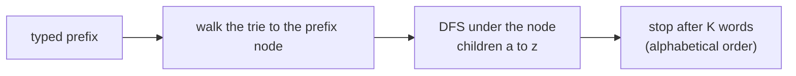

# Autocomplete / Prefix Suggestions

> Walk the prefix, then use DFS under that node to list the words. Visiting children in `a..z` order gives the suggestions **in alphabetical order**.

#### 1. What Is It?

**Autocomplete** returns words that start with what the user has typed. Typical rules: **at most 3** suggestions, in **alphabetical order**, recomputed after **each letter**.

| Step | Cost |
|---|---|
| 1. Walk the typed prefix to its node | `O(L)` |
| 2. DFS below that node, collect up to `K` words | `O(K · length)` if you stop at `K` |

**Signals:** "autocomplete", "suggestions", "search as you type", "products that start with".

#### 2. How It Works

*Search Suggestions System (LeetCode 1268).* Products: `mobile`, `mouse`, `moneypot`, `monitor`, `mousepad`. Search word: `mouse`. After each typed letter, return up to 3 products with that prefix, in order.

```text
typed "m":     mobile, moneypot, monitor, mouse, mousepad  → first 3: mobile, moneypot, monitor
typed "mo":    same list                                    → mobile, moneypot, monitor
typed "mou":   mouse, mousepad                              → mouse, mousepad
typed "mous":  mouse, mousepad
typed "mouse": mouse, mousepad
```



**DFS under the prefix node.** Because children are visited `a → z`, words come out in sorted order. If the current node is a word end, add it **before** going deeper (a shorter word sorts before its longer extensions).

```text
collect(node, path):
    if results has K words: return
    if node.isEnd: add path
    for letter a..z:
        if node has that child: collect(child, path + letter)
```

**Alternatives for 1268**

| Method | Time | Note |
|---|---|---|
| Trie + DFS (each prefix) | `O(total chars + L · K)` | the trie answer |
| Sort + binary search | `O(n log n · L)` | sort products, binary search the first match for each prefix, take 3 |
| Store the top 3 at each node while inserting | `O(total chars)` build, `O(L)` per query | uses more memory |

#### 3. Brute Force vs Optimized

| Approach | Time per typed letter |
|---|---|
| Scan all products with `startsWith`, sort, take 3 | `O(n · L + n log n)` |
| **Trie + DFS limited to `K`** | `O(L + K · length)` |
| Sorted array + binary search | `O(L log n + K)` |

```kotlin
// Brute force: filter and sort for every prefix
fun suggestedProductsBrute(products: Array<String>, searchWord: String): List<List<String>> =
    (1..searchWord.length).map { len ->
        val prefix = searchWord.substring(0, len)
        products.filter { it.startsWith(prefix) }.sorted().take(3)
    }
```

#### 4. Kotlin Code

```kotlin
class TrieNode {
    val next = arrayOfNulls<TrieNode>(26)
    var isEnd = false
}

class AutoComplete {
    private val root = TrieNode()

    fun insert(word: String) {
        var node = root
        for (c in word) {
            if (node.next[c - 'a'] == null) node.next[c - 'a'] = TrieNode()
            node = node.next[c - 'a']!!
        }
        node.isEnd = true
    }

    // Up to `limit` words that start with `prefix`, in alphabetical order
    fun suggest(prefix: String, limit: Int): List<String> {
        var node = root
        for (c in prefix) node = node.next[c - 'a'] ?: return emptyList()
        val result = mutableListOf<String>()
        val path = StringBuilder(prefix)

        fun dfs(cur: TrieNode) {
            if (result.size == limit) return
            if (cur.isEnd) result.add(path.toString())
            for (i in 0 until 26) {
                val child = cur.next[i] ?: continue
                path.append('a' + i)
                dfs(child)
                path.deleteCharAt(path.length - 1)
                if (result.size == limit) return
            }
        }
        dfs(node)
        return result
    }
}

// Search Suggestions System (LeetCode 1268)
fun suggestedProducts(products: Array<String>, searchWord: String): List<List<String>> {
    val ac = AutoComplete()
    for (p in products) ac.insert(p)
    return (1..searchWord.length).map { ac.suggest(searchWord.substring(0, it), 3) }
}
```

Checks: `suggestedProducts(arrayOf("mobile", "mouse", "moneypot", "monitor", "mousepad"), "mouse")` → `[["mobile","moneypot","monitor"], ["mobile","moneypot","monitor"], ["mouse","mousepad"], ["mouse","mousepad"], ["mouse","mousepad"]]`. `suggestedProducts(arrayOf("havana"), "havana")` → six lists, each `["havana"]`. `suggestedProducts(arrayOf("bags", "baggage", "banner", "box", "cloths"), "bags")` → `[["baggage","bags","banner"], ["baggage","bags","banner"], ["baggage","bags"], ["bags"]]`. `AutoComplete().suggest("x", 3)` → `[]`. `suggestedProductsBrute(...)` gives the same lists.

Order check for `"bag"`: the words are `baggage` and `bags`. After `bag`, `g` comes before `s`, so `baggage` precedes `bags`.

#### 5. Complexity

| | Time | Space |
|---|---|---|
| Build the trie | `O(total characters)` | `O(total characters)` |
| `suggest` | `O(L + K · maxLength)` | `O(maxLength)` stack |
| All `L` typed prefixes | `O(L · K · maxLength)` | |
| Sort + binary search | `O(n log n · L)` build, `O(L log n)` queries | `O(1)` extra |

#### 6. Common Mistakes

1. **Collecting all matches** before taking `K` (slow for common prefixes). Stop at `K`.
2. **Wrong order:** visiting children in a different order from `a..z`, or adding a word **after** its children.
3. **Forgetting that the prefix node itself may be a word** (`mouse` when typing `mouse`).
4. **Not returning an empty list** when the prefix is missing.
5. **Rebuilding the path** with string concatenation in every DFS call (slow).
6. **Using a `HashMap`** for children and then getting unsorted suggestions.

#### 7. Say This in the Interview

1. "I insert all products into a trie. For each typed prefix I walk to its node and run a DFS that visits children in `a..z` order, so the results are alphabetical, and I stop after three."
2. "Walking the prefix is `O(L)`. The DFS cost depends on how many words I need, not on how many products exist."
3. "An alternative is to sort the products and binary-search the start of each prefix, which uses no extra memory."

#### 8. Quick Check

1. Which child order gives alphabetical suggestions?
2. If `car` and `cart` both match, which comes first?
3. What do you return for a prefix that is not in the trie?

<details>
<summary>Answers</summary>

1. `a` to `z`.
2. `car` (a word end is added before its children are visited).
3. An empty list.

</details>

#### 9. Related LeetCode Questions

| # | Question | Idea |
|---|---|---|
| 1268 | [Search Suggestions System](https://leetcode.com/problems/search-suggestions-system/) (Medium) | trie + DFS or sort + binary search |
| 642 | [Design Search Autocomplete System](https://leetcode.com/problems/design-search-autocomplete-system/) (Hard, premium) | counts + top 3 |
| 208 | [Implement Trie (Prefix Tree)](https://leetcode.com/problems/implement-trie-prefix-tree/) (Medium) | the base |
| 14 | [Longest Common Prefix](https://leetcode.com/problems/longest-common-prefix/) (Easy) | trie walk |
| 692 | [Top K Frequent Words](https://leetcode.com/problems/top-k-frequent-words/) (Medium) | top words by count |
