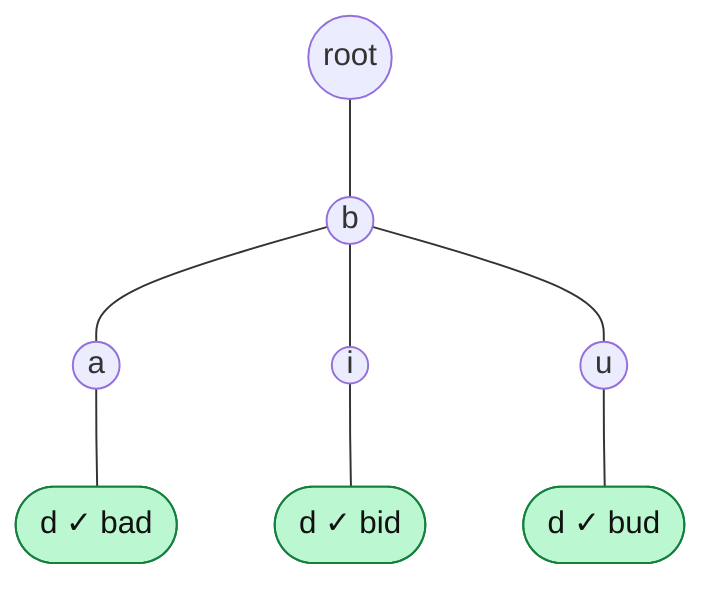

# Wildcard Search

> A `.` in the pattern means "any one letter". The trie walks **every** child at a wildcard, so the search becomes a DFS.

#### 1. What Is It?

**Wildcard search** looks up a pattern where `.` matches **any single letter**.

| Question | Rule |
|---|---|
| **Design Add and Search Words** (211) | `search("b.d")` matches `bad`, `bid`, `bud`. `.` matches exactly one letter |
| **Implement Magic Dictionary** (676) | `search(word)`: can you change **exactly one** letter to get a stored word? |

**Signals:** "dot matches any letter", "pattern", "exactly one letter different", "word with a wildcard".

#### 2. How It Works

**Normal letter:** follow the one matching child. **Wildcard `.`:** try **every** child, and succeed if **any** path succeeds.



```text
search "b.d":
  'b'   → follow child b
  '.'   → try children a, i, u
            a → 'd' → exists and isEnd → TRUE (stop)
search ".ad":  '.' tries every child of the root; only the branch b → a → d works
search "b..d": needs 4 letters; no stored word has 4 letters → FALSE
```

```text
dfs(node, i):
    if i == word.length: return node.isEnd
    if word[i] == '.':
        for each existing child: if dfs(child, i + 1): return true
        return false
    child = node.next[word[i]]  or return false
    return dfs(child, i + 1)
```

**Cost.** Without wildcards it is `O(L)`. Each `.` can branch up to 26 ways, so the worst case is `O(26^L)` (for a pattern of all dots). In practice the trie prunes branches that do not exist, so it is bounded by the number of nodes: `O(total characters)`.

**Magic Dictionary (exactly one change).** DFS with a flag `changed`. At each letter:

- if the child matches, continue with the same flag;
- if a **different** child exists and `changed == false`, take it and set `changed = true`.

At the end, succeed only if `changed` is `true` and the node is a word end.

#### 3. Brute Force vs Optimized

| Approach | Time per search |
|---|---|
| Store words in a list, compare each with the pattern | `O(n · L)` |
| Group words by length, compare only the same length | `O(n_L · L)` |
| **Trie + DFS** | `O(L)` for letters, branching only at `.` |

```kotlin
// Brute force: compare the pattern with every stored word
fun matches(pattern: String, word: String): Boolean =
    pattern.length == word.length && pattern.indices.all { pattern[it] == '.' || pattern[it] == word[it] }

fun searchBrute(words: List<String>, pattern: String): Boolean = words.any { matches(pattern, it) }
```

#### 4. Kotlin Code

```kotlin
class TrieNode {
    val next = arrayOfNulls<TrieNode>(26)
    var isEnd = false
}

// Design Add and Search Words Data Structure (LeetCode 211)
class WordDictionary {
    private val root = TrieNode()

    fun addWord(word: String) {
        var node = root
        for (c in word) {
            if (node.next[c - 'a'] == null) node.next[c - 'a'] = TrieNode()
            node = node.next[c - 'a']!!
        }
        node.isEnd = true
    }

    fun search(word: String): Boolean = dfs(root, word, 0)

    private fun dfs(node: TrieNode, word: String, i: Int): Boolean {
        if (i == word.length) return node.isEnd
        val c = word[i]
        if (c == '.') {
            for (child in node.next) {
                if (child != null && dfs(child, word, i + 1)) return true
            }
            return false
        }
        val child = node.next[c - 'a'] ?: return false
        return dfs(child, word, i + 1)
    }
}

// Implement Magic Dictionary (LeetCode 676): exactly one letter must be changed
class MagicDictionary {
    private val root = TrieNode()

    fun buildDict(dictionary: Array<String>) {
        for (w in dictionary) {
            var node = root
            for (c in w) {
                if (node.next[c - 'a'] == null) node.next[c - 'a'] = TrieNode()
                node = node.next[c - 'a']!!
            }
            node.isEnd = true
        }
    }

    fun search(searchWord: String): Boolean = dfs(root, searchWord, 0, false)

    private fun dfs(node: TrieNode, word: String, i: Int, changed: Boolean): Boolean {
        if (i == word.length) return changed && node.isEnd
        val want = word[i] - 'a'
        for (letter in 0 until 26) {
            val child = node.next[letter] ?: continue
            if (letter == want) {
                if (dfs(child, word, i + 1, changed)) return true
            } else if (!changed) {
                if (dfs(child, word, i + 1, true)) return true        // use the one allowed change here
            }
        }
        return false
    }
}
```

Checks (`WordDictionary`): `addWord("bad")`, `addWord("dad")`, `addWord("mad")`. `search("pad")` → `false`. `search("bad")` → `true`. `search(".ad")` → `true`. `search("b..")` → `true`. `search("b.")` → `false` (length 2). `search("...")` → `true`. `search("....")` → `false`. `searchBrute(listOf("bad", "dad", "mad"), ".ad")` → `true`.

Checks (`MagicDictionary`): `buildDict(arrayOf("hello", "leetcode"))`. `search("hello")` → `false` (zero changes is not enough). `search("hhllo")` → `true`. `search("hell")` → `false`. `search("leetcoded")` → `false`.

#### 5. Complexity

| | Time | Space |
|---|---|---|
| `addWord` | `O(L)` | `O(L)` |
| `search` without `.` | `O(L)` | `O(L)` stack |
| `search` with `.` | `O(26^d · L)` worst, for `d` dots, bounded by the trie size | `O(L)` |
| Magic Dictionary `search` | `O(26 · L)` | `O(L)` |

#### 6. Common Mistakes

1. **Treating `.` as a normal letter** (`'.' - 'a'` is negative and crashes).
2. **Returning `true` at the first matching child without recursing**, or `false` after the first child fails (must try all).
3. **Not checking `isEnd`** at the end of the pattern.
4. **Magic Dictionary:** accepting zero changes (the word itself).
5. **Magic Dictionary:** allowing two changes (the flag must stop a second change).
6. **Pattern longer or shorter than the stored word** (handled by `isEnd` at the right depth).

#### 7. Say This in the Interview

1. "For a normal letter I follow one child. For `.` I try every child recursively and return true if any branch matches. Without wildcards it's `O(L)`."
2. "The worst case is a pattern of all dots, which explores the whole trie. That is bounded by the number of nodes."
3. "For the magic dictionary I carry a `changed` flag: take a different child only once, and accept only if the flag is set at a word end."

#### 8. Quick Check

1. Does `search("b.")` match `bad`?
2. What does the DFS return at `.` if no child leads to a match?
3. `MagicDictionary` with `hello`: is `hello` itself accepted?

<details>
<summary>Answers</summary>

1. No. `.` matches one letter, so `b.` has length 2 and `bad` has length 3.
2. `false`.
3. No. Exactly one letter must be changed.

</details>

#### 9. Related LeetCode Questions

| # | Question | Idea |
|---|---|---|
| 211 | [Design Add and Search Words Data Structure](https://leetcode.com/problems/design-add-and-search-words-data-structure/) (Medium) | `.` DFS |
| 676 | [Implement Magic Dictionary](https://leetcode.com/problems/implement-magic-dictionary/) (Medium) | one change |
| 208 | [Implement Trie (Prefix Tree)](https://leetcode.com/problems/implement-trie-prefix-tree/) (Medium) | the base |
| 10 | [Regular Expression Matching](https://leetcode.com/problems/regular-expression-matching/) (Hard) | DP, `.` and `*` |
| 44 | [Wildcard Matching](https://leetcode.com/problems/wildcard-matching/) (Hard) | DP, `?` and `*` |
| 1032 | [Stream of Characters](https://leetcode.com/problems/stream-of-characters/) (Hard) | reversed words |
