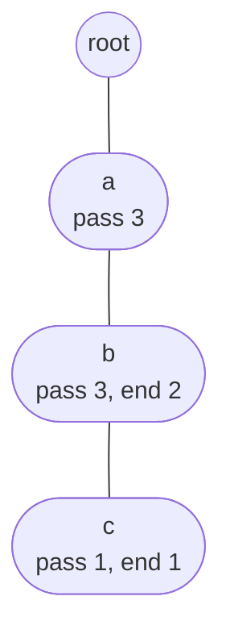

# Counting Words / Prefixes

> Put a **counter on every node**. Then "how many words start with this prefix?" is one walk, `O(L)`.

#### 1. What Is It?

Store counts in the nodes:

| Counter | Meaning |
|---|---|
| **`pass`** (prefix count) | how many inserted words go **through** this node (words that start with this prefix) |
| **`end`** (word count) | how many times a word **ends exactly** here (duplicates allowed) |

With these two numbers you can answer, in `O(L)`:

- "How many words are **equal** to `w`?" → `end` at the node of `w`.
- "How many words **start with** `p`?" → `pass` at the node of `p`.
- "Remove one copy of `w`" → decrement along the path.

**Signals:** "count words with prefix", "Implement Trie II", "sum of prefix scores", "how many strings start with".

#### 2. How It Works

Insert `ab`, `abc`, `ab`:

```text
insert "ab":  a.pass=1  b.pass=1  b.end=1
insert "abc": a.pass=2  b.pass=2  c.pass=1  c.end=1
insert "ab":  a.pass=3  b.pass=3  b.end=2
```



- `countWordsEqualTo("ab")` = `b.end` = `2`
- `countWordsStartingWith("ab")` = `b.pass` = `3`
- `countWordsStartingWith("abc")` = `c.pass` = `1`

**Erase one copy of `ab`:** walk the path, subtract `1` from `pass` on every node, and subtract `1` from `end` at the last node. (If a `pass` reaches `0`, the node is no longer used and can be pruned.)

**Sum of Prefix Scores of Strings (LeetCode 2416).** For each word, the **score** is the number of words that start with **each of its prefixes**, added together. Insert all words with `pass` counters, then for each word add up the `pass` of every node on its path.

```text
words = ["abc", "ab", "bc", "b"]
pass:  a=2  ab=2  abc=1  b=2  bc=1
"abc": a(2) + ab(2) + abc(1) = 5        "ab": 2 + 2 = 4        "bc": b(2) + bc(1) = 3        "b": 2
answer [5, 4, 3, 2]
```

#### 3. Brute Force vs Optimized

| Query | Brute force | Counters |
|---|---|---|
| Words starting with `p` | scan all words: `O(n · L)` | `O(L)` |
| Words equal to `w` | scan or a `HashMap` | `O(L)` |
| Prefix scores of all words | for each prefix of each word scan all: `O(n² · L²)` | `O(total chars)` |

```kotlin
// Brute force prefix scores: for each word and each of its prefixes, count the matching words
fun sumPrefixScoresBrute(words: Array<String>): IntArray =
    IntArray(words.size) { i ->
        (1..words[i].length).sumOf { len ->
            val prefix = words[i].substring(0, len)
            words.count { it.startsWith(prefix) }
        }
    }
```

#### 4. Kotlin Code

```kotlin
class TrieNode {
    val next = arrayOfNulls<TrieNode>(26)
    var pass = 0         // words going through this node
    var end = 0          // words ending exactly here
}

// Implement Trie II (LeetCode 1804)
class Trie {
    private val root = TrieNode()

    fun insert(word: String) {
        var node = root
        for (c in word) {
            if (node.next[c - 'a'] == null) node.next[c - 'a'] = TrieNode()
            node = node.next[c - 'a']!!
            node.pass++
        }
        node.end++
    }

    private fun find(s: String): TrieNode? {
        var node = root
        for (c in s) node = node.next[c - 'a'] ?: return null
        return node
    }

    fun countWordsEqualTo(word: String): Int = find(word)?.end ?: 0

    fun countWordsStartingWith(prefix: String): Int = find(prefix)?.pass ?: 0

    fun erase(word: String) {
        if (countWordsEqualTo(word) == 0) return              // not stored
        var node = root
        for (c in word) {
            node = node.next[c - 'a']!!
            node.pass--
        }
        node.end--
    }

    // Sum of Prefix Scores of Strings (LeetCode 2416): after inserting all the words
    fun prefixScore(word: String): Int {
        var node = root
        var score = 0
        for (c in word) {
            node = node.next[c - 'a'] ?: return score
            score += node.pass
        }
        return score
    }
}

fun sumPrefixScores(words: Array<String>): IntArray {
    val trie = Trie()
    for (w in words) trie.insert(w)
    return IntArray(words.size) { trie.prefixScore(words[it]) }
}
```

Checks (`Trie`): insert `apple`, insert `apple`, then `countWordsEqualTo("apple")` → `2`, `countWordsStartingWith("app")` → `2`. `erase("apple")` → `countWordsEqualTo("apple")` → `1`, `countWordsStartingWith("app")` → `1`. `erase("apple")` again → `0` and `0`. `erase("apple")` once more does nothing (no negative counts). `countWordsStartingWith("x")` → `0`. With `ab`, `abc`, `ab`: `countWordsEqualTo("ab")` → `2`, `countWordsStartingWith("ab")` → `3`, `countWordsStartingWith("abc")` → `1`. `sumPrefixScores(arrayOf("abc", "ab", "bc", "b"))` → `[5, 4, 3, 2]`. `sumPrefixScores(arrayOf("abcd"))` → `[4]`. `sumPrefixScoresBrute(arrayOf("abc", "ab", "bc", "b"))` → `[5, 4, 3, 2]`.

#### 5. Complexity

| | Time | Space |
|---|---|---|
| `insert`, `erase` | `O(L)` | |
| `countWordsEqualTo`, `countWordsStartingWith` | `O(L)` | |
| `sumPrefixScores` | `O(total characters)` | `O(total characters)` |
| Brute force | `O(n² · L²)` | |

#### 6. Common Mistakes

1. **Updating `pass` on the root** (not needed) or **skipping it on the last node** (it must be counted on every node of the path, including the last).
2. **Erasing a word that is not stored.** Counts go negative.
3. **Forgetting duplicates:** a word inserted twice should count twice.
4. **Mixing `end` and `pass`.** `end` is exact words, `pass` is words with this prefix.
5. **Not pruning** nodes whose `pass` is `0` (only a memory issue).
6. **Counting words with a prefix** by DFS-ing the subtree (`O(size)`) when a `pass` counter gives `O(L)`.

#### 7. Say This in the Interview

1. "I keep two counters per node: how many words pass through it, and how many end there. Prefix counts are then a single walk."
2. "Erase walks the path and decrements both counters. It is `O(L)`."
3. "For prefix scores I add up the `pass` counter along each word's path, so the total is linear in the number of characters."

#### 8. Quick Check

1. In the trie of `ab`, `abc`, `ab`, what is `pass` at `b`? And `end` at `b`?
2. What does `countWordsStartingWith("")` return?
3. Why increment `pass` on every node and not only at the end?

<details>
<summary>Answers</summary>

1. `pass = 3`, `end = 2`.
2. The total number of stored words (the root's count, if you keep it).
3. Every prefix of the word must count the word, so each node on the path needs it.

</details>

#### 9. Related LeetCode Questions

| # | Question | Idea |
|---|---|---|
| 1804 | [Implement Trie II (Prefix Tree)](https://leetcode.com/problems/implement-trie-ii-prefix-tree/) (Medium, premium) | `pass` and `end` |
| 2416 | [Sum of Prefix Scores of Strings](https://leetcode.com/problems/sum-of-prefix-scores-of-strings/) (Hard) | sum of `pass` |
| 677 | [Map Sum Pairs](https://leetcode.com/problems/map-sum-pairs/) (Medium) | totals on nodes |
| 14 | [Longest Common Prefix](https://leetcode.com/problems/longest-common-prefix/) (Easy) | walk the trie |
| 208 | [Implement Trie (Prefix Tree)](https://leetcode.com/problems/implement-trie-prefix-tree/) (Medium) | the base |
| 1707 | [Maximum XOR With an Element From Array](https://leetcode.com/problems/maximum-xor-with-an-element-from-array/) (Hard) | binary trie (note 15) |
