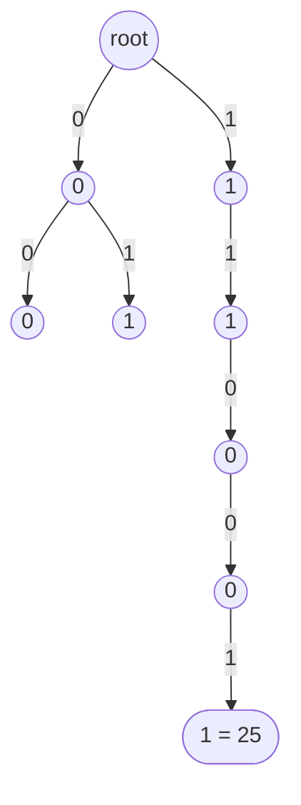

# Bitwise Trie / Binary Trie

> A trie where each node has only **two children, `0` and `1`**. Numbers are stored bit by bit. It solves "maximum XOR" in `O(n)`.

#### 1. What Is It?

A **binary trie** (bitwise trie) stores numbers by their **bits**, from the **most significant** bit to the least significant. Every node has two children: bit `0` and bit `1`. A path of 31 (or 32) edges spells one number.

**Why:** to **maximise `a XOR b`**, you want the bits of `a` and `b` to be **different**, starting from the highest bit. A binary trie lets you choose, bit by bit, the **opposite** bit if it exists.

**Signals:** "maximum XOR", "XOR of two numbers", "XOR with a query value", "bit by bit".

#### 2. How It Works

Numbers `[3, 10, 5, 25, 2, 8]`. In binary (5 bits): `00011, 01010, 00101, 11001, 00010, 01000`.



*(Only part of the trie is drawn. The path `1 → 1 → 0 → 0 → 1` is the number `25`.)*

**Maximum XOR of two numbers in the array (LeetCode 421).**

1. **Insert** every number into the trie, bit `30` down to bit `0` (for non-negative `Int`).
2. For each number `x`, walk the trie from the top. At each bit, **prefer the opposite bit** (`1 − bit`). If that child exists, go there and set that bit in the result. Otherwise follow the same bit.
3. The best result over all `x` is the answer.

```text
x = 5 = 00101.   Walk the trie, preferring the opposite bit at every level:
  bit4 of 5 is 0 → want 1: exists (25 starts with 1)       result bit4 = 1
  bit3 of 5 is 0 → want 1: exists (25 = 11001)             result bit3 = 1
  bit2 of 5 is 1 → want 0: exists (25 has 0 here)          result bit2 = 1
  bit1 of 5 is 0 → want 1: not on this path → take 0        result bit1 = 0
  bit0 of 5 is 1 → want 0: not on this path → take 1        result bit0 = 0   (we ended at 25: 5 XOR 25)
  result bits 1 1 1 0 0 = 11100 = 28
```

`5 XOR 25 = 28`, the maximum for this array.

The trie works because a **higher bit matters more than all lower bits together**. So we always fix the high bits first.

#### 3. Brute Force vs Optimized

| Approach | Time | Space |
|---|---|---|
| Try every pair | `O(n²)` | `O(1)` |
| **Binary trie** | **`O(32 · n)` = `O(n)`** | `O(32 · n)` |
| Hash set of prefixes, bit by bit | `O(32 · n)` | `O(n)` |

```kotlin
// Brute force: every pair
fun findMaximumXORBrute(nums: IntArray): Int {
    var best = 0
    for (i in nums.indices) for (j in i + 1 until nums.size) best = maxOf(best, nums[i] xor nums[j])
    return best
}
```

#### 4. Kotlin Code

```kotlin
class BitNode {
    val next = arrayOfNulls<BitNode>(2)        // index 0 and 1
}

// Maximum XOR of Two Numbers in an Array (LeetCode 421): numbers are 0 <= x < 2^31
fun findMaximumXOR(nums: IntArray): Int {
    val root = BitNode()
    for (x in nums) {                          // insert from the highest bit (30) to bit 0
        var node = root
        for (b in 30 downTo 0) {
            val bit = (x shr b) and 1
            if (node.next[bit] == null) node.next[bit] = BitNode()
            node = node.next[bit]!!
        }
    }
    var best = 0
    for (x in nums) {
        var node = root
        var current = 0
        for (b in 30 downTo 0) {
            val bit = (x shr b) and 1
            val want = 1 - bit                 // the opposite bit gives a 1 in the XOR
            if (node.next[want] != null) {
                current = current or (1 shl b)
                node = node.next[want]!!
            } else {
                node = node.next[bit]!!
            }
        }
        best = maxOf(best, current)
    }
    return best
}
```

Checks: `findMaximumXOR(intArrayOf(3, 10, 5, 25, 2, 8))` → `28`. `findMaximumXOR(intArrayOf(14, 70, 53, 83, 49, 91, 36, 80, 92, 51, 66, 70))` → `127`. `findMaximumXOR(intArrayOf(0))` → `0`. `findMaximumXOR(intArrayOf(8, 10, 2))` → `10` (`8 XOR 2`). `findMaximumXORBrute(intArrayOf(3, 10, 5, 25, 2, 8))` → `28`.

For a query "maximum XOR of `x` with any number in a set" (LeetCode 1707), build the trie once and run the inner loop for each query.

#### 5. Complexity

| | Time | Space |
|---|---|---|
| Insert one number | `O(B)` for `B = 31` bits | `O(B)` new nodes |
| Maximum XOR query | `O(B)` | |
| Whole problem | `O(n · B)` = `O(n)` | `O(n · B)` |
| Brute force | `O(n²)` | `O(1)` |

#### 6. Common Mistakes

1. **Inserting from the lowest bit.** The trie must go from the **most significant** bit.
2. **Using the wrong number of bits.** Use `31` for non-negative `Int` (bits `30..0`).
3. **Not preferring the opposite bit** (taking the same bit gives `0` in the XOR).
4. **Forgetting `current or (1 shl b)`** when the opposite child exists.
5. **Querying before inserting** or querying an empty trie (`node.next[bit]!!` crashes).
6. **Negative numbers:** the sign bit changes the picture. Treat the numbers as 32-bit patterns, and say so.
7. **Pairing a number with itself** (XOR `0`). It is harmless for the maximum.

#### 7. Say This in the Interview

1. "To maximise XOR I want the highest bits to differ. I put the numbers in a trie by their bits from the most significant down, and for each number I walk the trie, always taking the opposite bit when it exists."
2. "That's `O(32 · n)` instead of the `O(n²)` pair check. Space is `O(32 · n)`."
3. "The reason greedy works is that one higher bit is worth more than all lower bits together."

#### 8. Quick Check

1. How many children does a binary trie node have?
2. At a bit where `x` has `1`, which child do you want?
3. What is the XOR of `5` and `25`?

<details>
<summary>Answers</summary>

1. Two (`0` and `1`).
2. The `0` child (the opposite bit), which makes that bit `1` in the XOR.
3. `28` (`00101 XOR 11001 = 11100`).

</details>

#### 9. Related LeetCode Questions

| # | Question | Idea |
|---|---|---|
| 421 | [Maximum XOR of Two Numbers in an Array](https://leetcode.com/problems/maximum-xor-of-two-numbers-in-an-array/) (Medium) | binary trie |
| 1707 | [Maximum XOR With an Element From Array](https://leetcode.com/problems/maximum-xor-with-an-element-from-array/) (Hard) | offline queries + trie |
| 1938 | [Maximum Genetic Difference Query](https://leetcode.com/problems/maximum-genetic-difference-query/) (Hard) | trie on a tree |
| 1803 | [Count Pairs With XOR in a Range](https://leetcode.com/problems/count-pairs-with-xor-in-a-range/) (Hard) | trie with counts |
| 136 | [Single Number](https://leetcode.com/problems/single-number/) (Easy) | XOR basics |
| 268 | [Missing Number](https://leetcode.com/problems/missing-number/) (Easy) | XOR basics |
