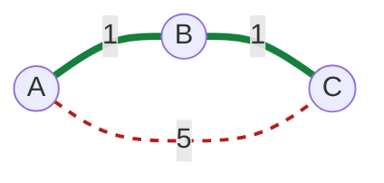

# Weighted vs Unweighted Graph

#### 1. What Is It?

- **Unweighted graph:** all edges are equal. Every step counts as 1.
- **Weighted graph:** each edge has a **weight** (a cost): distance, time, price, difficulty.

This difference decides **which shortest-path algorithm** you must use. This is asked in almost every graph interview.

| Edge weights | Algorithm | Time |
|---|---|---|
| all equal (or none) | **BFS** | `O(V + E)` |
| only `0` or `1` | 0-1 BFS (Queue folder, note 17) | `O(V + E)` |
| different, **not negative** | **Dijkstra** (note 18) | `O((V + E) log V)` |
| negative possible | Bellman-Ford | `O(V · E)` |
| all pairs of nodes | Floyd-Warshall | `O(V³)` |

#### 2. How It Works

```text
Unweighted: "shortest" = fewest edges          (A → C is 1 edge)
Weighted:   "shortest" = smallest total weight (A → B → C costs 1 + 1 = 2, A → C costs 5)
```

*Numbers on the edges are the weights. The green route has 2 edges but costs only 2. The red route has 1 edge but costs 5.*



BFS counts edges, so it would pick `A → C` (1 edge, cost 5). The cheapest route is `A → B → C` (2 edges, cost 2). With weights, the cheapest route depends on the weights, not on the number of edges.

A weighted edge is stored as **(neighbour, weight)**:

```text
0: [(1, 1), (2, 5)]
1: [(0, 1), (2, 1)]
2: [(0, 5), (1, 1)]
```

#### 3. Brute Force vs Optimized

| Approach | Time | Result |
|---|---|---|
| Try every simple path and keep the cheapest | exponential | correct, impractical |
| BFS (counts edges) | `O(V + E)` | **wrong** when weights differ |
| **Dijkstra** (non-negative weights) | `O((V + E) log V)` | cheapest path |
| Bellman-Ford (negative weights allowed) | `O(V · E)` | cheapest path |

```kotlin
// Brute force: try every simple path from node to target, return the cheapest total weight
fun cheapestBrute(graph: Array<List<IntArray>>, node: Int, target: Int, seen: BooleanArray): Int {
    if (node == target) return 0
    seen[node] = true
    var best = Int.MAX_VALUE
    for ((next, w) in graph[node]) {
        if (seen[next]) continue
        val rest = cheapestBrute(graph, next, target, seen)
        if (rest != Int.MAX_VALUE) best = minOf(best, w + rest)
    }
    seen[node] = false
    return best
}
```

For the weighted triangle `A-B 1`, `B-C 1`, `A-C 5` (nodes `0, 1, 2`), `cheapestBrute(...)` from `0` to `2` → `2` (via `1`), not `5`. BFS would pick the direct 1-edge route and return the wrong cost.

#### 4. Kotlin Code

```kotlin
// Weighted undirected graph: each entry is a Pair(neighbour, weight)
fun buildWeightedGraph(n: Int, edges: Array<IntArray>): List<List<Pair<Int, Int>>> {
    val graph = List(n) { mutableListOf<Pair<Int, Int>>() }
    for ((a, b, w) in edges) {
        graph[a].add(b to w)
        graph[b].add(a to w)
    }
    return graph
}

// Total weight of a path
fun pathCost(graph: List<List<Pair<Int, Int>>>, path: List<Int>): Int {
    var total = 0
    for (i in 0 until path.size - 1) {
        val (_, w) = graph[path[i]].first { it.first == path[i + 1] }
        total += w
    }
    return total
}

// Usage
val g = buildWeightedGraph(3, arrayOf(intArrayOf(0, 1, 1), intArrayOf(0, 2, 5), intArrayOf(1, 2, 1)))
println(pathCost(g, listOf(0, 1, 2)))     // 2  (2 edges)
println(pathCost(g, listOf(0, 2)))        // 5  (1 edge)
```

How to choose in an interview:

```text
Does every move cost the same?        → BFS
Do costs differ and none is negative? → Dijkstra
Are there negative costs?             → Bellman-Ford
```

#### 5. Complexity

| | Unweighted (BFS) | Weighted (Dijkstra) |
|---|---|---|
| Time | `O(V + E)` | `O((V + E) log V)` |
| Memory | `O(V)` | `O(V)` |

#### 6. Common Mistakes

1. **Using BFS on a weighted graph.** It finds the fewest edges, not the lowest cost.
2. **Using Dijkstra with negative weights.** It can give wrong answers.
3. **Forgetting that weights go in both directions** for an undirected weighted edge.
4. **Overflow.** A sum of weights may be bigger than `Int`. Use `Long` when the limits are big.
5. **Using `Int.MAX_VALUE` as infinity and then adding to it.** It overflows. Check before adding.

#### 7. Say This in the Interview

1. "Are the edges weighted? If all moves cost 1, BFS is enough and gives `O(V + E)`."
2. "With different non-negative weights I use Dijkstra with a priority queue."
3. "If there could be negative weights I would use Bellman-Ford."

#### 8. Quick Check

1. Which algorithm for the fewest moves in a maze?
2. Why does BFS fail on a weighted graph?

<details>
<summary>Answers</summary>

1. BFS (all moves cost the same).
2. BFS counts edges, not total weight. The path with fewer edges can have a much higher cost.

</details>

#### 9. Related LeetCode Questions

| # | Question | Idea |
|---|---|---|
| 1091 | Shortest Path in Binary Matrix (Medium) | unweighted, BFS |
| 743 | Network Delay Time (Medium) | weighted, Dijkstra |
| 1631 | Path With Minimum Effort (Medium) | weighted grid, Dijkstra |
| 787 | Cheapest Flights Within K Stops (Medium) | weighted with a stop limit |
| 1514 | Path with Maximum Probability (Medium) | Dijkstra on probabilities |
