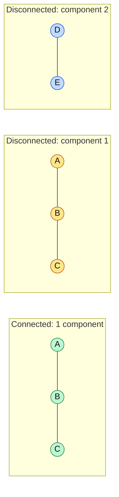
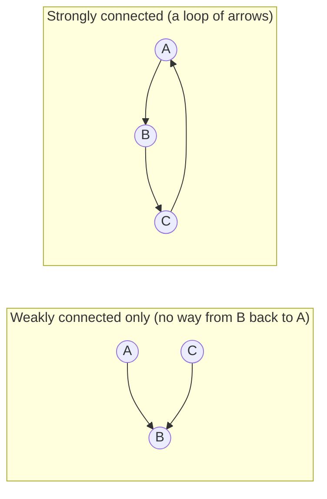
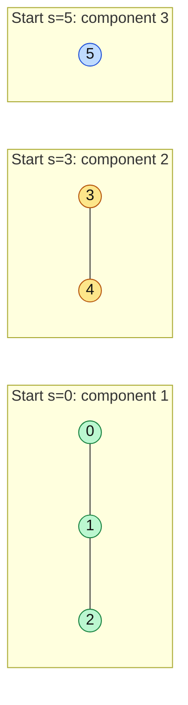

# Connected vs Disconnected Graph

#### 1. What Is It?

- A graph is **connected** if you can get from **any** vertex to **any** other vertex.
- A graph is **disconnected** if it has two or more separate pieces. Each piece is a **connected component**.

*One piece (connected) versus two separate pieces (disconnected).*



Why it matters in interviews:

- A single BFS or DFS from one node only visits **one component**. To cover the whole graph, start a new search from **every node that is still unvisited**.
- "How many groups / islands / provinces?" means "how many connected components?".
- "Can I reach B from A?" means "are A and B in the same component?".

For **directed** graphs there are two ideas: *weakly* connected (connected if you ignore directions) and *strongly* connected (you can follow the arrows from any node to any other). Interviews mostly ask the undirected kind.

*Weakly connected: connected only if you ignore the arrows. Strongly connected: you can follow the arrows from any node to any other.*



#### 2. How It Works

Count the components with a loop over all nodes:

```text
visited = all false;  components = 0
for each node s:
    if s is not visited:
        components++
        run DFS/BFS from s, marking everything it reaches as visited
```

*Each DFS start counts one component.*



```text
Graph: 0-1, 1-2, 3-4,  5 alone

s=0: not visited → component 1 → visits 0,1,2
s=1, s=2: already visited
s=3: not visited → component 2 → visits 3,4
s=5: not visited → component 3 → visits 5

answer: 3
```

Another way is **union-find** (note 23), which is handy when edges arrive one by one.

#### 3. Brute Force vs Optimized

| Question | Brute force | Better |
|---|---|---|
| Is the whole graph connected? | check a path for every pair of vertices: `O(V² · (V + E))` | one BFS / DFS from any vertex, count visited `== V`: `O(V + E)` |
| How many components? | repeat the pair check | loop over vertices, start a search from each unvisited one: `O(V + E)` |
| Are `A` and `B` in the same component? | a new search for every query: `O(V + E)` each | union-find: almost `O(1)` per query |

One search from one vertex only covers **its** component. To cover the whole graph, start a new search from every vertex that is still unvisited.

```text
V = 6, edges 0-1, 1-2, 3-4:   searches start at 0, 3 and 5   →   3 components
```

#### 4. Kotlin Code

```kotlin
// Number of Connected Components in an Undirected Graph (LeetCode 323)
fun countComponents(n: Int, edges: Array<IntArray>): Int {
    val graph = List(n) { mutableListOf<Int>() }
    for ((a, b) in edges) {
        graph[a].add(b)
        graph[b].add(a)
    }
    val visited = BooleanArray(n)

    fun dfs(node: Int) {
        visited[node] = true
        for (next in graph[node]) if (!visited[next]) dfs(next)
    }

    var components = 0
    for (s in 0 until n) {
        if (!visited[s]) {
            components++
            dfs(s)                       // marks the whole component
        }
    }
    return components
}

// Is the whole graph connected?
fun isConnected(n: Int, edges: Array<IntArray>): Boolean = countComponents(n, edges) == 1

// Find if Path Exists in Graph (LeetCode 1971)
fun validPath(n: Int, edges: Array<IntArray>, source: Int, destination: Int): Boolean {
    val graph = List(n) { mutableListOf<Int>() }
    for ((a, b) in edges) {
        graph[a].add(b)
        graph[b].add(a)
    }
    val visited = BooleanArray(n)
    val queue = ArrayDeque<Int>()
    visited[source] = true
    queue.addLast(source)
    while (queue.isNotEmpty()) {
        val node = queue.removeFirst()
        if (node == destination) return true
        for (next in graph[node]) {
            if (!visited[next]) {
                visited[next] = true
                queue.addLast(next)
            }
        }
    }
    return false
}
```

Checks: `countComponents(5, [[0,1],[1,2],[3,4]])` → `2`. `countComponents(6, [[0,1],[1,2],[3,4]])` → `3`.

Very deep graphs can make the recursive `dfs` overflow the stack. Use BFS or an explicit stack in that case.

#### 5. Complexity

| | Time | Space |
|---|---|---|
| Count components (DFS/BFS) | `O(V + E)` | `O(V + E)` |
| Count components (union-find) | `O(E · α(V))` (almost `O(E)`) | `O(V)` |

#### 6. Common Mistakes

1. **Starting only one search** and missing the other components.
2. **Not resetting** `visited` between separate runs (when you need it).
3. **Forgetting isolated nodes** (no edges). Each one is a component of its own.
4. **Recursion depth** on a huge graph.
5. **Mixing up** weakly and strongly connected for directed graphs.

#### 7. Say This in the Interview

1. "A single search only visits one component, so I loop over all nodes and start a new search from each unvisited one. The number of new searches is the number of components."
2. "Time `O(V + E)`. Isolated nodes count as components."

#### 8. Quick Check

1. A graph with 4 nodes and no edges has how many components?
2. After one DFS from node 0, how do you know the graph is connected?

<details>
<summary>Answers</summary>

1. `4`. Every node is alone.
2. If the DFS visited all `n` nodes.

</details>

#### 9. Related LeetCode Questions

| # | Question | Idea |
|---|---|---|
| 1971 | Find if Path Exists in Graph (Easy) | same component? |
| 323 | Number of Connected Components in an Undirected Graph (Medium, premium) | count components |
| 547 | Number of Provinces (Medium) | count components (matrix input) |
| 841 | Keys and Rooms (Medium) | can one search reach every node? |
| 200 | Number of Islands (Medium) | components on a grid |
| 1319 | Number of Operations to Make Network Connected (Medium) | components − 1 |
