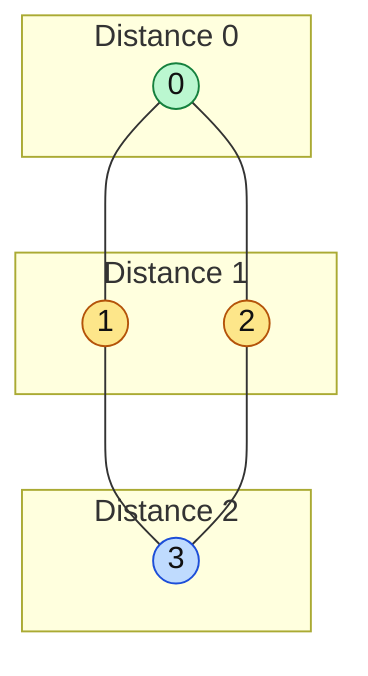
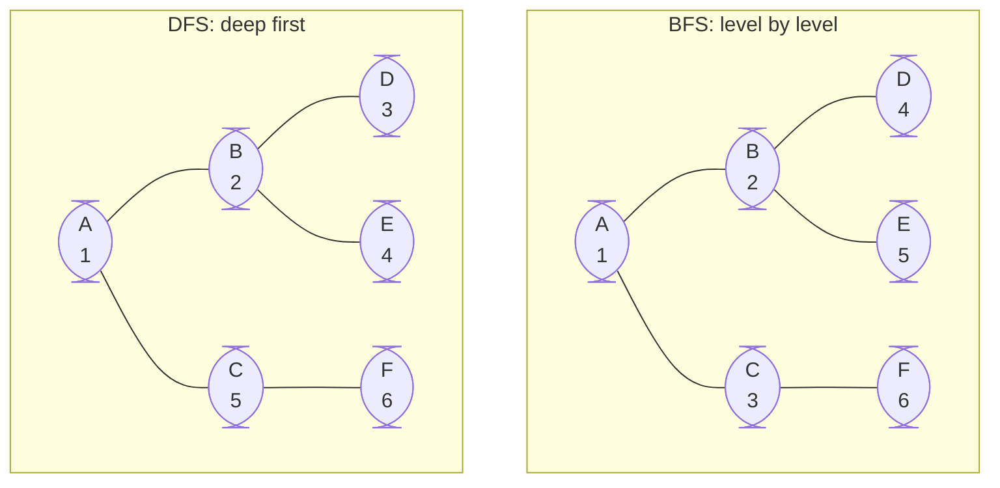

# BFS — Breadth First Search

> The other core graph walk, and the tool for "fewest steps" questions. The queue details are also in `01-data-structure/04-Queue/05-BFS.md`.

#### 1. What Is It?

**BFS** visits nodes in **rings around the start**: first the start, then all nodes 1 step away, then all nodes 2 steps away, and so on.

It uses a **queue** and a **visited** set.

Because closer nodes are always handled first, BFS finds the **shortest path** (fewest edges) in an **unweighted** graph.

#### 2. How It Works

*BFS visits rings around the start: distance 0, then distance 1, then distance 2.*



```text
Graph:  0 — 1 — 3          0: [1, 2]    1: [0, 3]    2: [0, 3]    3: [1, 2]
        |       |
        2 ——————┘

queue [0]            visited {0}
take 0 → add 1, 2    queue [1, 2]     visited {0, 1, 2}
take 1 → add 3       queue [2, 3]     visited {0, 1, 2, 3}
take 2 → 3 is seen   queue [3]
take 3               queue []

visit order: 0, 1, 2, 3          distance: 0→0, 1→1, 2→1, 3→2
```

**The rule that avoids most bugs:** mark a node visited **when you add it to the queue**, not when you take it out.

To get **levels** (distances), process the queue one round at a time: `repeat(queue.size) { ... }` and increase `steps` after each round.

BFS or DFS?

| | BFS | DFS |
|---|---|---|
| Finds the shortest path (equal steps) | **yes** | no |
| Uses | queue | stack / recursion |
| Memory | wide graphs use more | deep graphs use more |
| Good for | nearest target, levels | cycles, all paths, components |

*The same tree. The number under each letter is the visit order.*



#### 3. Kotlin Code

```kotlin
// BFS order
fun bfs(graph: List<List<Int>>, start: Int): List<Int> {
    val visited = BooleanArray(graph.size)
    val order = mutableListOf<Int>()
    val queue = ArrayDeque<Int>()
    visited[start] = true
    queue.addLast(start)
    while (queue.isNotEmpty()) {
        val node = queue.removeFirst()
        order.add(node)
        for (next in graph[node]) {
            if (!visited[next]) {
                visited[next] = true              // mark when you ADD
                queue.addLast(next)
            }
        }
    }
    return order
}

// Distance (number of edges) from start to every node; -1 if unreachable
fun distances(graph: List<List<Int>>, start: Int): IntArray {
    val dist = IntArray(graph.size) { -1 }
    val queue = ArrayDeque<Int>()
    dist[start] = 0
    queue.addLast(start)
    while (queue.isNotEmpty()) {
        val node = queue.removeFirst()
        for (next in graph[node]) {
            if (dist[next] == -1) {
                dist[next] = dist[node] + 1
                queue.addLast(next)
            }
        }
    }
    return dist
}

// Level by level: the number of edges from start to target (-1 if unreachable)
fun shortestSteps(graph: List<List<Int>>, start: Int, target: Int): Int {
    val visited = BooleanArray(graph.size)
    val queue = ArrayDeque<Int>()
    visited[start] = true
    queue.addLast(start)
    var steps = 0
    while (queue.isNotEmpty()) {
        repeat(queue.size) {
            val node = queue.removeFirst()
            if (node == target) return steps
            for (next in graph[node]) {
                if (!visited[next]) {
                    visited[next] = true
                    queue.addLast(next)
                }
            }
        }
        steps++
    }
    return -1
}
```

Checks (graph above): `bfs` → `[0, 1, 2, 3]`. `distances(graph, 0)` → `[0, 1, 1, 2]`. `shortestSteps(graph, 0, 3)` → `2`.

#### 4. Complexity

For `V` nodes and `E` edges:

| | Time | Space |
|---|---|---|
| BFS (adjacency list) | `O(V + E)` | `O(V)` |
| BFS (adjacency matrix) | `O(V²)` | `O(V)` |

#### 5. Common Mistakes

1. **Marking visited when taking the node out** of the queue. The same node enters many times.
2. **Forgetting to mark the start node.**
3. **Missing disconnected parts.**
4. **Using BFS for the shortest path on a weighted graph.** Use Dijkstra.
5. **Reading `queue.size` in a `while` condition** for levels. Use `repeat(queue.size)`.
6. **Using a list with `removeAt(0)`** as the queue (`O(n)`).

#### 6. Say This in the Interview

1. "I need the fewest steps, and every step costs the same, so I use BFS."
2. "I mark nodes visited when I enqueue them."
3. "Time `O(V + E)`, space `O(V)`. For different edge costs I would switch to Dijkstra."

#### 7. Quick Check

1. In BFS, when do you mark a node visited?
2. What is the BFS distance from a node to itself?

<details>
<summary>Answers</summary>

1. When you add it to the queue.
2. `0`.

</details>

#### 8. Related LeetCode Questions

| # | Question | Idea |
|---|---|---|
| 1971 | Find if Path Exists in Graph (Easy) | BFS reachability |
| 102 | Binary Tree Level Order Traversal (Medium) | BFS by levels |
| 133 | Clone Graph (Medium) | BFS + map |
| 785 | Is Graph Bipartite? (Medium) | BFS colouring |
| 1091 | Shortest Path in Binary Matrix (Medium) | grid BFS |
| 752 | Open the Lock (Medium) | BFS on states |
| 127 | Word Ladder (Hard) | BFS on words |
