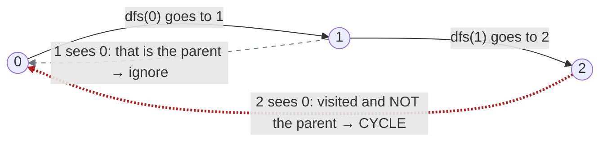
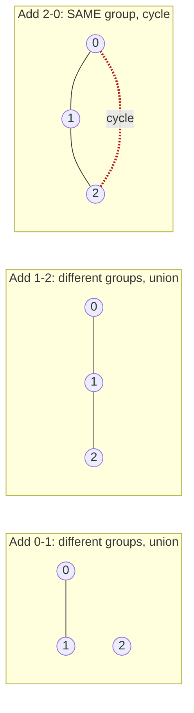

# Cycle Detection — Undirected Graph

#### 1. What Is It?

In an undirected graph, a **cycle** is a path that returns to its start without reusing an edge. Cycle detection answers: **"does this graph have a cycle?"**

Two standard ways:

| Way | Idea | Use when |
|---|---|---|
| **DFS with a parent** | if you reach an already visited node that is **not the node you came from**, there is a cycle | the whole graph is given |
| **Union-Find** | if an edge joins two nodes that are **already in the same group**, it makes a cycle | edges arrive one by one |

Where it appears: *Graph Valid Tree* (a tree has no cycle), *Redundant Connection* (find the edge that creates a cycle).

#### 2. How It Works

**DFS with a parent.** In an undirected graph every edge also points back to where you came from. That back edge is *not* a cycle. So pass the `parent` down and ignore it.

*DFS walks 0 → 1 → 2. The edge back to the parent is ignored. The edge from 2 to 0 is a different, already visited node: that is the cycle.*



```text
Graph (triangle):  0 - 1,  1 - 2,  2 - 0

dfs(0, parent = -1): visit 0
   neighbour 1: not visited → dfs(1, parent = 0)
       neighbour 0: visited, but it is the parent → ignore
       neighbour 2: not visited → dfs(2, parent = 1)
           neighbour 1: parent → ignore
           neighbour 0: visited and NOT the parent → CYCLE!
```

*Union-Find view: add the edges one by one. The third edge joins two nodes that are already in the same group, so it closes a cycle.*



**Union-Find.** For each edge `(a, b)`:

```text
if find(a) == find(b): this edge makes a cycle
else: union(a, b)
```

(Union-find is explained in note 23.)

#### 3. Brute Force vs Optimized

| Approach | Time | Note |
|---|---|---|
| Remove each edge in turn, test if its ends are still connected | `O(E · (V + E))` | one BFS per edge |
| **DFS with a parent:** a visited neighbour that is not the parent means a cycle | **`O(V + E)`** | one pass |
| **Union-find:** `find(a) == find(b)` before joining means a cycle | `O(E α(V))` | good when edges arrive one by one |

```text
Brute force: edge (a, b) is on a cycle if a and b are still connected without it.
DFS: reaching an already visited vertex that is NOT the one you came from closes a cycle.
```

Remember the parent exception. In an undirected graph every edge is also an edge back to where you came from, and that is not a cycle.

#### 4. Kotlin Code

```kotlin
// DFS with a parent
fun hasCycle(n: Int, edges: Array<IntArray>): Boolean {
    val graph = List(n) { mutableListOf<Int>() }
    for ((a, b) in edges) {
        graph[a].add(b)
        graph[b].add(a)
    }
    val visited = BooleanArray(n)

    fun dfs(node: Int, parent: Int): Boolean {
        visited[node] = true
        for (next in graph[node]) {
            if (!visited[next]) {
                if (dfs(next, node)) return true
            } else if (next != parent) {
                return true                                 // visited and not the parent → cycle
            }
        }
        return false
    }

    for (s in 0 until n) {
        if (!visited[s] && dfs(s, -1)) return true          // check every component
    }
    return false
}

// Redundant Connection (LeetCode 684): the edge that makes a cycle, with union-find
fun findRedundantConnection(edges: Array<IntArray>): IntArray {
    val parent = IntArray(edges.size + 1) { it }

    fun find(x: Int): Int {
        if (parent[x] != x) parent[x] = find(parent[x])     // path compression
        return parent[x]
    }

    for ((a, b) in edges) {
        val rootA = find(a)
        val rootB = find(b)
        if (rootA == rootB) return intArrayOf(a, b)         // already connected → this edge closes a cycle
        parent[rootA] = rootB
    }
    return intArrayOf()
}
```

Checks: `hasCycle(3, [[0,1],[1,2],[2,0]])` → `true`. `hasCycle(4, [[0,1],[1,2],[2,3]])` → `false`. `findRedundantConnection([[1,2],[1,3],[2,3]])` → `[2, 3]`.

#### 5. Complexity

| Way | Time | Space |
|---|---|---|
| DFS with a parent | `O(V + E)` | `O(V)` |
| Union-Find | `O(E · α(V))` | `O(V)` |

#### 6. Common Mistakes

1. **Treating the parent as a cycle.** Every undirected edge points back to the parent, so ignore it.
2. **Using this check on a directed graph.** It gives wrong answers. Use the 3-state DFS (note 14).
3. **Checking only one component.** Loop over all nodes.
4. **Parallel edges** (two edges between the same pair). The simple parent check misses this cycle. Track the edge id instead of the parent node if the problem allows parallel edges.
5. **Union-find with 0-based arrays** when nodes are 1-based. Allocate `n + 1`.

#### 7. Say This in the Interview

1. "In an undirected DFS, reaching a visited node that is not my parent means a cycle."
2. "Or with union-find: if an edge joins two nodes already in the same set, that edge creates the cycle."
3. "Time `O(V + E)`. I check every component."

#### 8. Quick Check

1. Why ignore the parent in the DFS?
2. Does a tree have a cycle?

<details>
<summary>Answers</summary>

1. The edge to the parent is the edge we just came through. It is not a new path back, so it is not a cycle.
2. No. A tree is connected and has no cycle.

</details>

#### 9. Related LeetCode Questions

| # | Question | Idea |
|---|---|---|
| 261 | Graph Valid Tree (Medium, premium) | no cycle and connected |
| 684 | Redundant Connection (Medium) | the edge that makes a cycle |
| 685 | Redundant Connection II (Hard) | the directed version |
| 547 | Number of Provinces (Medium) | union-find practice |
| 1584 | Min Cost to Connect All Points (Medium) | Kruskal avoids cycles with union-find |
