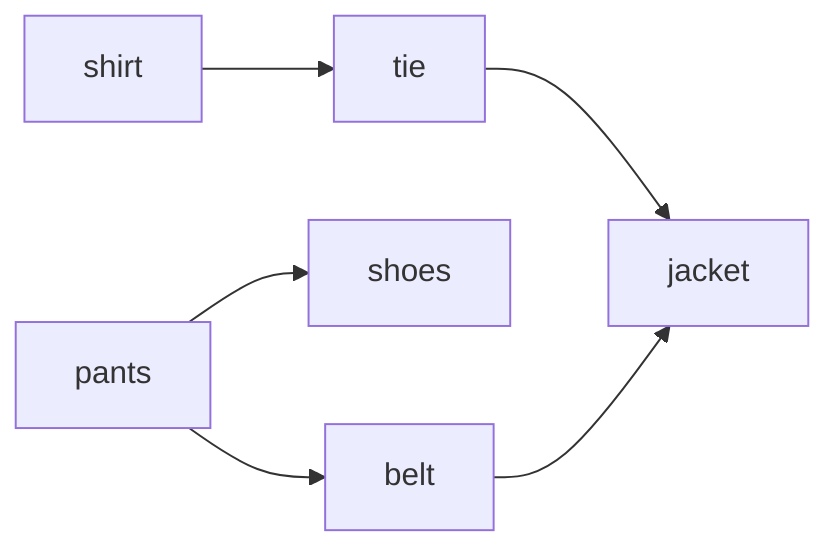
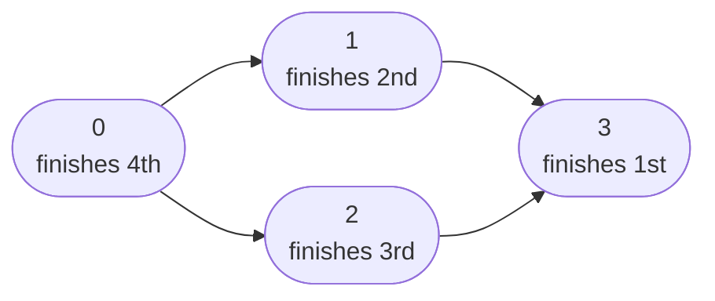

# Topological Sort

> A top FAANG graph topic. Course Schedule II and Alien Dictionary are classics.

#### 1. What Is It?

A **topological sort** puts the vertices of a **directed acyclic graph (DAG)** in a line, so that for every edge `A → B`, **A comes before B**.

Think of it as an order in which you can do tasks when some tasks must be done first.

*An arrow means 'do this first'. Many orders are valid, for example: shirt, pants, tie, belt, shoes, jacket.*



```text
Edges: shirt → tie → jacket,  pants → shoes,  pants → belt → jacket

A valid order: shirt, pants, tie, belt, shoes, jacket
(Many valid orders can exist. Any one is accepted.)
```

Facts to remember:

- It only exists if the graph has **no cycle**. If there is a cycle, no valid order exists.
- There are two ways to find it: **DFS** (this note) and **Kahn's algorithm** with a queue (note 16).

Typical stories: course prerequisites, build order, task scheduling, package dependencies.

#### 2. How It Works

**DFS method:** do a DFS. When a node is **finished** (all its descendants are done), add it to a list. The finish list is in reverse topological order. Reverse it at the end.

*DFS finish order is 3, 1, 2, 0. Reverse it to get a valid topological order: 0, 2, 1, 3.*



```text
Graph: 0 → 1, 0 → 2, 1 → 3, 2 → 3

dfs(0)
   dfs(1)
      dfs(3)  finished → add 3
   1 finished → add 1
   dfs(2)
      3 already done
   2 finished → add 2
0 finished → add 0

finish list: [3, 1, 2, 0]   → reversed: [0, 2, 1, 3]   a valid order
```

Why it works: a node is added only after everything it points to has been added. So after reversing, a node always comes before the nodes it points to.

To detect a cycle, use the 3 states from note 14. Seeing a "visiting" node means no valid order.

#### 3. Brute Force vs Optimized

| Approach | Time | Note |
|---|---|---|
| Try every permutation and check the edges | `O(V! · E)` | impossible beyond `V = 10` |
| Repeatedly scan for a vertex whose prerequisites are all done | `O(V² + V · E)` | simple, slow |
| **DFS finish order, reversed** | **`O(V + E)`** | needs cycle detection |
| **Kahn's algorithm** (note 16) | **`O(V + E)`** | in-degree queue |

```kotlin
// Brute force: keep picking a vertex that has no unfinished prerequisite
fun topoBrute(n: Int, edges: Array<IntArray>): List<Int> {
    val done = BooleanArray(n)
    val order = mutableListOf<Int>()
    repeat(n) {
        val pick = (0 until n).firstOrNull { v -> !done[v] && edges.none { it[1] == v && !done[it[0]] } }
            ?: return emptyList()                          // no vertex is free: there is a cycle
        done[pick] = true
        order.add(pick)
    }
    return order
}
```

`topoBrute(4, arrayOf(intArrayOf(0, 1), intArrayOf(0, 2), intArrayOf(1, 3), intArrayOf(2, 3)))` → `[0, 1, 2, 3]`. Each pick scans every vertex and every edge. Kahn's algorithm keeps a queue of free vertices and updates in-degrees instead.

#### 4. Kotlin Code

```kotlin
// Returns a valid order, or an empty list if there is a cycle
fun topologicalSort(n: Int, graph: List<List<Int>>): List<Int> {
    val state = IntArray(n)                       // 0 = unvisited, 1 = visiting, 2 = done
    val finished = mutableListOf<Int>()

    fun dfs(node: Int): Boolean {                 // returns false if a cycle is found
        state[node] = 1
        for (next in graph[node]) {
            if (state[next] == 1) return false
            if (state[next] == 0 && !dfs(next)) return false
        }
        state[node] = 2
        finished.add(node)                        // added AFTER all its descendants
        return true
    }

    for (s in 0 until n) {
        if (state[s] == 0 && !dfs(s)) return emptyList()
    }
    return finished.reversed()
}

// Course Schedule II (LeetCode 210)
fun findOrder(numCourses: Int, prerequisites: Array<IntArray>): IntArray {
    val graph = List(numCourses) { mutableListOf<Int>() }
    for ((course, pre) in prerequisites) graph[pre].add(course)     // pre → course
    return topologicalSort(numCourses, graph).toIntArray()
}
```

Checks: `topologicalSort(4, [[1,2],[3],[3],[]])` → `[0, 2, 1, 3]`. `findOrder(2, [[1,0]])` → `[0, 1]`. `findOrder(2, [[1,0],[0,1]])` → `[]`.

Any valid order is accepted. Your answer may differ from another correct answer.

#### 5. Complexity

| | Time | Space |
|---|---|---|
| Topological sort | `O(V + E)` | `O(V)` |

#### 6. Common Mistakes

1. **Adding the node to the list before visiting its neighbours** (preorder). It must be added **after** (postorder).
2. **Forgetting to reverse** the list.
3. **Not detecting cycles.** The order is meaningless if there is a cycle.
4. **Wrong edge direction** from `[course, prerequisite]`.
5. **Not starting a DFS from every unvisited node.**
6. **Assuming the answer is unique.** There can be many valid orders.

#### 7. Say This in the Interview

1. "I model tasks as nodes and 'A before B' as an edge `A → B`. A valid order exists only if there is no cycle."
2. "I do a DFS, add each node after its descendants, and reverse the list. Or I use Kahn's algorithm with in-degrees."
3. "Time `O(V + E)`."

#### 8. Quick Check

1. When does a topological order not exist?
2. Is the topological order unique?

<details>
<summary>Answers</summary>

1. When the graph has a cycle.
2. No. Several orders can be valid.

</details>

#### 9. Related LeetCode Questions

| # | Question | Idea |
|---|---|---|
| 207 | Course Schedule (Medium) | is an order possible? |
| 210 | Course Schedule II (Medium) | give an order |
| 269 | Alien Dictionary (Hard, premium) | build the graph from words (note 31) |
| 2115 | Find All Possible Recipes from Given Supplies (Medium) | dependencies |
| 1203 | Sort Items by Groups Respecting Dependencies (Hard) | two levels of ordering |
