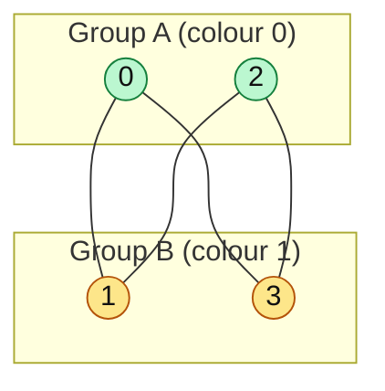
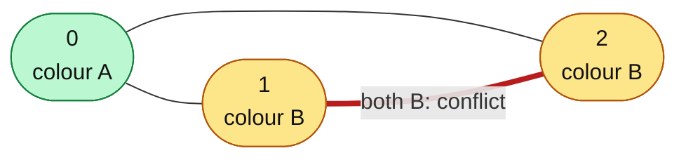

# Bipartite Graph / Graph Coloring

#### 1. What Is It?

A graph is **bipartite** if you can split its vertices into **two groups** so that **every edge connects a vertex of one group to a vertex of the other group**. No edge stays inside a group.

Equivalent ideas:

- You can **colour** the vertices with **2 colours** so that neighbours always have different colours.
- The graph has **no odd-length cycle**.

Where it appears:

| Story | Two groups |
|---|---|
| "split people into two teams so that enemies are apart" | Possible Bipartition |
| "can the graph be coloured with 2 colours?" | Is Graph Bipartite? |
| matching jobs to workers | jobs vs workers |

#### 2. How It Works

Use BFS (or DFS) to colour the graph:

1. Colour the start node `0`.
2. Give every neighbour the **opposite colour** (`1 - colour`).
3. If a neighbour already has the **same colour** as the current node → **not bipartite**.
4. Repeat for every component (the graph may be disconnected).

*A square is bipartite: put 0 and 2 in Group A, 1 and 3 in Group B, and every edge goes between the two groups.*



*A triangle is not bipartite: 0 gets colour A, so 1 and 2 must both be B, but 1 and 2 are joined by an edge.*



```text
Graph: 0-1, 1-2, 2-3, 3-0   (a square: even cycle)

colour 0 = A
neighbours 1 and 3 → B
neighbour of 1: 2 → A      (and 2's neighbour 3 is B: fine)
all edges join A and B → bipartite

Graph: 0-1, 1-2, 2-0   (a triangle: odd cycle)

colour 0 = A;  1 = B;  2 (neighbour of 0) = B
but 1-2 is an edge and both are B → NOT bipartite
```

#### 3. Brute Force vs Optimized

| Approach | Time | Note |
|---|---|---|
| Try all `2^V` ways to split the vertices into two groups | `O(2^V · E)` | only for tiny `V` |
| **BFS / DFS colouring** with two colours | **`O(V + E)`** | fail when an edge joins two equal colours |
| Union-find with "enemy" links | `O(E α(V))` | alternative |

```kotlin
// Brute force: try every assignment of two groups (bitmask), only for small n
fun isBipartiteBrute(n: Int, edges: Array<IntArray>): Boolean {
    for (mask in 0 until (1 shl n)) {
        if (edges.all { (a, b) -> ((mask shr a) and 1) != ((mask shr b) and 1) }) return true
    }
    return false
}
```

`isBipartiteBrute(4, arrayOf(intArrayOf(0, 1), intArrayOf(1, 2), intArrayOf(2, 3), intArrayOf(3, 0)))` → `true` (a square). `isBipartiteBrute(3, arrayOf(intArrayOf(0, 1), intArrayOf(1, 2), intArrayOf(2, 0)))` → `false` (a triangle, an odd cycle).

#### 4. Kotlin Code

```kotlin
// Is Graph Bipartite? (LeetCode 785): graph[i] = neighbours of i
fun isBipartite(graph: Array<IntArray>): Boolean {
    val n = graph.size
    val colour = IntArray(n) { -1 }                    // -1 = not coloured yet

    for (start in 0 until n) {
        if (colour[start] != -1) continue              // already done (another component)
        colour[start] = 0
        val queue = ArrayDeque<Int>()
        queue.addLast(start)
        while (queue.isNotEmpty()) {
            val node = queue.removeFirst()
            for (next in graph[node]) {
                if (colour[next] == -1) {
                    colour[next] = 1 - colour[node]    // the opposite colour
                    queue.addLast(next)
                } else if (colour[next] == colour[node]) {
                    return false                       // two neighbours with the same colour
                }
            }
        }
    }
    return true
}

// Possible Bipartition (LeetCode 886): people 1..n, dislikes[i] = [a, b]
fun possibleBipartition(n: Int, dislikes: Array<IntArray>): Boolean {
    val graph = Array(n + 1) { mutableListOf<Int>() }
    for ((a, b) in dislikes) {
        graph[a].add(b)
        graph[b].add(a)
    }
    val colour = IntArray(n + 1) { -1 }
    for (start in 1..n) {
        if (colour[start] != -1) continue
        colour[start] = 0
        val queue = ArrayDeque<Int>()
        queue.addLast(start)
        while (queue.isNotEmpty()) {
            val node = queue.removeFirst()
            for (next in graph[node]) {
                if (colour[next] == -1) {
                    colour[next] = 1 - colour[node]
                    queue.addLast(next)
                } else if (colour[next] == colour[node]) {
                    return false
                }
            }
        }
    }
    return true
}
```

Checks: `isBipartite([[1,3],[0,2],[1,3],[0,2]])` → `true` (the square). `isBipartite([[1,2],[0,2],[0,1]])` → `false` (the triangle). `possibleBipartition(4, [[1,2],[1,3],[2,4]])` → `true`.

#### 5. Complexity

| | Time | Space |
|---|---|---|
| BFS / DFS colouring | `O(V + E)` | `O(V)` |

#### 6. Common Mistakes

1. **Colouring only one component.** Loop over all nodes.
2. **Treating "already coloured with the opposite colour" as an error.** That is fine. Only the **same** colour is a problem.
3. **Using `visited` only.** You need the colour, not just visited.
4. **Nodes numbered from 1** with 0-based arrays.
5. **Directed edges.** Bipartite checking treats edges as undirected.

#### 7. Say This in the Interview

1. "A graph is bipartite if I can 2-colour it. I BFS from every unvisited node, giving neighbours the opposite colour."
2. "If a neighbour already has my colour, it is not bipartite. That happens exactly when there is an odd cycle."
3. "Time `O(V + E)`."

#### 8. Quick Check

1. Is a triangle bipartite?
2. Is any tree bipartite?

<details>
<summary>Answers</summary>

1. No. It is an odd cycle (3 edges).
2. Yes. A tree has no cycle at all, so no odd cycle.

</details>

#### 9. Related LeetCode Questions

| # | Question | Idea |
|---|---|---|
| 785 | Is Graph Bipartite? (Medium) | 2-colour with BFS |
| 886 | Possible Bipartition (Medium) | the same with `dislikes` edges |
| 1042 | Flower Planting With No Adjacent (Medium) | greedy colouring |
| 207 | Course Schedule (Medium) | another cycle-related graph question |
