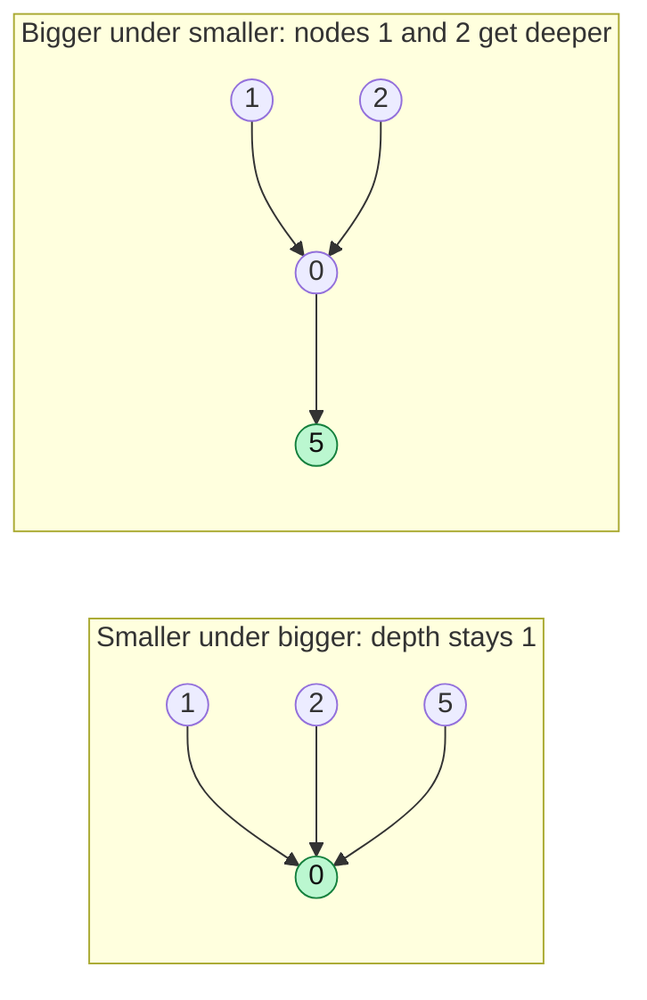

# Union by Rank / Size

#### 1. What Is It?

**Union by size** (or **union by rank**) is the second trick that keeps Union-Find fast.

When you merge two groups, attach the **smaller** tree under the **bigger** tree's root. This stops the trees from becoming tall chains.

- **Size:** the number of nodes in the tree.
- **Rank:** an upper bound of the tree's height.

Both work. **Size** is easier to explain and also lets you read the size of a group. Most interview solutions use size.

#### 2. How It Works

*Joining a group of size 3 (root 0) with a single node 5. Attach the small tree under the big one, so the tree stays flat.*



```text
Group A (root 0, size 3):  0 ← 1, 0 ← 2          Group B (root 5, size 1): just 5

union(0, 5):
   size[A] = 3, size[B] = 1 → attach B under A

Result: root 0, size 4.     find(5) = 5 → 0   (2 steps)

If we had attached A under B instead, then 0, 1 and 2 would be deeper (3 steps each).
```

Rule: the root with the smaller size gets a new parent: the root with the bigger size.

With union by size, the height of any tree is at most `log n`. So `find` costs `O(log n)` even without path compression. With both tricks, `O(α(n))`.

#### 3. Brute Force vs Optimized

| `union` strategy | Tree height after `n` unions | `find` cost |
|---|---|---|
| Always attach the second root under the first | up to `n` (a chain) | `O(n)` |
| Attach the **smaller** tree under the **bigger** one | at most `log₂ n` | `O(log n)` |
| Union by size **and** path compression | almost flat | `O(α(n))` |

```kotlin
// Naive union: parent[rootOfB] = rootOfA, no matter the sizes
fun unionNaive(parent: IntArray, a: Int, b: Int) {
    var ra = a; while (parent[ra] != ra) ra = parent[ra]
    var rb = b; while (parent[rb] != rb) rb = parent[rb]
    if (ra != rb) parent[rb] = ra
}
```

Doing `union(1, 0)`, `union(2, 1)`, `union(3, 2)`, `union(4, 3)` with this rule builds a chain `0 → 1 → 2 → 3 → 4` (root `4`), so `find(0)` walks four links. Union by size attaches the smaller tree under the bigger one every time, so the tree stays flat.

#### 4. Kotlin Code

```kotlin
class UnionFindBySize(n: Int) {
    private val parent = IntArray(n) { it }
    private val size = IntArray(n) { 1 }
    var count = n
        private set

    fun find(x: Int): Int {
        if (parent[x] != x) parent[x] = find(parent[x])      // path compression (note 24)
        return parent[x]
    }

    fun union(a: Int, b: Int): Boolean {
        var rootA = find(a)
        var rootB = find(b)
        if (rootA == rootB) return false
        if (size[rootA] < size[rootB]) {                     // make A the bigger one
            val temp = rootA; rootA = rootB; rootB = temp
        }
        parent[rootB] = rootA                                // the smaller goes under the bigger
        size[rootA] += size[rootB]
        count--
        return true
    }

    fun sizeOf(x: Int) = size[find(x)]                       // size of the group that contains x
}

// Union by rank (the other version)
class UnionFindByRank(n: Int) {
    private val parent = IntArray(n) { it }
    private val rank = IntArray(n)

    fun find(x: Int): Int {
        if (parent[x] != x) parent[x] = find(parent[x])
        return parent[x]
    }

    fun union(a: Int, b: Int): Boolean {
        val rootA = find(a)
        val rootB = find(b)
        if (rootA == rootB) return false
        when {
            rank[rootA] < rank[rootB] -> parent[rootA] = rootB
            rank[rootA] > rank[rootB] -> parent[rootB] = rootA
            else -> { parent[rootB] = rootA; rank[rootA]++ }     // equal ranks: the new root grows by 1
        }
        return true
    }
}

// Largest group size (e.g. Largest Component Size, biggest friend circle)
fun largestGroup(n: Int, pairs: Array<IntArray>): Int {
    val uf = UnionFindBySize(n)
    for ((a, b) in pairs) uf.union(a, b)
    return (0 until n).maxOf { uf.sizeOf(it) }
}
```

Check: `largestGroup(5, [[0,1],[1,2],[3,4]])` → `3`.

#### 5. Complexity

| Tricks used | Time per operation |
|---|---|
| none | `O(n)` |
| union by size only | `O(log n)` |
| path compression only | `O(log n)` amortized |
| **both** | **`O(α(n))`** (almost constant) |

#### 6. Common Mistakes

1. **Comparing the sizes of the nodes** and not of their roots. Always `find` first.
2. **Updating the size of the wrong root.** Add to the root that stays.
3. **Forgetting to update `size`** after a union.
4. **Mixing up size and rank.** Pick one and keep it consistent.
5. **Using only this trick** and thinking it makes `find` constant. You also want path compression.

#### 7. Say This in the Interview

1. "When I union two groups, I attach the smaller tree under the bigger one, so trees stay shallow."
2. "With path compression as well, each operation is `O(α(n))`, which is practically constant."
3. "Tracking size also lets me answer 'how big is this group?' directly."

#### 8. Quick Check

1. Which root becomes the parent in a union by size?
2. What is the height of a tree with union by size, at most?

<details>
<summary>Answers</summary>

1. The root of the bigger group.
2. About `log n`.

</details>

#### 9. Related LeetCode Questions

| # | Question | Idea |
|---|---|---|
| 684 | Redundant Connection (Medium) | union-find |
| 721 | Accounts Merge (Medium) | union-find on emails |
| 947 | Most Stones Removed with Same Row or Column (Medium) | union rows and columns |
| 952 | Largest Component Size by Common Factor (Hard) | group size with union-find |
| 1319 | Number of Operations to Make Network Connected (Medium) | groups − 1 |
