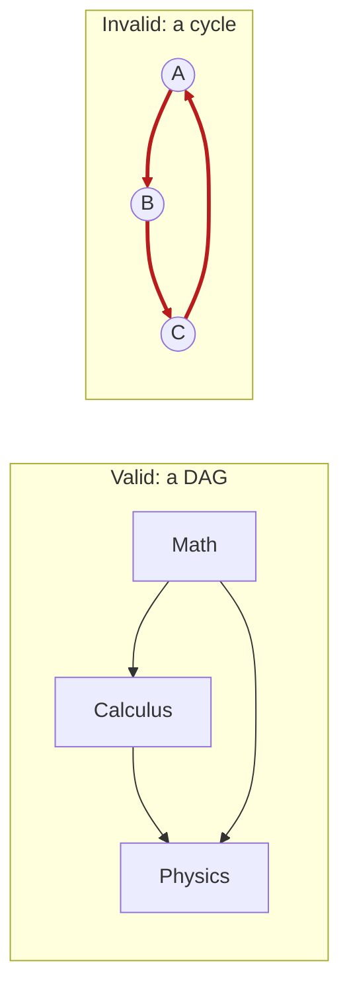
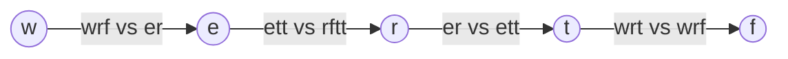

# Dependency Graph Problems

> "A must happen before B." This is the topological sort pattern in disguise.

#### 1. What Is It?

A **dependency graph** is a directed graph where an edge `A → B` means **"A must come before B"** (B depends on A).

Typical stories:

- course **prerequisites**,
- the **build order** of software modules,
- the order of **tasks** in a project,
- the order of **letters** in an unknown alphabet,
- **recipes** that need other recipes.

The questions are always one of three:

| Question | Method |
|---|---|
| **Is a valid order possible?** | cycle detection (Kahn's: did we process all nodes?) |
| **Give one valid order** | topological sort (Kahn's or DFS) |
| **What is the minimum time / number of rounds?** | Kahn's by levels, or the longest path in the DAG (note 34) |

If the dependencies contain a **cycle**, no order exists.

*An arrow means 'needed first'. Left: a valid plan (a DAG). Right: a cycle, so no order exists.*



#### 2. How It Works

Recipe for any dependency problem:

1. Build the graph: an edge from "needed first" to "needed later".
2. Count the in-degree of each node.
3. Run Kahn's algorithm (note 16).
4. If you processed all nodes → the order is valid. Otherwise there is a cycle.

*Alien Dictionary* (LeetCode 269): you get words sorted in an alien language. Find the order of the letters.

The trick: the **first different letter** of two **neighbouring** words gives one rule.

*Alien Dictionary: each pair of neighbouring words gives one arrow. Reading the arrows from left to right gives the order w, e, r, t, f.*



```text
words: "wrt", "wrf", "er", "ett", "rftt"

wrt vs wrf  → first difference: t vs f   → t comes before f    edge t → f
wrf vs er   → w vs e                     → w before e          edge w → e
er  vs ett  → r vs t                     → r before t          edge r → t
ett vs rftt → e vs r                     → e before r          edge e → r

Graph: w → e → r → t → f.    Order: "wertf"
```

Invalid case: if a longer word comes before its own prefix (`"abc"` then `"ab"`), no order exists. Return `""`.

#### 3. Brute Force vs Optimized

| Approach | Time | Note |
|---|---|---|
| Try every ordering of the tasks | `O(V!)` | impossible beyond about 10 tasks |
| Repeatedly scan for a task with no pending prerequisites | `O(V² + V · E)` | works, slow |
| **Kahn's algorithm** | **`O(V + E)`** | also detects a cycle |
| DFS with 3 states | `O(V + E)` | order = reverse finish |

The three standard questions and their tools:

| Question | Tool |
|---|---|
| Is an order possible? | did Kahn process all vertices? |
| Give one order | Kahn or reverse DFS finish order |
| Minimum rounds / time | Kahn **by levels**, or the longest path in the DAG |

```text
build the edge  "needed first"  →  "needed later",  count in-degrees,  run Kahn
```

#### 4. Kotlin Code

```kotlin
// Alien Dictionary (LeetCode 269). Returns any valid order, or "" if there is none.
fun alienOrder(words: List<String>): String {
    val graph = HashMap<Char, MutableSet<Char>>()
    val indegree = HashMap<Char, Int>()
    for (word in words) for (c in word) {                       // every letter is a node
        graph.getOrPut(c) { mutableSetOf() }
        indegree.putIfAbsent(c, 0)
    }

    for (i in 0 until words.size - 1) {                         // compare neighbouring words
        val a = words[i]
        val b = words[i + 1]
        if (a.length > b.length && a.startsWith(b)) return ""   // "abc" before "ab" is invalid
        for (j in 0 until minOf(a.length, b.length)) {
            if (a[j] != b[j]) {                                 // the first difference gives one rule
                if (graph.getValue(a[j]).add(b[j])) {           // add() is false for a repeated rule
                    indegree[b[j]] = indegree.getValue(b[j]) + 1
                }
                break
            }
        }
    }

    val queue = ArrayDeque<Char>()                              // Kahn's algorithm
    for ((c, d) in indegree) if (d == 0) queue.addLast(c)
    val order = StringBuilder()
    while (queue.isNotEmpty()) {
        val c = queue.removeFirst()
        order.append(c)
        for (next in graph.getValue(c)) {
            indegree[next] = indegree.getValue(next) - 1
            if (indegree.getValue(next) == 0) queue.addLast(next)
        }
    }
    return if (order.length == indegree.size) order.toString() else ""      // fewer letters → a cycle
}

// Find All Possible Recipes (LeetCode 2115)
fun findAllRecipes(recipes: Array<String>, ingredients: List<List<String>>, supplies: Array<String>): List<String> {
    val graph = HashMap<String, MutableList<String>>()          // ingredient → recipes that need it
    val indegree = HashMap<String, Int>()
    for ((i, recipe) in recipes.withIndex()) {
        indegree[recipe] = ingredients[i].size
        for (item in ingredients[i]) graph.getOrPut(item) { mutableListOf() }.add(recipe)
    }
    val queue = ArrayDeque<String>(supplies.toList())           // what we can already make
    val result = mutableListOf<String>()
    while (queue.isNotEmpty()) {
        val item = queue.removeFirst()
        for (recipe in graph[item] ?: emptyList()) {
            indegree[recipe] = indegree.getValue(recipe) - 1
            if (indegree.getValue(recipe) == 0) {
                result.add(recipe)
                queue.addLast(recipe)                           // a finished recipe can be an ingredient
            }
        }
    }
    return result
}
```

Checks: `alienOrder(["wrt","wrf","er","ett","rftt"])` → `"wertf"`. `alienOrder(["z","x","z"])` → `""` (a cycle). `alienOrder(["abc","ab"])` → `""`.

#### 5. Complexity

| | Time | Space |
|---|---|---|
| Course Schedule style (Kahn) | `O(V + E)` | `O(V + E)` |
| Alien Dictionary (`C` = total characters of all words) | `O(C)` | `O(1)` for a fixed alphabet (at most 26 letters) |

#### 6. Common Mistakes

1. **Wrong edge direction.** Edge = "must come before".
2. **Alien Dictionary: forgetting that every letter is a node**, even letters with no rules.
3. **Adding the same rule twice.** The in-degree becomes too big. Use a set for the edges.
4. **Not handling the prefix case** (`"abc"` before `"ab"`).
5. **Comparing non-neighbouring words.** Only neighbouring words give rules.
6. **Not checking for a cycle** at the end.
7. **Expecting a unique answer.** Any valid order is accepted.

#### 7. Say This in the Interview

1. "This is a dependency problem. I model 'A before B' as an edge `A → B`, then run Kahn's algorithm."
2. "If I cannot process all nodes, there is a cycle, so no valid order exists."
3. "Time `O(V + E)`."

#### 8. Quick Check

1. In Alien Dictionary, which letters of two words give a rule?
2. When is there no valid order?

<details>
<summary>Answers</summary>

1. The first position where the two neighbouring words differ.
2. When there is a cycle, or a longer word comes before its own prefix.

</details>

#### 9. Related LeetCode Questions

| # | Question | Idea |
|---|---|---|
| 207 | Course Schedule (Medium) | is an order possible? |
| 210 | Course Schedule II (Medium) | give an order |
| 269 | Alien Dictionary (Hard, premium) | build the graph from words |
| 2115 | Find All Possible Recipes from Given Supplies (Medium) | ingredients are dependencies |
| 1136 | Parallel Courses (premium) | minimum semesters |
| 1203 | Sort Items by Groups Respecting Dependencies (Hard) | two levels of ordering |
