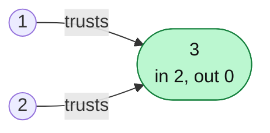
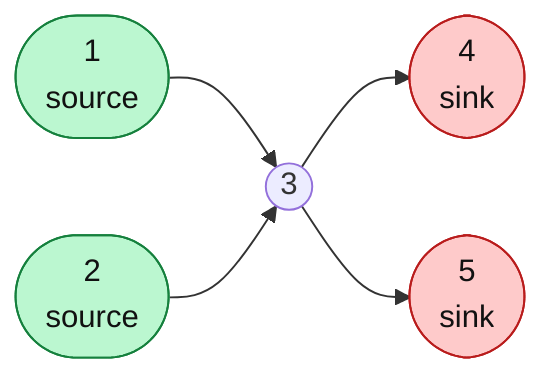
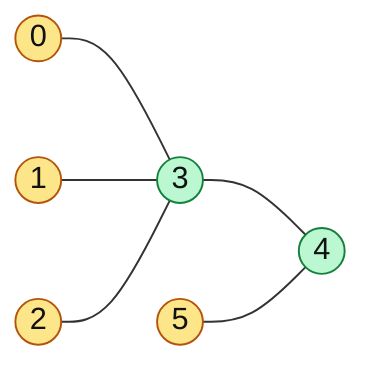

# In-degree / Out-degree Patterns

#### 1. What Is It?

In a **directed** graph:

- **In-degree** of a node = the number of edges **coming into** it.
- **Out-degree** of a node = the number of edges **going out** of it.

Just counting these two numbers solves a surprising number of interview questions **without any DFS or BFS**.

| Degree | Meaning in stories |
|---|---|
| in-degree `0` | nothing points to it: a "start" node, a task with no prerequisites, a source |
| out-degree `0` | it points to nothing: an "end" node, a leaf, a sink |
| in-degree `n - 1` and out-degree `0` | everyone points to it and it points to nobody: the **town judge** |

For an **undirected** graph the same idea uses the plain **degree**: a node with degree `1` is a **leaf**.

Where else degrees are used: Kahn's algorithm (note 16) is built on in-degrees. Peeling leaves finds the centre of a tree.

#### 2. How It Works

Count the degrees in one pass over the edge list:

```text
for each edge (from, to):  outDegree[from]++,  inDegree[to]++
```

*Find the Town Judge* (LeetCode 997): the judge trusts nobody (out-degree 0) and everybody else trusts the judge (in-degree `n - 1`).

```text
n = 3, trust = [[1,3],[2,3]]     edge a → b means "a trusts b"

out-degree: 1→1, 2→1, 3→0
in-degree:  3→2
Node 3: out-degree 0 and in-degree 2 = n - 1  → the judge
```

*Town Judge: everyone trusts node 3, and node 3 trusts nobody (in-degree 2 = n - 1, out-degree 0).*



*Minimum Number of Vertices to Reach All Nodes* (LeetCode 1557): in a DAG, you must start from every node with **in-degree 0**. Nothing can reach them. Every other node is reachable from one of them.

*Sources (in-degree 0, green) cannot be reached from anywhere, so you must start from them. Sinks (out-degree 0, red) lead nowhere.*



*Minimum Height Trees* (LeetCode 310): the best root is at the **centre** of the tree. Remove the leaves (degree 1) layer by layer. The last one or two nodes are the centres.

*Peel the leaves (yellow, degree 1) layer by layer. The last nodes left (green) are the centres, the best roots.*



#### 3. Brute Force vs Optimized

| Question | Brute force | With degree counts |
|---|---|---|
| In-degree and out-degree of every vertex | for each vertex scan all edges: `O(V · E)` | one pass over the edges: `O(V + E)` |
| Find the Town Judge | for each person scan the whole trust list twice: `O(n · E)` | two arrays: `O(n + E)` |
| Minimum vertices to reach all nodes in a DAG | search from each vertex | vertices with in-degree `0`: `O(V + E)` |
| Centre of a tree | BFS from every vertex, find the minimum eccentricity | peel leaves layer by layer: `O(V)` |

```kotlin
// Brute force: Find the Town Judge by scanning the trust list for every person
fun findJudgeBrute(n: Int, trust: Array<IntArray>): Int {
    for (p in 1..n) {
        val trustsSomeone = trust.any { it[0] == p }
        val trustedBy = trust.count { it[1] == p }
        if (!trustsSomeone && trustedBy == n - 1) return p
    }
    return -1
}
```

`findJudgeBrute(3, arrayOf(intArrayOf(1, 3), intArrayOf(2, 3)))` → `3`. `findJudgeBrute(3, arrayOf(intArrayOf(1, 3), intArrayOf(2, 3), intArrayOf(3, 1)))` → `-1`.

#### 4. Kotlin Code

```kotlin
// Find the Town Judge (LeetCode 997): people are 1..n
fun findJudge(n: Int, trust: Array<IntArray>): Int {
    val inDegree = IntArray(n + 1)
    val outDegree = IntArray(n + 1)
    for ((a, b) in trust) {
        outDegree[a]++
        inDegree[b]++
    }
    for (person in 1..n) {
        if (inDegree[person] == n - 1 && outDegree[person] == 0) return person
    }
    return -1
}

// Minimum Number of Vertices to Reach All Nodes (LeetCode 1557)
fun findSmallestSetOfVertices(n: Int, edges: List<List<Int>>): List<Int> {
    val hasIncoming = BooleanArray(n)
    for (edge in edges) hasIncoming[edge[1]] = true
    return (0 until n).filter { !hasIncoming[it] }          // the nodes with in-degree 0
}

// Find Center of Star Graph (LeetCode 1791): the centre appears in every edge
fun findCenter(edges: Array<IntArray>): Int {
    val (a, b) = edges[0]
    val (c, d) = edges[1]
    return if (a == c || a == d) a else b
}

// Minimum Height Trees (LeetCode 310): peel the leaves
fun findMinHeightTrees(n: Int, edges: Array<IntArray>): List<Int> {
    if (n == 1) return listOf(0)
    val graph = List(n) { mutableListOf<Int>() }
    val degree = IntArray(n)
    for ((a, b) in edges) {
        graph[a].add(b); graph[b].add(a)
        degree[a]++; degree[b]++
    }
    val queue = ArrayDeque<Int>()
    for (i in 0 until n) if (degree[i] == 1) queue.addLast(i)        // the leaves

    var remaining = n
    while (remaining > 2) {                                           // 1 or 2 nodes are the centres
        val size = queue.size
        remaining -= size
        repeat(size) {
            val leaf = queue.removeFirst()
            for (next in graph[leaf]) {
                degree[next]--
                if (degree[next] == 1) queue.addLast(next)            // it became a leaf
            }
        }
    }
    return queue.toList()
}
```

Checks: `findJudge(3, [[1,3],[2,3]])` → `3`. `findSmallestSetOfVertices(6, [[0,1],[0,2],[2,5],[3,4],[4,2]])` → `[0, 3]`. `findCenter([[1,2],[2,3],[4,2]])` → `2`. `findMinHeightTrees(4, [[1,0],[1,2],[1,3]])` → `[1]`.

#### 5. Complexity

| | Time | Space |
|---|---|---|
| Count degrees | `O(V + E)` | `O(V)` |
| Minimum Height Trees | `O(V + E)` | `O(V + E)` |
| Find Center of Star Graph | `O(1)` | `O(1)` |

#### 6. Common Mistakes

1. **Mixing up in-degree and out-degree** (the direction of the edge).
2. **Town judge:** forgetting that the judge must have out-degree `0`, or the case `n = 1` (the judge is person 1 when there are no trust edges).
3. **Arrays too small** when people are numbered from 1.
4. **Minimum Height Trees:** forgetting `n == 1`, and stopping at `remaining > 2` (not `> 0`).
5. **Using degrees on a graph with cycles** and expecting a "start" node. A cycle has no node with in-degree 0.

#### 7. Say This in the Interview

1. "I only need counts, so I count in-degree and out-degree in one pass over the edges. That is `O(V + E)` with no search."
2. "The judge has in-degree `n - 1` and out-degree 0."
3. "For a tree centre I peel leaves layer by layer, which is Kahn's idea on an undirected tree."

#### 8. Quick Check

1. A node has in-degree 0 in a DAG. What does that tell you?
2. What is the in-degree of the town judge?

<details>
<summary>Answers</summary>

1. Nothing points to it, so it has no prerequisites. It can go first.
2. `n - 1`.

</details>

#### 9. Related LeetCode Questions

| # | Question | Idea |
|---|---|---|
| 997 | Find the Town Judge (Easy) | in-degree `n - 1`, out-degree `0` |
| 1791 | Find Center of Star Graph (Easy) | the node in every edge |
| 1557 | Minimum Number of Vertices to Reach All Nodes (Medium) | in-degree `0` nodes |
| 310 | Minimum Height Trees (Medium) | peel leaves |
| 207 | Course Schedule (Medium) | Kahn uses in-degrees |
| 2285 | Maximum Total Importance of Roads (Medium) | assign the biggest values to the highest degrees |
