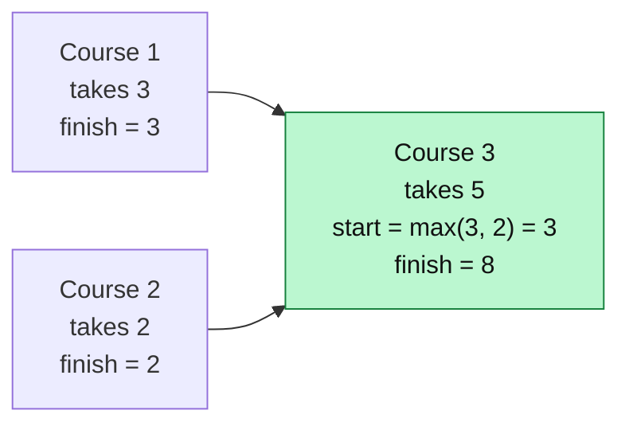
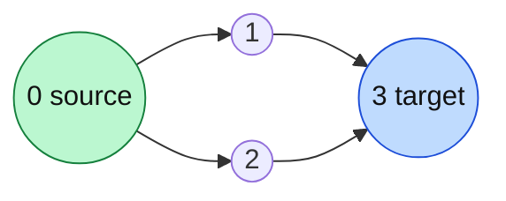

# DAG Problems

> A DAG (directed acyclic graph) can be processed in topological order. That makes many "longest / count / earliest" problems easy.

#### 1. What Is It?

A **DAG** is a directed graph with **no cycle**. Because there is no cycle, you can line the nodes up in **topological order** (note 15 or 16), so every edge goes from left to right.

That gives a powerful method:

> **Process the nodes in topological order. When you reach a node, all its predecessors are already done, so its answer can be computed from theirs.**

It works like dynamic programming on a graph.

| Problem type | Example |
|---|---|
| **Longest path** / earliest finish time | Parallel Courses III |
| **Count the paths** from A to B | All Paths From Source to Target |
| **Shortest path** with negative weights, in a DAG | one pass in topological order |
| **Minimum rounds** / levels | Parallel Courses |

(In a general graph the longest path is very hard. In a DAG it is easy.)

#### 2. How It Works

*Parallel Courses III* (LeetCode 2050): each course takes some months. You may take several courses at the same time, but a course can start only after all its prerequisites have **finished**. What is the **minimum total time**?

For each course keep `finish[course]` = the earliest month it can be finished.

*Each course finishes at (latest prerequisite finish) + (its own time). Course 3 must wait for both 1 and 2.*



```text
courses: 1 (3 months), 2 (2 months), 3 (5 months)       relations: 1 → 3,  2 → 3

finish[1] = 3,  finish[2] = 2          (no prerequisites)
course 3 can start when both 1 and 2 are done: max(3, 2) = 3
finish[3] = 3 + 5 = 8

answer = the largest finish time = 8
```

Process with Kahn's algorithm (note 16): when you take a course from the queue, for each course `next` it unlocks, update `finish[next] = max(finish[next], finish[course] + time[next])`.

*All Paths From Source to Target* (LeetCode 797): because the graph is a DAG, plain DFS with backtracking works and **needs no visited set** (note 8).

*Example: graph = [[1,2],[3],[3],[]]. There are 2 paths from 0 to 3: 0 → 1 → 3 and 0 → 2 → 3.*



#### 3. Brute Force vs Optimized

| Problem | Brute force | Topological order DP |
|---|---|---|
| Longest path in a DAG (Parallel Courses III) | DFS over every path: exponential | process in topological order, `finish[next] = max(finish[next], finish[u] + time[next])`: `O(V + E)` |
| Count the paths from `A` to `B` | enumerate every path | `ways[next] += ways[u]` in topological order: `O(V + E)` |
| Earliest start times | simulate time steps | Kahn by levels |
| Shortest path with negative edges (no cycles) | Bellman-Ford `O(V · E)` | one pass in topological order: `O(V + E)` |

When you process a vertex in topological order, **all its predecessors are already finished**, so its answer can be computed from theirs. This is dynamic programming on a graph.

```text
courses: 1 (3 months), 2 (2 months), 3 (5 months);  1 → 3, 2 → 3
finish[1] = 3, finish[2] = 2, finish[3] = max(3, 2) + 5 = 8     answer 8
```

All Paths From Source to Target on a DAG needs no `visited` set: there is no cycle, so plain DFS with backtracking is safe.

#### 4. Kotlin Code

```kotlin
// Parallel Courses III (LeetCode 2050): courses are 1..n, relations[i] = [prev, next], time[i] = months for course i + 1
fun minimumTime(n: Int, relations: Array<IntArray>, time: IntArray): Int {
    val graph = List(n) { mutableListOf<Int>() }
    val indegree = IntArray(n)
    for ((prev, next) in relations) {
        graph[prev - 1].add(next - 1)
        indegree[next - 1]++
    }

    val finish = IntArray(n) { time[it] }                       // earliest finish, at least its own time
    val queue = ArrayDeque<Int>()
    for (i in 0 until n) if (indegree[i] == 0) queue.addLast(i)

    while (queue.isNotEmpty()) {
        val course = queue.removeFirst()
        for (next in graph[course]) {
            finish[next] = maxOf(finish[next], finish[course] + time[next])
            indegree[next]--
            if (indegree[next] == 0) queue.addLast(next)
        }
    }
    return finish.max()
}

// All Paths From Source to Target (LeetCode 797): graph[i] = nodes you can go to from i
fun allPathsSourceTarget(graph: Array<IntArray>): List<List<Int>> {
    val result = mutableListOf<List<Int>>()
    val path = mutableListOf(0)

    fun go(node: Int) {
        if (node == graph.size - 1) {
            result.add(path.toList())
            return
        }
        for (next in graph[node]) {
            path.add(next)
            go(next)
            path.removeAt(path.size - 1)                        // backtrack
        }
    }

    go(0)
    return result
}

// Count the paths from 0 to n - 1 in a DAG with memoization (no need to list them)
fun countPaths(graph: Array<IntArray>): Int {
    val memo = IntArray(graph.size) { -1 }
    fun count(node: Int): Int {
        if (node == graph.size - 1) return 1
        if (memo[node] != -1) return memo[node]
        var total = 0
        for (next in graph[node]) total += count(next)
        memo[node] = total
        return total
    }
    return count(0)
}
```

Checks: `minimumTime(3, [[1,3],[2,3]], [3,2,5])` → `8`. `allPathsSourceTarget([[1,2],[3],[3],[]])` → `[[0,1,3],[0,2,3]]`. `countPaths([[1,2],[3],[3],[]])` → `2`.

`finish.max()` needs a recent Kotlin version (1.7+). On older versions use `finish.maxOrNull()!!`.

#### 5. Complexity

| | Time | Space |
|---|---|---|
| Longest path / DP in topological order | `O(V + E)` | `O(V)` |
| Count paths with memo | `O(V + E)` | `O(V)` |
| List all paths | exponential in the worst case | `O(V)` + the answer |

#### 6. Common Mistakes

1. **Using DP on a graph with a cycle.** The order does not exist.
2. **Updating `finish[next]` with `finish[course]` only**, forgetting to add `time[next]`.
3. **Taking the sum instead of the maximum** over prerequisites. A course waits for the slowest prerequisite.
4. **1-based course numbers** with 0-based arrays.
5. **Answering with `finish[last]`** instead of the maximum over all courses.
6. **Listing all paths** when only the count is needed. Use memoization.

#### 7. Say This in the Interview

1. "This is a DAG, so I process nodes in topological order. When I reach a node, all its prerequisites are done."
2. "A course can start when its slowest prerequisite finishes, so `finish[next] = max(finish[next], finish[course] + time[next])`."
3. "Time `O(V + E)`."

#### 8. Quick Check

1. Why does a DAG make the longest path easy?
2. In Parallel Courses III, what is the total time of independent courses taken at the same time?

<details>
<summary>Answers</summary>

1. In topological order, each node's predecessors are already computed, so one pass is enough. There is no cycle to go around.
2. The **maximum** of their times, not the sum, because they run in parallel.

</details>

#### 9. Related LeetCode Questions

| # | Question | Idea |
|---|---|---|
| 797 | All Paths From Source to Target (Medium) | DFS + backtracking in a DAG |
| 2050 | Parallel Courses III (Hard) | longest path with Kahn |
| 1136 | Parallel Courses (premium) | levels = semesters |
| 329 | Longest Increasing Path in a Matrix (Hard) | DFS + memo on an implicit DAG |
| 1857 | Largest Color Value in a Directed Graph (Hard) | DP over a topological order |
| 210 | Course Schedule II (Medium) | the order itself |
