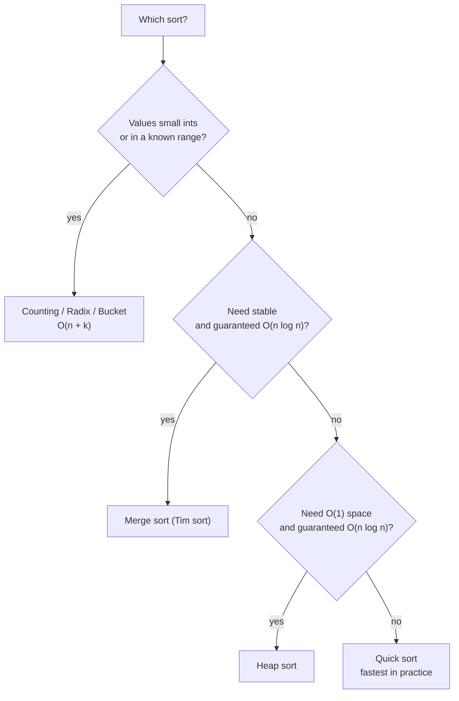

# Sorting Fundamentals

> Put items in order so that searching, merging, grouping and duplicate checks become easy. Know the vocabulary (stable, in-place) and the speed limit (`O(n log n)`) before the individual algorithms.

#### 1. What Is It?

**Sorting** rearranges items by a rule: numbers by value, names alphabetically, products by price, logs by time.

**Why it matters in interviews.** Sorting is often the first step that makes a problem easy:

| After sorting... | You can... | Example |
|---|---|---|
| equal items sit side by side | find duplicates in one pass | Contains Duplicate |
| the data is ordered | binary search, two pointers | Two Sum II, 3Sum |
| overlapping items are neighbours | merge them | Merge Intervals |
| the best items are at one end | pick greedily | Meeting Rooms, Assign Cookies |

**Key terms**

| Term | Plain meaning |
|---|---|
| **Stable** | equal items keep their original order |
| **In-place** | uses `O(1)` extra memory (only a few variables) |
| **Comparison sort** | decides order only by comparing two items (`<`) |
| **Non-comparison sort** | uses the values themselves as positions (counting, radix, bucket) |
| **Adaptive** | gets faster when the input is already nearly sorted |

**Stable example.** Sort `(A,20) (B,10) (C,20)` by the number:

```text
stable:    (B,10) (A,20) (C,20)    A is still before C
unstable:  (B,10) (C,20) (A,20)    A and C swapped: allowed, but surprising
```

Stability matters when you sort **twice** (first by name, then by score): a stable sort keeps the name order inside each score.

#### 2. How It Works

**The speed limit.** Any comparison sort must distinguish `n!` possible orders. Each comparison has two outcomes, so you need at least `log₂(n!)` comparisons, and `log₂(n!) ≈ n log₂ n`. So **no comparison sort can beat `O(n log n)`** in the worst case. To go faster (`O(n + k)`) you must use the values directly: counting, radix and bucket sort.



**Comparison table of the classic sorts**

| Sort | Best | Average | Worst | Space | Stable | Note |
|---|---|---|---|---|---|---|
| Bubble | `O(n)` | `O(n²)` | `O(n²)` | `O(1)` | yes | teaching only |
| Selection | `O(n²)` | `O(n²)` | `O(n²)` | `O(1)` | no | fewest swaps (`n − 1`) |
| Insertion | `O(n)` | `O(n²)` | `O(n²)` | `O(1)` | yes | great for small or nearly sorted input |
| Merge | `O(n log n)` | `O(n log n)` | `O(n log n)` | `O(n)` | yes | linked lists, external sort |
| Quick | `O(n log n)` | `O(n log n)` | `O(n²)` | `O(log n)` | no | fastest in practice |
| Heap | `O(n log n)` | `O(n log n)` | `O(n log n)` | `O(1)` | no | guaranteed, in place |
| Counting | `O(n + k)` | `O(n + k)` | `O(n + k)` | `O(k)` | yes | small integer range `k` |
| Radix | `O(d(n + k))` | `O(d(n + k))` | `O(d(n + k))` | `O(n + k)` | yes | `d` digits |
| Bucket | `O(n + k)` | `O(n + k)` | `O(n²)` | `O(n + k)` | yes | uniformly spread values |

**What real libraries do.** Kotlin and Java sort objects with **Tim sort** (merge + insertion, stable, `O(n log n)`). Primitive arrays such as `IntArray` use a dual-pivot quicksort. In an interview, use the library sort unless the question asks you to write one.

#### 3. Brute Force vs Optimized

| Approach | Time | When |
|---|---|---|
| Simple sorts (bubble, selection, insertion) | `O(n²)` | tiny input, or to explain the idea |
| Merge / quick / heap | `O(n log n)` | general purpose |
| Counting / radix / bucket | `O(n + k)` | values in a small range |
| **Do you need a full sort?** | | |
| Only the Kth element | `O(n)` quickselect | Kth Largest |
| Only the top K | `O(n log k)` heap | Top K Frequent |
| Only min and max | `O(n)` scan | no sort at all |

**Interview habit:** before you sort, ask "do I need the whole order?" Often a scan, a heap or a hash map does the job faster.

#### 4. Kotlin Code

```kotlin
// Library sorts you should know
val nums = intArrayOf(5, 2, 9, 1)
val asc = nums.sortedArray()                       // [1, 2, 5, 9] new array
val desc = nums.sortedArrayDescending()            // [9, 5, 2, 1]
nums.sort()                                        // in place, nums = [1, 2, 5, 9]

// Sorting objects: stable (Tim sort)
data class Player(val name: String, val score: Int)
val players = listOf(Player("A", 20), Player("B", 10), Player("C", 20))

val byScore = players.sortedBy { it.score }
// [B(10), A(20), C(20)]   A stays before C: stable

val byScoreDescThenName = players.sortedWith(compareBy({ -it.score }, { it.name }))
// [A(20), C(20), B(10)]   score high to low, ties by name

// Custom comparator with sortedWith (Largest Number style)
fun largestNumber(nums: IntArray): String {
    val parts = nums.map { it.toString() }.sortedWith { a, b -> (b + a).compareTo(a + b) }
    return if (parts[0] == "0") "0" else parts.joinToString("")
}

// Check whether an array is sorted (a handy test helper)
fun isSorted(a: IntArray): Boolean {
    for (i in 1 until a.size) if (a[i - 1] > a[i]) return false
    return true
}
```

Checks: `intArrayOf(5, 2, 9, 1).sortedArray()` → `[1, 2, 5, 9]`. `players.sortedBy { it.score }` names → `B, A, C`. `players.sortedWith(compareBy({ -it.score }, { it.name }))` names → `A, C, B`. `largestNumber(intArrayOf(3, 30, 34, 5, 9))` → `"9534330"`. `largestNumber(intArrayOf(0, 0))` → `"0"`. `isSorted(intArrayOf(1, 2, 2, 3))` → `true`; `isSorted(intArrayOf(2, 1))` → `false`.

**Comparator rule.** A comparator returns a negative number if `a` goes first, positive if `b` goes first, zero if equal. Never return `a − b` for large ints (overflow); use `compareValues(a, b)` or `a.compareTo(b)`.

#### 5. Complexity

| | Time | Space |
|---|---|---|
| Comparison sort lower bound | `Ω(n log n)` | |
| Library sort of objects (Tim sort) | `O(n log n)` | `O(n)` |
| Library sort of `IntArray` | `O(n log n)` | `O(log n)` |
| Checking sortedness | `O(n)` | `O(1)` |

#### 6. Common Mistakes

1. **Sorting when a scan or a heap is enough.**
2. **Ignoring stability** when sorting by two keys.
3. **Comparator `a − b` overflow** on large or negative values.
4. **Sorting the original** when the caller expects it unchanged (`sort()` is in place; `sorted()` makes a copy).
5. **Forgetting the cost of the sort** when stating complexity: `O(n log n)` dominates a later `O(n)` pass.
6. **Writing a sort from scratch** when the library one is allowed.
7. **Claiming quicksort is always `O(n log n)`.** Its worst case is `O(n²)`.

#### 7. Say This in the Interview

1. "Sorting first costs `O(n log n)`, but then I can solve it in one `O(n)` pass, so the total is `O(n log n)`."
2. "No comparison sort can beat `n log n`. If the values are small integers I can use counting sort in `O(n + k)`."
3. "I need a stable sort here because I'm sorting by the second key after the first."
4. "Do I need the full order? For the Kth element, quickselect is `O(n)`."

#### 8. Quick Check

1. What does "stable" mean?
2. Fastest possible comparison sort in the worst case?
3. Which simple sort uses the fewest swaps?

<details>
<summary>Answers</summary>

1. Equal items keep their original relative order.
2. `O(n log n)`: it is a proven lower bound.
3. Selection sort: at most `n − 1` swaps.

</details>

#### 9. Related LeetCode Questions

| # | Question | Idea |
|---|---|---|
| 912 | [Sort an Array](https://leetcode.com/problems/sort-an-array/) (Medium) | write merge or heap sort |
| 242 | [Valid Anagram](https://leetcode.com/problems/valid-anagram/) (Easy) | sort or count |
| 217 | [Contains Duplicate](https://leetcode.com/problems/contains-duplicate/) (Easy) | neighbours after sorting |
| 1122 | [Relative Sort Array](https://leetcode.com/problems/relative-sort-array/) (Easy) | custom order |
| 179 | [Largest Number](https://leetcode.com/problems/largest-number/) (Medium) | custom comparator |
| 56 | [Merge Intervals](https://leetcode.com/problems/merge-intervals/) (Medium) | sort by start |
