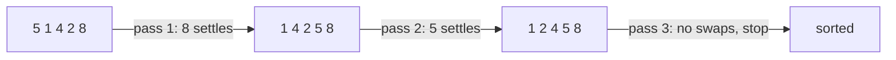

# Bubble Sort

> Repeatedly swap neighbours that are in the wrong order. After each pass, the largest remaining item has "bubbled" to the end. Simple, slow, mostly for learning.

#### 1. What Is It?

Compare each pair of neighbours. If the left one is bigger, swap them. One full pass puts the **largest** unsorted item in its final place at the right end.

| Property | Value |
|---|---|
| Stable | yes (swap only when strictly greater) |
| In place | yes |
| Adaptive | yes, with the early-exit flag |
| Use in practice | almost never |

**Signal:** an interviewer asks "explain a simple sorting algorithm", or wants to see you write one quickly and then improve on it.

#### 2. How It Works

Sort `[5, 1, 4, 2, 8]`:

```text
Pass 1: 5>1 swap → [1,5,4,2,8]   5>4 swap → [1,4,5,2,8]
        5>2 swap → [1,4,2,5,8]   5<8 keep → [1,4,2,5,8]      8 is in place
Pass 2: 1<4 keep                 4>2 swap → [1,2,4,5,8]
        4<5 keep                                              5 is in place
Pass 3: no swaps at all → stop early                          sorted: [1,2,4,5,8]
```



**Early exit.** If a whole pass makes no swap, the array is already sorted. This makes the best case `O(n)` (already sorted input).

**Shrinking range.** After pass `p`, the last `p` items are final, so each pass can stop one place earlier.

#### 3. Brute Force vs Optimized

| Version | Best | Worst |
|---|---|---|
| Plain: always `n − 1` passes over all pairs | `O(n²)` | `O(n²)` |
| Shrinking range | `O(n²)` | `O(n²)` |
| **Shrinking range + early exit** | **`O(n)`** | `O(n²)` |
| Merge / quick / heap sort | `O(n log n)` | `O(n log n)` (quick: `O(n²)`) |

```kotlin
// Plain version: no early exit
fun bubbleSortPlain(a: IntArray) {
    for (i in 0 until a.size - 1)
        for (j in 0 until a.size - 1 - i)
            if (a[j] > a[j + 1]) { val t = a[j]; a[j] = a[j + 1]; a[j + 1] = t }
}
```

#### 4. Kotlin Code

```kotlin
fun bubbleSort(a: IntArray) {
    for (i in 0 until a.size - 1) {
        var swapped = false
        for (j in 0 until a.size - 1 - i) {          // last i items are already in place
            if (a[j] > a[j + 1]) {
                val t = a[j]; a[j] = a[j + 1]; a[j + 1] = t
                swapped = true
            }
        }
        if (!swapped) return                          // sorted: stop early
    }
}
```

Checks: `[5, 1, 4, 2, 8]` → `[1, 2, 4, 5, 8]`. `[3, 3, 1]` → `[1, 3, 3]`. `[1, 2, 3]` → `[1, 2, 3]` after a single pass (early exit). `[]` and `[7]` → unchanged. `[9, 8, 7, 6]` → `[6, 7, 8, 9]` (worst case: 6 swaps).

#### 5. Complexity

| | Time | Space |
|---|---|---|
| Best (already sorted, with flag) | `O(n)` | `O(1)` |
| Average / worst | `O(n²)` | `O(1)` |
| Swaps in the worst case | `n(n − 1)/2` | |

#### 6. Common Mistakes

1. **Inner loop going to the end** (`a[j + 1]` out of bounds). The limit is `size − 1 − i`.
2. **Forgetting the `swapped` flag**, so sorted input is still `O(n²)`.
3. **Using `>=` for the swap**, which makes it unstable and wastes swaps.
4. **Offering it as the "best" answer.** Say it is for learning and name a better one.

#### 7. Say This in the Interview

1. "Bubble sort swaps adjacent out-of-order pairs. After each pass the largest item is in place."
2. "It is `O(n²)`, but with an early-exit flag it is `O(n)` on sorted input, and it is stable and in place."
3. "In practice I'd use a library sort, or merge sort if asked to write `O(n log n)`."

#### 8. Quick Check

1. After pass 1, what is guaranteed?
2. Best case with the flag?
3. Number of swaps for `[3, 2, 1]`?

<details>
<summary>Answers</summary>

1. The largest item is at the last index.
2. `O(n)`: one pass, no swaps.
3. 3 swaps (each pair is inverted).

</details>

#### 9. Related LeetCode Questions

| # | Question | Idea |
|---|---|---|
| 1051 | [Height Checker](https://leetcode.com/problems/height-checker/) (Easy) | compare with the sorted order |
| 905 | [Sort Array By Parity](https://leetcode.com/problems/sort-array-by-parity/) (Easy) | swap-based partition |
| 283 | [Move Zeroes](https://leetcode.com/problems/move-zeroes/) (Easy) | stable move in place |
| 75 | [Sort Colors](https://leetcode.com/problems/sort-colors/) (Medium) | three-way partition |
| 912 | [Sort an Array](https://leetcode.com/problems/sort-an-array/) (Medium) | needs `O(n log n)` |
