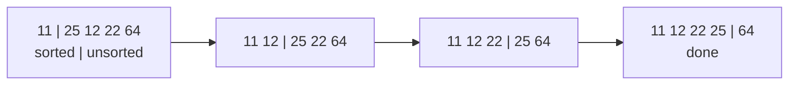

# Selection Sort

> Repeatedly pick the smallest item from the unsorted part and put it at the front. Always `O(n²)` comparisons, but at most `n − 1` swaps.

#### 1. What Is It?

Split the array into a **sorted prefix** (left) and an **unsorted rest** (right). Each round, **select** the minimum of the rest and swap it into the first unsorted position.

| Property | Value |
|---|---|
| Stable | no (the swap can jump over equal items) |
| In place | yes |
| Adaptive | no (always scans the whole rest) |
| Swaps | at most `n − 1` |

**Signal:** writing to memory is expensive (few swaps wanted), or the interviewer asks for a simple sort with a clear invariant. Also the idea behind "find the Kth smallest by selecting `k` times".

#### 2. How It Works

Sort `[64, 25, 12, 22, 11]`:

```text
i=0: min of all = 11 (index 4) → swap with index 0 → [11, 25, 12, 22, 64]
i=1: min of rest = 12 (index 2) → swap with index 1 → [11, 12, 25, 22, 64]
i=2: min of rest = 22 (index 3) → swap with index 2 → [11, 12, 22, 25, 64]
i=3: min of rest = 25 (already there)                → [11, 12, 22, 25, 64]
```



**Why it is unstable.** `[4a, 4b, 2]`: the minimum `2` is swapped with `4a`, giving `[2, 4b, 4a]`. The two 4s changed order.

#### 3. Brute Force vs Optimized

Selection sort has no early exit: even sorted input costs `O(n²)` comparisons. Its one advantage is the swap count.

| Sort | Comparisons | Swaps |
|---|---|---|
| Bubble | `O(n²)` | up to `O(n²)` |
| **Selection** | `O(n²)` | **at most `n − 1`** |
| Insertion | `O(n²)` | up to `O(n²)` shifts |
| Heap sort (selection with a heap) | `O(n log n)` | `O(n log n)` |

Heap sort is selection sort with a smarter way to find the maximum: a heap finds it in `O(log n)` instead of `O(n)`.

```kotlin
// Brute force idea for Kth smallest: select the minimum k times
fun kthSmallestBySelection(a: IntArray, k: Int): Int {
    val b = a.copyOf()
    for (i in 0 until k) {
        var m = i
        for (j in i + 1 until b.size) if (b[j] < b[m]) m = j
        val t = b[i]; b[i] = b[m]; b[m] = t
    }
    return b[k - 1]
}
```

#### 4. Kotlin Code

```kotlin
fun selectionSort(a: IntArray) {
    for (i in 0 until a.size - 1) {
        var minIndex = i
        for (j in i + 1 until a.size) {
            if (a[j] < a[minIndex]) minIndex = j       // select the smallest
        }
        if (minIndex != i) {                            // swap only if needed
            val t = a[i]; a[i] = a[minIndex]; a[minIndex] = t
        }
    }
}
```

Checks: `[64, 25, 12, 22, 11]` → `[11, 12, 22, 25, 64]`. `[3, 1, 2]` → `[1, 2, 3]`. `[1, 1, 1]` → unchanged. `[]`, `[5]` → unchanged. `kthSmallestBySelection(intArrayOf(7, 10, 4, 3, 20, 15), 3)` → `7`.

#### 5. Complexity

| | Time | Space |
|---|---|---|
| Best / average / worst | `O(n²)` | `O(1)` |
| Comparisons | `n(n − 1)/2` always | |
| Swaps | `≤ n − 1` | |

#### 6. Common Mistakes

1. **Swapping inside the inner loop** (that is a different, slower algorithm).
2. **Claiming it is stable.** It is not.
3. **Inner loop starting at `i`** instead of `i + 1` (harmless but sloppy).
4. **Expecting an early exit** on sorted input. There is none.

#### 7. Say This in the Interview

1. "Selection sort finds the minimum of the unsorted part and swaps it to the front. It is `O(n²)` always but does at most `n − 1` swaps."
2. "It is not stable, because the long-distance swap can reorder equal items."
3. "Heap sort is the same idea, with a heap to find the extreme in `O(log n)`."

#### 8. Quick Check

1. Best-case time?
2. Maximum number of swaps?
3. Why unstable?

<details>
<summary>Answers</summary>

1. Still `O(n²)`: the scan never stops early.
2. `n − 1`.
3. A swap can move an item past an equal item.

</details>

#### 9. Related LeetCode Questions

| # | Question | Idea |
|---|---|---|
| 414 | [Third Maximum Number](https://leetcode.com/problems/third-maximum-number/) (Easy) | select the max three times |
| 1200 | [Minimum Absolute Difference](https://leetcode.com/problems/minimum-absolute-difference/) (Easy) | sort, compare neighbours |
| 1122 | [Relative Sort Array](https://leetcode.com/problems/relative-sort-array/) (Easy) | ordered selection |
| 215 | [Kth Largest Element in an Array](https://leetcode.com/problems/kth-largest-element-in-an-array/) (Medium) | select the Kth |
| 75 | [Sort Colors](https://leetcode.com/problems/sort-colors/) (Medium) | swap-based placement |
