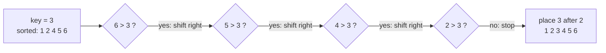

# Insertion Sort

> Take the next item and slide it left into its place in the sorted part, like sorting playing cards in your hand. Best for **small** or **nearly sorted** data.

#### 1. What Is It?

Keep a sorted prefix. Pick the next item (the **key**), shift larger sorted items one step right, and drop the key into the gap.

| Property | Value |
|---|---|
| Stable | yes (shift only while strictly greater) |
| In place | yes |
| Adaptive | yes: `O(n)` on nearly sorted data |
| Online | yes (can sort items as they arrive) |

**Why it matters:** real libraries (Tim sort, introsort) use insertion sort for **small chunks** (about 16–32 items), because it has low overhead.

**Signal:** "the array is almost sorted", "only a few items are out of place", "items arrive one at a time", or sorting a **linked list** by insertion.

#### 2. How It Works

Sort `[5, 2, 4, 6, 1, 3]`:

```text
start:        [5 | 2, 4, 6, 1, 3]
key 2: shift 5            → [2, 5 | 4, 6, 1, 3]
key 4: shift 5            → [2, 4, 5 | 6, 1, 3]
key 6: nothing to shift   → [2, 4, 5, 6 | 1, 3]
key 1: shift 6,5,4,2      → [1, 2, 4, 5, 6 | 3]
key 3: shift 6,5,4        → [1, 2, 3, 4, 5, 6]
```



**Cost depends on disorder.** The work equals the number of **inversions** (pairs in the wrong order). Sorted input has 0 inversions → `O(n)`. Reversed input has `n(n − 1)/2` → `O(n²)`.

#### 3. Brute Force vs Optimized

| Version | Finding the spot | Moving items | Total worst |
|---|---|---|---|
| Plain insertion | scan left | shift while scanning | `O(n²)` |
| **Binary insertion** | binary search `O(log n)` | still shifts `O(n)` | `O(n²)` moves, fewer comparisons |
| Merge / quick / heap | | | `O(n log n)` |

Binary insertion saves comparisons, not shifts, so it helps only when comparisons are expensive.

```kotlin
// Binary insertion: finds the position with binary search (fewer comparisons)
fun binaryInsertionSort(a: IntArray) {
    for (i in 1 until a.size) {
        val key = a[i]
        var lo = 0
        var hi = i                                     // find the first index with a[idx] > key
        while (lo < hi) {
            val mid = lo + (hi - lo) / 2
            if (a[mid] <= key) lo = mid + 1 else hi = mid   // <= keeps it stable
        }
        for (j in i downTo lo + 1) a[j] = a[j - 1]
        a[lo] = key
    }
}
```

#### 4. Kotlin Code

```kotlin
fun insertionSort(a: IntArray) {
    for (i in 1 until a.size) {
        val key = a[i]
        var j = i - 1
        while (j >= 0 && a[j] > key) {            // shift bigger items right
            a[j + 1] = a[j]
            j--
        }
        a[j + 1] = key                            // drop the key in the gap
    }
}
```

Checks: `[5, 2, 4, 6, 1, 3]` → `[1, 2, 3, 4, 5, 6]`. `[1, 2, 3]` → unchanged with no shifts. `[3, 2, 1]` → `[1, 2, 3]`. `[2, 2, 1]` → `[1, 2, 2]`. `[]`, `[5]` → unchanged. `binaryInsertionSort` on `[5, 2, 4, 6, 1, 3]` → `[1, 2, 3, 4, 5, 6]`.

#### 5. Complexity

| | Time | Space |
|---|---|---|
| Best (sorted) | `O(n)` | `O(1)` |
| Average / worst | `O(n²)` | `O(1)` |
| Work | `O(n + inversions)` | |

#### 6. Common Mistakes

1. **`a[j] >= key` in the loop**, which breaks stability.
2. **Overwriting the key** before saving it (always store `key = a[i]` first).
3. **Checking `a[j]` before `j >= 0`** (index −1 error). Order the conditions as `j >= 0 && a[j] > key`.
4. **Swapping repeatedly** instead of shifting (works, but about 3× the writes).
5. **Using it on big random input.**

#### 7. Say This in the Interview

1. "Insertion sort grows a sorted prefix by sliding each new item into place. It is `O(n²)` worst case but `O(n)` for nearly sorted input."
2. "It is stable, in place and online, which is why library sorts use it for small chunks."
3. "The running time is proportional to the number of inversions."

#### 8. Quick Check

1. Best case and when?
2. Number of inversions in `[3, 2, 1]`?
3. Why do libraries still use it?

<details>
<summary>Answers</summary>

1. `O(n)` when the input is already sorted.
2. 3: `(3,2) (3,1) (2,1)`.
3. Very low overhead, so it beats fancy sorts on tiny chunks.

</details>

#### 9. Related LeetCode Questions

| # | Question | Idea |
|---|---|---|
| 147 | [Insertion Sort List](https://leetcode.com/problems/insertion-sort-list/) (Medium) | insertion on a linked list |
| 88 | [Merge Sorted Array](https://leetcode.com/problems/merge-sorted-array/) (Easy) | insert from the back |
| 977 | [Squares of a Sorted Array](https://leetcode.com/problems/squares-of-a-sorted-array/) (Easy) | merge two ordered halves |
| 75 | [Sort Colors](https://leetcode.com/problems/sort-colors/) (Medium) | in-place ordering |
| 912 | [Sort an Array](https://leetcode.com/problems/sort-an-array/) (Medium) | needs `O(n log n)` |
