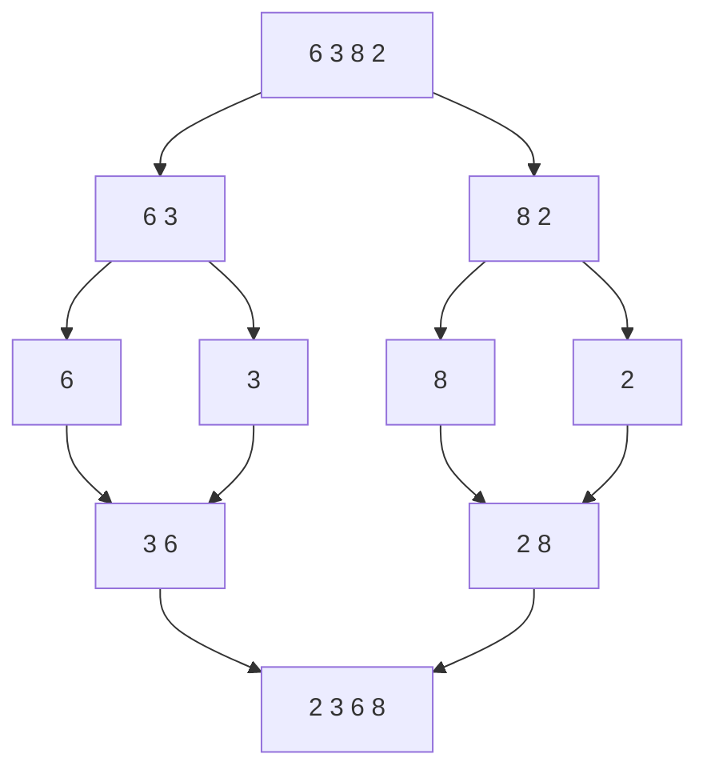

# Merge Sort

> Split the array in half, sort each half, then **merge** the two sorted halves. Guaranteed `O(n log n)`, stable, and the best choice for linked lists and huge data.

#### 1. What Is It?

Merge sort is **divide and conquer**:

1. **Divide:** split the array into two halves.
2. **Conquer:** sort each half (recursively).
3. **Combine:** merge two sorted halves into one sorted array in `O(n)`.

| Property | Value |
|---|---|
| Time | `O(n log n)` in every case |
| Space | `O(n)` for arrays (`O(log n)` for linked lists) |
| Stable | yes |
| In place | no (needs a helper array) |

**Signals:** "sort a linked list", "guaranteed `O(n log n)`", "stable sort", "data too big for memory (external sort)", "count inversions / smaller numbers after self" (the merge step counts as it goes).

#### 2. How It Works

Sort `[6, 3, 8, 2]`:



**The merge step.** Two pointers, one on each sorted half. Take the smaller front item each time.

```text
left  = [3, 6]      right = [2, 8]
compare 3 vs 2 → take 2    result [2]
compare 3 vs 8 → take 3    result [2, 3]
compare 6 vs 8 → take 6    result [2, 3, 6]
left empty → copy the rest of right: 8     result [2, 3, 6, 8]
```

On a **tie**, take from the **left** half. That is what makes merge sort stable.

**Why `n log n`.** The array is halved `log₂ n` times (the number of levels), and each level does `O(n)` work to merge: `n × log n`.

#### 3. Brute Force vs Optimized

| Approach | Time | Note |
|---|---|---|
| Simple sorts (insertion) | `O(n²)` | |
| **Merge sort** | **`O(n log n)`** | extra `O(n)` space |
| Quick sort | `O(n log n)` avg | in place, not stable |
| Heap sort | `O(n log n)` | in place, not stable |

**Common optimisation:** allocate one helper array once and reuse it (instead of copying slices in every call), and use insertion sort for ranges smaller than about 16 items.

```kotlin
// Simple but wasteful: creates new arrays at every level
fun mergeSortCopy(a: IntArray): IntArray {
    if (a.size <= 1) return a
    val mid = a.size / 2
    val left = mergeSortCopy(a.copyOfRange(0, mid))
    val right = mergeSortCopy(a.copyOfRange(mid, a.size))
    val out = IntArray(a.size)
    var i = 0; var j = 0; var k = 0
    while (i < left.size && j < right.size) out[k++] = if (left[i] <= right[j]) left[i++] else right[j++]
    while (i < left.size) out[k++] = left[i++]
    while (j < right.size) out[k++] = right[j++]
    return out
}
```

#### 4. Kotlin Code

```kotlin
// Optimised: one helper array, half-open ranges [lo, hi)
fun mergeSort(a: IntArray) {
    if (a.size < 2) return
    sortRange(a, IntArray(a.size), 0, a.size)
}

private fun sortRange(a: IntArray, tmp: IntArray, lo: Int, hi: Int) {
    if (hi - lo <= 1) return
    val mid = lo + (hi - lo) / 2
    sortRange(a, tmp, lo, mid)
    sortRange(a, tmp, mid, hi)
    var i = lo; var j = mid; var k = lo
    while (i < mid && j < hi) tmp[k++] = if (a[i] <= a[j]) a[i++] else a[j++]   // <= keeps it stable
    while (i < mid) tmp[k++] = a[i++]
    while (j < hi) tmp[k++] = a[j++]
    for (x in lo until hi) a[x] = tmp[x]
}

// Count inversions (pairs i < j with a[i] > a[j]): merge sort with a counter
fun countInversions(input: IntArray): Long {
    val a = input.copyOf()
    val tmp = IntArray(a.size)
    fun sort(lo: Int, hi: Int): Long {
        if (hi - lo <= 1) return 0
        val mid = lo + (hi - lo) / 2
        var count = sort(lo, mid) + sort(mid, hi)
        var i = lo; var j = mid; var k = lo
        while (i < mid && j < hi) {
            if (a[i] <= a[j]) tmp[k++] = a[i++]
            else { tmp[k++] = a[j++]; count += (mid - i) }      // all remaining left items are bigger
        }
        while (i < mid) tmp[k++] = a[i++]
        while (j < hi) tmp[k++] = a[j++]
        for (x in lo until hi) a[x] = tmp[x]
        return count
    }
    return sort(0, a.size)
}

// Merge two sorted linked lists (LeetCode 21): the merge step on nodes, O(1) extra space
class ListNode(var `val`: Int) { var next: ListNode? = null }

fun mergeTwoLists(l1: ListNode?, l2: ListNode?): ListNode? {
    val dummy = ListNode(0)
    var tail = dummy
    var a = l1
    var b = l2
    while (a != null && b != null) {
        if (a.`val` <= b.`val`) { tail.next = a; a = a.next } else { tail.next = b; b = b.next }
        tail = tail.next!!
    }
    tail.next = a ?: b
    return dummy.next
}
```

Checks: `mergeSort` on `[6, 3, 8, 2]` → `[2, 3, 6, 8]`. `[5, 1, 1, 2, 0, 0]` → `[0, 0, 1, 1, 2, 5]`. `[]`, `[9]` → unchanged. `mergeSortCopy(intArrayOf(3, 1, 2))` → `[1, 2, 3]`. `countInversions(intArrayOf(2, 4, 1, 3, 5))` → `3`. `countInversions(intArrayOf(3, 2, 1))` → `3`. `countInversions(intArrayOf(1, 2, 3))` → `0`. `mergeTwoLists([1,2,4], [1,3,4])` → `1→1→2→3→4→4`.

#### 5. Complexity

| | Time | Space |
|---|---|---|
| Best / average / worst | `O(n log n)` | `O(n)` array |
| Recursion stack | | `O(log n)` |
| Linked list | `O(n log n)` | `O(log n)` stack only |

#### 6. Common Mistakes

1. **`mid = (lo + hi) / 2` overflow** for huge indexes. Use `lo + (hi − lo) / 2`.
2. **`<` instead of `<=` in the merge**, which makes it unstable.
3. **Forgetting to copy the leftover items** after one half runs out.
4. **Allocating new arrays in every call**, which is slow and memory heavy.
5. **Forgetting to copy back** from `tmp` to `a`.
6. **Counting inversions with `Int`** (can reach about `n²/2`; use `Long`).
7. **Splitting a linked list wrongly** (use slow/fast pointers to find the middle and cut it).

#### 7. Say This in the Interview

1. "Merge sort halves the array `log n` times and merges in `O(n)` per level, so it is `O(n log n)` in every case."
2. "It is stable if I take the left item on ties. The cost is `O(n)` extra space for arrays."
3. "For a linked list it is ideal: no random access needed and merging uses `O(1)` extra space."
4. "The merge step can also count inversions: when I take from the right half, all remaining left items are greater."

#### 8. Quick Check

1. Why is merge sort stable?
2. Space for arrays?
3. How many levels for `n = 1000`?

<details>
<summary>Answers</summary>

1. On a tie it takes the left (earlier) item first.
2. `O(n)` for the helper array.
3. About 10 (`log₂ 1000 ≈ 10`).

</details>

#### 9. Related LeetCode Questions

| # | Question | Idea |
|---|---|---|
| 912 | [Sort an Array](https://leetcode.com/problems/sort-an-array/) (Medium) | write merge sort |
| 21 | [Merge Two Sorted Lists](https://leetcode.com/problems/merge-two-sorted-lists/) (Easy) | the merge step |
| 88 | [Merge Sorted Array](https://leetcode.com/problems/merge-sorted-array/) (Easy) | merge from the back |
| 148 | [Sort List](https://leetcode.com/problems/sort-list/) (Medium) | merge sort on a list |
| 23 | [Merge k Sorted Lists](https://leetcode.com/problems/merge-k-sorted-lists/) (Hard) | repeated merges or a heap |
| 315 | [Count of Smaller Numbers After Self](https://leetcode.com/problems/count-of-smaller-numbers-after-self/) (Hard) | counting in the merge |
