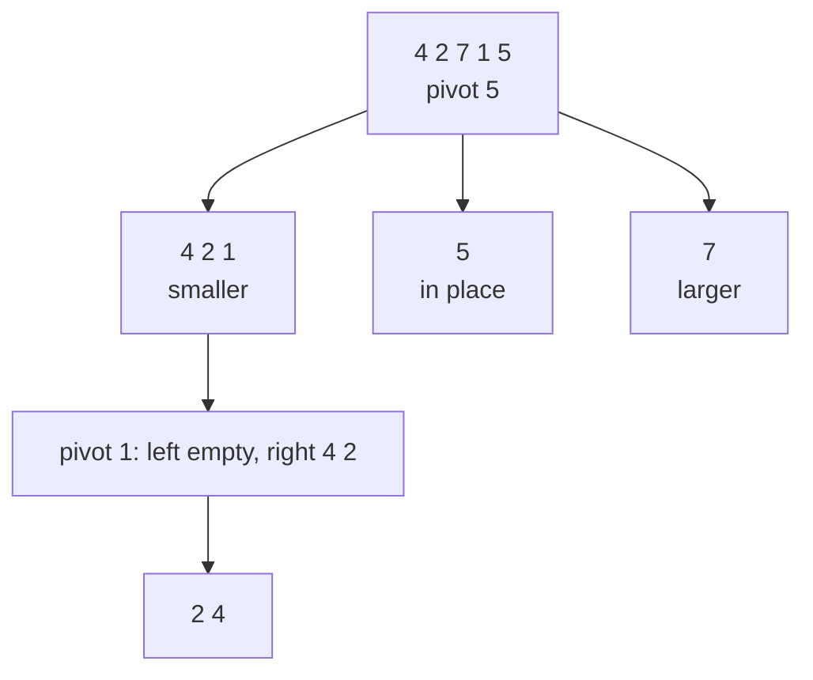

# Quick Sort

> Pick a **pivot**, put smaller items on its left and larger on its right, then sort each side. The fastest general-purpose sort in practice: `O(n log n)` on average, `O(n²)` in the worst case.

#### 1. What Is It?

Quick sort is divide and conquer, but the work happens **before** the recursion (partition), not after (merge).

1. **Choose a pivot.**
2. **Partition:** rearrange so items `<` pivot are left and items `>` pivot are right. The pivot lands in its **final** position.
3. **Recurse** on the left part and the right part.

| Property | Value |
|---|---|
| Time | `O(n log n)` average, `O(n²)` worst |
| Space | `O(log n)` stack (in place) |
| Stable | no |
| Why it is fast | in place, cache friendly, small constant factor |

**Signals:** "sort in place", "Kth element" (quickselect), "partition around a value", "Dutch national flag" (Sort Colors).

#### 2. How It Works

Sort `[4, 2, 7, 1, 5]`, pivot = last item (Lomuto partition):

```text
pivot = 5, store = 0
i=0: 4<5 → swap(0,0), store=1
i=1: 2<5 → swap(1,1), store=2
i=2: 7   → skip
i=3: 1<5 → swap(3,2) → [4,2,1,7,5], store=3
finally swap pivot into store: swap(3,4) → [4,2,1,5,7]    pivot 5 is at index 3 (final)
recurse on [4,2,1] and [7]
```



**Worst case.** If the pivot is always the smallest or largest (for example sorted input with the last item as pivot), one side is empty each time: `n + (n−1) + ... = O(n²)` and the stack can be `O(n)`.

**Fixes**

| Problem | Fix |
|---|---|
| Sorted or reverse input | **random pivot**, or median of three |
| Many equal items (all one value) | **3-way partition** (`<`, `==`, `>`) |
| Deep recursion | recurse into the **smaller** side first, loop on the larger |

#### 3. Brute Force vs Optimized

| Version | Time | Note |
|---|---|---|
| Last item as pivot | `O(n²)` on sorted data | simplest |
| **Random pivot** | `O(n log n)` expected on any data | |
| **3-way partition** | `O(n)` for all-equal data | handles duplicates |
| Merge sort | `O(n log n)` always | stable, extra space |

```kotlin
// Simplest (but fragile): functional quick sort, O(n) extra space
fun quickSortSimple(list: List<Int>): List<Int> {
    if (list.size <= 1) return list
    val pivot = list[list.size / 2]
    return quickSortSimple(list.filter { it < pivot }) +
        list.filter { it == pivot } +
        quickSortSimple(list.filter { it > pivot })
}
```

#### 4. Kotlin Code

```kotlin
import kotlin.random.Random

// In place, Lomuto partition, random pivot
fun quickSort(a: IntArray) = quickSort(a, 0, a.size - 1)

private fun quickSort(a: IntArray, lo: Int, hi: Int) {
    if (lo >= hi) return
    val p = partition(a, lo, hi)
    quickSort(a, lo, p - 1)
    quickSort(a, p + 1, hi)
}

private fun partition(a: IntArray, lo: Int, hi: Int): Int {
    swap(a, Random.nextInt(lo, hi + 1), hi)       // random pivot moved to the end
    val pivot = a[hi]
    var store = lo
    for (i in lo until hi) {
        if (a[i] < pivot) { swap(a, i, store); store++ }
    }
    swap(a, store, hi)                            // pivot goes to its final index
    return store
}

private fun swap(a: IntArray, i: Int, j: Int) { val t = a[i]; a[i] = a[j]; a[j] = t }

// 3-way partition (Dutch national flag): fast with many duplicates
fun quickSort3(a: IntArray, lo: Int = 0, hi: Int = a.size - 1) {
    if (lo >= hi) return
    val pivot = a[Random.nextInt(lo, hi + 1)]
    var lt = lo          // a[lo until lt]   < pivot
    var i = lo           // a[lt until i]    == pivot
    var gt = hi          // a[gt + 1..hi]    > pivot
    while (i <= gt) {
        when {
            a[i] < pivot -> { swap(a, lt, i); lt++; i++ }
            a[i] > pivot -> { swap(a, i, gt); gt-- }       // do not advance i: the new a[i] is unchecked
            else -> i++
        }
    }
    quickSort3(a, lo, lt - 1)
    quickSort3(a, gt + 1, hi)
}

// Sort Colors (LeetCode 75): the same 3-way idea with fixed pivot 1
fun sortColors(nums: IntArray) {
    var lo = 0; var i = 0; var hi = nums.size - 1
    while (i <= hi) {
        when (nums[i]) {
            0 -> { swap(nums, lo, i); lo++; i++ }
            2 -> { swap(nums, i, hi); hi-- }
            else -> i++
        }
    }
}
```

Checks: `quickSort` on `[4, 2, 7, 1, 5]` → `[1, 2, 4, 5, 7]`. `[3, 3, 3]` → `[3, 3, 3]`. `[5, 4, 3, 2, 1]` → `[1, 2, 3, 4, 5]`. `[]`, `[1]` → unchanged. `quickSort3` on `[2, 0, 2, 1, 1, 0]` → `[0, 0, 1, 1, 2, 2]`. `sortColors` on `[2, 0, 2, 1, 1, 0]` → `[0, 0, 1, 1, 2, 2]`. `quickSortSimple(listOf(3, 1, 2, 3))` → `[1, 2, 3, 3]`.

#### 5. Complexity

| | Time | Space |
|---|---|---|
| Best / average | `O(n log n)` | `O(log n)` stack |
| Worst (bad pivots) | `O(n²)` | `O(n)` stack |
| Random pivot | `O(n log n)` expected | `O(log n)` expected |
| 3-way, all equal | `O(n)` | |

#### 6. Common Mistakes

1. **Always choosing the first or last item** as pivot (`O(n²)` on sorted input).
2. **Not moving the pivot to its final index** before recursing (infinite loops or wrong results).
3. **Recursing on `p` instead of `p − 1` / `p + 1`**, which never shrinks.
4. **Duplicates with a plain two-way split**: all-equal arrays become `O(n²)`.
5. **In the 3-way loop, advancing `i` after swapping with `gt`.** The swapped-in item is unchecked.
6. **Claiming it is stable.** It is not.
7. **Forgetting the base case** `lo >= hi`.

#### 7. Say This in the Interview

1. "Quick sort partitions around a pivot so the pivot lands in its final place, then sorts both sides. Average `O(n log n)`, in place."
2. "The worst case is `O(n²)` with bad pivots. A random pivot makes that very unlikely."
3. "With many duplicates I'd use a 3-way partition."
4. "It is not stable. If I need stability, I'd choose merge sort."
5. "The same partition gives quickselect: Kth element in `O(n)` average."

#### 8. Quick Check

1. Where is the pivot after partition?
2. Worst-case input for last-item pivot?
3. Which sort would you choose when stability matters?

<details>
<summary>Answers</summary>

1. At its final sorted index.
2. An already sorted (or reverse sorted) array.
3. Merge sort (or Tim sort).

</details>

#### 9. Related LeetCode Questions

| # | Question | Idea |
|---|---|---|
| 75 | [Sort Colors](https://leetcode.com/problems/sort-colors/) (Medium) | 3-way partition |
| 215 | [Kth Largest Element in an Array](https://leetcode.com/problems/kth-largest-element-in-an-array/) (Medium) | quickselect |
| 912 | [Sort an Array](https://leetcode.com/problems/sort-an-array/) (Medium) | write quick sort (random pivot) |
| 905 | [Sort Array By Parity](https://leetcode.com/problems/sort-array-by-parity/) (Easy) | two-way partition |
| 283 | [Move Zeroes](https://leetcode.com/problems/move-zeroes/) (Easy) | partition |
| 324 | [Wiggle Sort II](https://leetcode.com/problems/wiggle-sort-ii/) (Medium) | median + partition |
