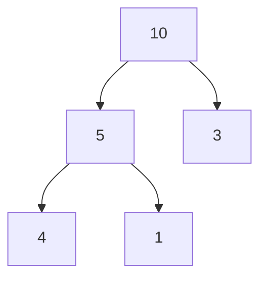

# Heap Sort

> Build a max-heap, then repeatedly move the biggest item to the end. Guaranteed `O(n log n)` and in place, but not stable and slower than quick sort in practice.

#### 1. What Is It?

A **max-heap** is a complete binary tree stored in an array where every parent is `>=` its children. The maximum is always at index 0.

Heap sort = selection sort (note 03) with a heap to find the maximum quickly.

| Property | Value |
|---|---|
| Time | `O(n log n)` in every case |
| Space | `O(1)` |
| Stable | no |
| In place | yes |

**Array layout.** For index `i`: left child `2i + 1`, right child `2i + 2`, parent `(i − 1) / 2`.

**Signals:** "guaranteed `O(n log n)` with `O(1)` space", "Kth largest / top K" (a heap, not a full sort), "priority queue".

#### 2. How It Works

Sort `[4, 10, 3, 5, 1]`.

**Step 1: build a max-heap** (sift down from the last parent, index `n/2 − 1`, to 0): `[10, 5, 3, 4, 1]`.



**Step 2: repeat.** Swap the root (max) with the last item of the heap, shrink the heap by one, sift the new root down.

```text
[10,5,3,4,1] swap(0,4) → [1,5,3,4 | 10]   sift down → [5,4,3,1 | 10]
[5,4,3,1]    swap(0,3) → [1,4,3 | 5,10]   sift down → [4,1,3 | 5,10]
[4,1,3]      swap(0,2) → [3,1 | 4,5,10]   sift down → [3,1 | 4,5,10]
[3,1]        swap(0,1) → [1 | 3,4,5,10]
sorted: [1, 3, 4, 5, 10]
```

**Why building is `O(n)`, not `O(n log n)`.** Most nodes are near the bottom and sift down only a short distance. The sum of those distances is `O(n)`.

#### 3. Brute Force vs Optimized

| Approach | Time | Space |
|---|---|---|
| Selection sort (scan for the max) | `O(n²)` | `O(1)` |
| **Heap sort** (heap finds the max) | `O(n log n)` | `O(1)` |
| Priority queue, copy out | `O(n log n)` | `O(n)` |

```kotlin
// Easy but uses extra space: PriorityQueue
import java.util.PriorityQueue
fun heapSortWithPq(a: IntArray): IntArray {
    val pq = PriorityQueue<Int>()
    for (x in a) pq.add(x)
    return IntArray(a.size) { pq.poll() }
}
```

#### 4. Kotlin Code

```kotlin
fun heapSort(a: IntArray) {
    val n = a.size
    for (i in n / 2 - 1 downTo 0) siftDown(a, i, n)      // build the max-heap
    for (end in n - 1 downTo 1) {
        swap(a, 0, end)                                   // biggest goes to its final place
        siftDown(a, 0, end)                               // heap is now a[0 until end]
    }
}

private fun siftDown(a: IntArray, start: Int, size: Int) {
    var i = start
    while (true) {
        val left = 2 * i + 1
        val right = left + 1
        var largest = i
        if (left < size && a[left] > a[largest]) largest = left
        if (right < size && a[right] > a[largest]) largest = right
        if (largest == i) return                          // heap property holds
        swap(a, i, largest)
        i = largest
    }
}

private fun swap(a: IntArray, i: Int, j: Int) { val t = a[i]; a[i] = a[j]; a[j] = t }

// Top K smallest with a max-heap of size k: O(n log k), no full sort
fun kSmallest(nums: IntArray, k: Int): List<Int> {
    val heap = java.util.PriorityQueue<Int>(compareByDescending { it })
    for (x in nums) {
        heap.add(x)
        if (heap.size > k) heap.poll()                    // drop the biggest
    }
    return heap.sorted()
}
```

Checks: `heapSort` on `[4, 10, 3, 5, 1]` → `[1, 3, 4, 5, 10]`. `[2, 2, 1]` → `[1, 2, 2]`. `[1]`, `[]` → unchanged. `[5, 4, 3, 2, 1]` → `[1, 2, 3, 4, 5]`. `heapSortWithPq(intArrayOf(3, 1, 2))` → `[1, 2, 3]`. `kSmallest(intArrayOf(7, 10, 4, 3, 20, 15), 3)` → `[3, 4, 7]`.

#### 5. Complexity

| | Time | Space |
|---|---|---|
| Build heap | `O(n)` | `O(1)` |
| Extract `n` times | `O(n log n)` | `O(1)` |
| Total, every case | `O(n log n)` | `O(1)` |

#### 6. Common Mistakes

1. **Wrong child indexes** (`2i + 1` and `2i + 2` for 0-based arrays).
2. **Sifting down with the old size** instead of the shrunken heap size `end`.
3. **Starting the build at `n − 1`** instead of the last parent `n/2 − 1`.
4. **Using a min-heap** and getting descending order (use a max-heap for ascending in place).
5. **Calling it stable.**
6. **Full sort when only top K is needed.** Use a heap of size `k`.

#### 7. Say This in the Interview

1. "Heap sort builds a max-heap in `O(n)`, then extracts the max `n` times, each `O(log n)`. Total `O(n log n)`, worst case too, with `O(1)` extra space."
2. "It is not stable and has poor cache behaviour, so quick sort is usually faster."
3. "For top K I don't sort fully: a heap of size `k` gives `O(n log k)`."

#### 8. Quick Check

1. Children of index 3 (0-based)?
2. Why is build-heap `O(n)`?
3. Where do the sorted items collect?

<details>
<summary>Answers</summary>

1. Indexes 7 and 8.
2. Most nodes are near the leaves and move only a few levels.
3. At the right end of the array, from the last index backwards.

</details>

#### 9. Related LeetCode Questions

| # | Question | Idea |
|---|---|---|
| 215 | [Kth Largest Element in an Array](https://leetcode.com/problems/kth-largest-element-in-an-array/) (Medium) | heap of size `k` |
| 347 | [Top K Frequent Elements](https://leetcode.com/problems/top-k-frequent-elements/) (Medium) | heap by count |
| 1046 | [Last Stone Weight](https://leetcode.com/problems/last-stone-weight/) (Easy) | max-heap |
| 973 | [K Closest Points to Origin](https://leetcode.com/problems/k-closest-points-to-origin/) (Medium) | heap by distance |
| 451 | [Sort Characters By Frequency](https://leetcode.com/problems/sort-characters-by-frequency/) (Medium) | heap or buckets |
| 912 | [Sort an Array](https://leetcode.com/problems/sort-an-array/) (Medium) | heap sort |
