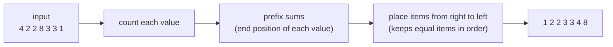

# Counting Sort

> Do not compare items at all. **Count** how many times each value appears, then write the values back in order. `O(n + k)` when the value range `k` is small.

#### 1. What Is It?

Counting sort works on **integers in a known, small range** (for example ages 0–120, letters a–z, exam scores 0–100).

| Property | Value |
|---|---|
| Time | `O(n + k)`, where `k` = range size (`max − min + 1`) |
| Space | `O(k)` for the counts (+ `O(n)` for the stable output) |
| Stable | yes (with the prefix-sum version) |
| Comparison based | no, so it beats the `n log n` limit |

**Signals:** "values are between 0 and 100", "lowercase letters only", "digits", "sort by a small key", "frequency of each value".

**Do not use** when the range is huge (`k ≫ n`), for example values up to `10⁹` with 100 items, or for floating-point numbers.

#### 2. How It Works

Sort `[4, 2, 2, 8, 3, 3, 1]` (min 1, max 8).

**Step 1: count.** Index = value − min.

```text
value:  1  2  3  4  5  6  7  8
count:  1  2  2  1  0  0  0  1
```

**Step 2 (simple version): write back.** Output each value `count` times: `1, 2, 2, 3, 3, 4, 8`. This is enough for plain integers.

**Step 2 (stable version): prefix sums.** `count[v]` becomes the number of items `<= v`, which is the **end position** of value `v`. Walk the input **from the right** and place each item at `count[v] − 1`.

```text
prefix: [1, 3, 5, 6, 6, 6, 6, 7]
x=1 → out[0]; x=3 → out[4]; x=3 → out[3]; x=8 → out[6];
x=2 → out[2]; x=2 → out[1]; x=4 → out[5]
result: [1, 2, 2, 3, 3, 4, 8]
```



**Why stability matters here:** counting sort is the building block of **radix sort**, which sorts digit by digit and needs each pass to be stable.

#### 3. Brute Force vs Optimized

| Approach | Time | When |
|---|---|---|
| Comparison sort | `O(n log n)` | any data |
| **Counting sort** | **`O(n + k)`** | integer range `k` is about `n` or smaller |
| Hash map of counts, then sort the keys | `O(n + d log d)` | `d` distinct values, any range |

```kotlin
// Brute force: library sort
fun sortLibrary(a: IntArray): IntArray = a.sortedArray()

// Hash map when the range is huge but distinct values are few
fun sortByCountMap(a: IntArray): IntArray {
    val freq = HashMap<Int, Int>()
    for (x in a) freq[x] = (freq[x] ?: 0) + 1
    val out = ArrayList<Int>(a.size)
    for (key in freq.keys.sorted()) repeat(freq[key]!!) { out.add(key) }
    return out.toIntArray()
}
```

#### 4. Kotlin Code

```kotlin
// Stable counting sort, supports negative numbers (offset by min)
fun countingSort(a: IntArray): IntArray {
    if (a.isEmpty()) return a
    val min = a.min()
    val max = a.max()
    val count = IntArray(max - min + 1)
    for (x in a) count[x - min]++
    for (i in 1 until count.size) count[i] += count[i - 1]     // prefix sums = end positions
    val out = IntArray(a.size)
    for (i in a.indices.reversed()) {                           // right to left = stable
        val x = a[i]
        count[x - min]--
        out[count[x - min]] = x
    }
    return out
}

// Sort Colors with counts (LeetCode 75): two passes, O(1) space
fun sortColorsByCount(nums: IntArray) {
    val count = IntArray(3)
    for (x in nums) count[x]++
    var k = 0
    for (color in 0..2) repeat(count[color]) { nums[k++] = color }
}

// Valid Anagram (LeetCode 242): counting on 26 letters
fun isAnagram(s: String, t: String): Boolean {
    if (s.length != t.length) return false
    val c = IntArray(26)
    for (i in s.indices) { c[s[i] - 'a']++; c[t[i] - 'a']-- }
    return c.all { it == 0 }
}

// Height Checker (LeetCode 1051): sort heights with a counting array (1..100)
fun heightChecker(heights: IntArray): Int {
    val count = IntArray(101)
    for (h in heights) count[h]++
    var wrong = 0
    var h = 1
    for (original in heights) {
        while (count[h] == 0) h++
        if (original != h) wrong++
        count[h]--
    }
    return wrong
}
```

Checks: `countingSort(intArrayOf(4, 2, 2, 8, 3, 3, 1))` → `[1, 2, 2, 3, 3, 4, 8]`. `countingSort(intArrayOf(-2, 3, -2, 0))` → `[-2, -2, 0, 3]`. `countingSort(intArrayOf(5))` → `[5]`. `sortColorsByCount` on `[2, 0, 2, 1, 1, 0]` → `[0, 0, 1, 1, 2, 2]`. `isAnagram("anagram", "nagaram")` → `true`. `heightChecker(intArrayOf(1, 1, 4, 2, 1, 3))` → `3`. `heightChecker(intArrayOf(5, 1, 2, 3, 4))` → `5`. `sortByCountMap(intArrayOf(1000000, 3, 1000000, 7))` → `[3, 7, 1000000, 1000000]`.

#### 5. Complexity

| | Time | Space |
|---|---|---|
| Count + prefix + place | `O(n + k)` | `O(n + k)` |
| Simple write-back version | `O(n + k)` | `O(k)` |

If `k` is `O(n)`, this is `O(n)`. If `k` is `n²`, it is worse than `n log n`.

#### 6. Common Mistakes

1. **Using it on a huge range** (memory blow-up).
2. **Forgetting negative numbers**: subtract `min` for the index.
3. **Iterating left to right in the placement loop**, which loses stability.
4. **Off-by-one in the count size**: it is `max − min + 1`.
5. **Trying it on floats or strings** without a mapping.
6. **Overflow in `max − min + 1`** for extreme ranges.

#### 7. Say This in the Interview

1. "The values are in a small range, so I count them. It is `O(n + k)` and avoids the `n log n` comparison limit."
2. "With prefix sums and a right-to-left pass it is stable, which radix sort needs."
3. "If the range were `10⁹` with few items I would sort with the library instead."

#### 8. Quick Check

1. Array size for values 5..20?
2. Why walk from the right?
3. Time when `k = n`?

<details>
<summary>Answers</summary>

1. 16 (`20 − 5 + 1`).
2. So equal items keep their original order (stability).
3. `O(n)`.

</details>

#### 9. Related LeetCode Questions

| # | Question | Idea |
|---|---|---|
| 242 | [Valid Anagram](https://leetcode.com/problems/valid-anagram/) (Easy) | count 26 letters |
| 1051 | [Height Checker](https://leetcode.com/problems/height-checker/) (Easy) | counting sort of 1..100 |
| 1122 | [Relative Sort Array](https://leetcode.com/problems/relative-sort-array/) (Easy) | counts + custom order |
| 75 | [Sort Colors](https://leetcode.com/problems/sort-colors/) (Medium) | three counts |
| 451 | [Sort Characters By Frequency](https://leetcode.com/problems/sort-characters-by-frequency/) (Medium) | count then order |
| 169 | [Majority Element](https://leetcode.com/problems/majority-element/) (Easy) | frequency counting |
