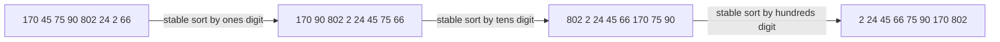

# Radix Sort

> Sort numbers **digit by digit**, from the least significant digit to the most significant, using a stable sort (counting sort) for each digit. `O(d · (n + b))`.

#### 1. What Is It?

Instead of comparing whole numbers, radix sort groups them by **one digit at a time**. Because each pass is **stable**, the order from earlier (lower) digits survives later passes.

| Property | Value |
|---|---|
| Time | `O(d · (n + b))`, `d` = digits in the largest number, `b` = base (10) |
| Space | `O(n + b)` |
| Stable | yes |
| Comparison based | no |

**Signals:** "sort large integers of fixed length", "sort strings of equal length", "maximum gap in `O(n)`", or when `d` is small and `n` is huge.

**Compare:** counting sort needs a table as large as the *value range*. Radix sort only needs a table of size `b` (10) per pass, so it handles large values like `10⁹` with `d = 10` passes.

#### 2. How It Works

Least-significant-digit (LSD) radix sort of `[170, 45, 75, 90, 802, 24, 2, 66]`:

```text
start:           170  45  75  90  802  24   2  66
sort by ones:    170  90  802   2   24  45  75  66
sort by tens:    802   2   24  45   66 170  75  90
sort by hundreds:  2  24   45  66   75  90 170 802     sorted
```



**Why it works.** After sorting by the hundreds digit, numbers are in the right order by hundreds. Numbers with the *same* hundreds digit are still ordered by tens (the previous pass), thanks to **stability**. Same logic for ones.

**Number of passes** = digits of the largest number. A number with fewer digits has leading zeros (digit 0), so it naturally sorts first.

#### 3. Brute Force vs Optimized

| Approach | Time |
|---|---|
| Comparison sort | `O(n log n)` |
| Counting sort on the full range | `O(n + k)` with `k` up to `10⁹` (too big) |
| **Radix sort** | **`O(d · n)`**, with `d ≤ 10` for 32-bit ints |

For 32-bit ints, `d ≈ 10` decimal passes, so it is about `10n`, versus `n log n ≈ 20n` for 1 million items. A fair win, but real libraries still prefer comparison sorts because of constant factors and memory.

```kotlin
// Brute force: library sort
fun sortLibrary(a: IntArray): IntArray = a.sortedArray()
```

#### 4. Kotlin Code

```kotlin
// LSD radix sort for non-negative ints
fun radixSort(a: IntArray) {
    if (a.size < 2) return
    val max = a.max()
    var exp = 1L                                   // 1, 10, 100, ... (Long avoids overflow)
    while (max / exp > 0) {
        countingByDigit(a, exp)
        exp *= 10
    }
}

private fun countingByDigit(a: IntArray, exp: Long) {
    val count = IntArray(10)
    for (x in a) count[((x / exp) % 10).toInt()]++
    for (i in 1 until 10) count[i] += count[i - 1]
    val out = IntArray(a.size)
    for (i in a.indices.reversed()) {              // right to left keeps it stable
        val d = ((a[i] / exp) % 10).toInt()
        count[d]--
        out[count[d]] = a[i]
    }
    out.copyInto(a)
}

// Negative numbers: sort negatives and non-negatives separately
fun radixSortWithNegatives(a: IntArray): IntArray {
    val neg = a.filter { it < 0 }.map { -it }.toIntArray()
    val pos = a.filter { it >= 0 }.toIntArray()
    radixSort(neg)
    radixSort(pos)
    val negSorted = neg.reversed().map { -it }     // most negative first
    return (negSorted + pos.toList()).toIntArray()
}

// Maximum Gap (LeetCode 164): sort in O(n) with radix sort, then scan
fun maximumGap(nums: IntArray): Int {
    if (nums.size < 2) return 0
    val a = nums.copyOf()
    radixSort(a)
    var gap = 0
    for (i in 1 until a.size) gap = maxOf(gap, a[i] - a[i - 1])
    return gap
}
```

Checks: `radixSort` on `[170, 45, 75, 90, 802, 24, 2, 66]` → `[2, 24, 45, 66, 75, 90, 170, 802]`. `[5, 5, 1]` → `[1, 5, 5]`. `[0, 0]` → `[0, 0]`. `[2000000000, 1]` → `[1, 2000000000]` (works because `exp` is `Long`). `radixSortWithNegatives(intArrayOf(3, -1, -10, 0, 7))` → `[-10, -1, 0, 3, 7]`. `maximumGap(intArrayOf(3, 6, 9, 1))` → `3`. `maximumGap(intArrayOf(10))` → `0`.

#### 5. Complexity

| | Time | Space |
|---|---|---|
| LSD radix, base 10 | `O(d · (n + 10))` | `O(n)` |
| 32-bit ints | about `10 · n` | `O(n)` |
| With base 256 (bytes) | 4 passes | `O(n + 256)` |

#### 6. Common Mistakes

1. **Using an unstable inner sort.** The whole method breaks.
2. **Overflow in `exp *= 10`** when the maximum is near `Int.MAX_VALUE`.
3. **Ignoring negative numbers.**
4. **Processing the most significant digit first** with the LSD code (wrong order).
5. **Forgetting that `d` is not constant** for huge numbers: the cost grows with digit count.
6. **Confusing it with bucket sort.**

#### 7. Say This in the Interview

1. "Radix sort does a stable counting sort on each digit from least to most significant. Total `O(d · n)`."
2. "Stability is essential: it keeps the order from the lower digits."
3. "It is great for fixed-width integers or equal-length strings; otherwise a comparison sort is simpler."

#### 8. Quick Check

1. Why start with the least significant digit?
2. Passes needed for max = 9,999?
3. What property must each pass have?

<details>
<summary>Answers</summary>

1. Later, more significant passes override it, and stability keeps ties in lower-digit order.
2. 4.
3. It must be stable.

</details>

#### 9. Related LeetCode Questions

| # | Question | Idea |
|---|---|---|
| 164 | [Maximum Gap](https://leetcode.com/problems/maximum-gap/) (Medium) | radix or buckets for `O(n)` |
| 912 | [Sort an Array](https://leetcode.com/problems/sort-an-array/) (Medium) | any sort, radix for ints |
| 1122 | [Relative Sort Array](https://leetcode.com/problems/relative-sort-array/) (Easy) | counting-style order |
| 242 | [Valid Anagram](https://leetcode.com/problems/valid-anagram/) (Easy) | counting on characters |
| 179 | [Largest Number](https://leetcode.com/problems/largest-number/) (Medium) | digit-order thinking |
| 976 | [Largest Perimeter Triangle](https://leetcode.com/problems/largest-perimeter-triangle/) (Easy) | sort, then scan |
