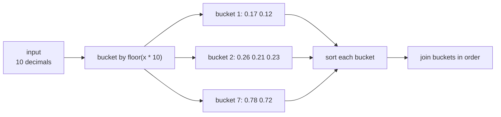
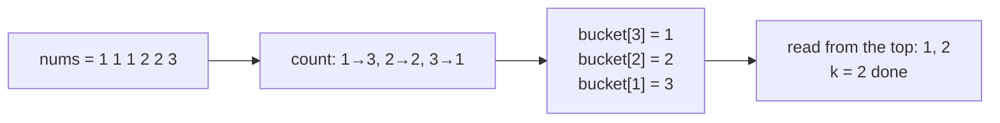

# Bucket Sort

> Spread the items into **buckets** by value range, sort each small bucket, then join the buckets. `O(n)` on average when the data is spread evenly.

#### 1. What Is It?

Divide the value range into buckets. Put each item in its bucket. Sort inside each bucket (usually with insertion sort or the library sort). Read the buckets in order.

| Property | Value |
|---|---|
| Time | `O(n + k)` average, `O(n²)` worst |
| Space | `O(n + k)` |
| Stable | yes (if the inner sort is stable) |
| Best for | numbers spread **uniformly** over a known range, such as decimals in `[0, 1)` |

**Signals:** "floating-point numbers in a range", "group by frequency or by key", "top K frequent", "maximum gap in `O(n)`", "sort when values are uniformly distributed".

**Bucket idea in disguise.** Many FAANG problems use buckets *without* calling it bucket sort: index = frequency (Top K Frequent), index = digit, index = time slot.

#### 2. How It Works

Sort `[0.78, 0.17, 0.39, 0.26, 0.72, 0.94, 0.21, 0.12, 0.23, 0.68]` with 10 buckets (bucket = `floor(x * 10)`):

```text
bucket 1: 0.17, 0.12        → sorted 0.12, 0.17
bucket 2: 0.26, 0.21, 0.23  → sorted 0.21, 0.23, 0.26
bucket 3: 0.39
bucket 6: 0.68
bucket 7: 0.78, 0.72        → sorted 0.72, 0.78
bucket 9: 0.94
join: 0.12 0.17 0.21 0.23 0.26 0.39 0.68 0.72 0.78 0.94
```



**When it goes wrong.** If all items land in one bucket, the cost becomes the inner sort of `n` items: `O(n²)` with insertion sort, or `O(n log n)` with a good inner sort.

**Pattern: bucket by frequency (Top K Frequent).** The frequency of any item is between 1 and `n`. Make `n + 1` buckets where bucket `f` holds items that appear `f` times. Walk from the highest bucket down until you have `k` items: `O(n)`, better than a heap's `O(n log k)`.



#### 3. Brute Force vs Optimized

| Problem | Brute force | Bucket idea |
|---|---|---|
| Sort uniform decimals | `O(n log n)` | `O(n)` average |
| Top K frequent | sort by count `O(n log n)` | buckets by frequency `O(n)` |
| Maximum gap | sort `O(n log n)` | buckets of size `(max − min)/(n − 1)` `O(n)` |
| Sort by small key | comparison sort | counting / buckets |

```kotlin
// Brute force Top K frequent: count, then sort by count
fun topKFrequentSort(nums: IntArray, k: Int): List<Int> {
    val freq = nums.toList().groupingBy { it }.eachCount()
    return freq.entries.sortedByDescending { it.value }.take(k).map { it.key }
}
```

#### 4. Kotlin Code

```kotlin
// Bucket sort for doubles in [0, 1)
fun bucketSort(a: DoubleArray) {
    val n = a.size
    if (n < 2) return
    val buckets = Array(n) { mutableListOf<Double>() }
    for (x in a) {
        val index = (x * n).toInt().coerceAtMost(n - 1)     // guard against x * n == n
        buckets[index].add(x)
    }
    var k = 0
    for (bucket in buckets) {
        bucket.sort()                                        // small lists, so cheap
        for (x in bucket) a[k++] = x
    }
}

// Top K Frequent Elements (LeetCode 347): buckets indexed by frequency, O(n)
fun topKFrequent(nums: IntArray, k: Int): IntArray {
    val freq = HashMap<Int, Int>()
    for (x in nums) freq[x] = (freq[x] ?: 0) + 1
    val buckets = Array(nums.size + 1) { mutableListOf<Int>() }
    for ((value, count) in freq) buckets[count].add(value)
    val result = ArrayList<Int>()
    for (count in nums.size downTo 1) {
        for (value in buckets[count]) {
            result.add(value)
            if (result.size == k) return result.toIntArray()
        }
    }
    return result.toIntArray()
}

// Sort Characters By Frequency (LeetCode 451)
fun frequencySort(s: String): String {
    val freq = HashMap<Char, Int>()
    for (c in s) freq[c] = (freq[c] ?: 0) + 1
    val buckets = Array(s.length + 1) { StringBuilder() }
    for ((c, count) in freq) repeat(count) { buckets[count].append(c) }
    val out = StringBuilder()
    for (count in s.length downTo 1) out.append(buckets[count])
    return out.toString()
}
```

Checks: `bucketSort` on `[0.78, 0.17, 0.39, 0.26, 0.72, 0.94, 0.21, 0.12, 0.23, 0.68]` → `[0.12, 0.17, 0.21, 0.23, 0.26, 0.39, 0.68, 0.72, 0.78, 0.94]`. `topKFrequent(intArrayOf(1, 1, 1, 2, 2, 3), 2)` → `[1, 2]`. `topKFrequent(intArrayOf(1), 1)` → `[1]`. `topKFrequentSort(intArrayOf(1, 1, 1, 2, 2, 3), 2)` → `[1, 2]`. `frequencySort("tree")` → `"eert"` (or `"eetr"`; the two `e` come first). `frequencySort("cccaaa")` → `"cccaaa"` or `"aaaccc"`.

#### 5. Complexity

| | Time | Space |
|---|---|---|
| Uniform data, `k` ≈ `n` buckets | `O(n)` average | `O(n + k)` |
| All items in one bucket | `O(n²)` with insertion sort, `O(n log n)` with a good sort | |
| Top K Frequent (buckets) | `O(n)` | `O(n)` |

#### 6. Common Mistakes

1. **Bad bucket index** (`x * n` can equal `n` when `x = 1.0`; clamp it).
2. **Assuming it is always `O(n)`.** It needs a roughly uniform spread.
3. **Using it for data outside a known range.**
4. **Forgetting to sort inside each bucket.**
5. **Bucket count too small or too large** (small → big buckets; large → wasted memory).
6. **Making `n` buckets for frequency but forgetting the `+ 1`** (frequency `n` needs index `n`).

#### 7. Say This in the Interview

1. "I'll distribute the values into buckets by range, sort each small bucket and join them. If the data is uniform that is `O(n)`."
2. "For Top K Frequent I use buckets indexed by frequency: counts are at most `n`, so it is `O(n)` instead of `O(n log k)`."
3. "The worst case is when everything lands in one bucket, which is as slow as the inner sort."

#### 8. Quick Check

1. Bucket index for `0.37` with 10 buckets?
2. Bucket sort vs counting sort?
3. Why `n + 1` buckets in Top K Frequent?

<details>
<summary>Answers</summary>

1. `floor(0.37 × 10) = 3`.
2. Counting sort has one bucket per exact value; bucket sort has a range per bucket and sorts inside it.
3. A frequency can be anywhere from 1 to `n`, so indexes 0 to `n` are needed.

</details>

#### 9. Related LeetCode Questions

| # | Question | Idea |
|---|---|---|
| 347 | [Top K Frequent Elements](https://leetcode.com/problems/top-k-frequent-elements/) (Medium) | buckets by frequency |
| 451 | [Sort Characters By Frequency](https://leetcode.com/problems/sort-characters-by-frequency/) (Medium) | buckets by frequency |
| 164 | [Maximum Gap](https://leetcode.com/problems/maximum-gap/) (Medium) | pigeonhole buckets |
| 49 | [Group Anagrams](https://leetcode.com/problems/group-anagrams/) (Medium) | bucket by key |
| 692 | [Top K Frequent Words](https://leetcode.com/problems/top-k-frequent-words/) (Medium) | frequency + order |
| 169 | [Majority Element](https://leetcode.com/problems/majority-element/) (Easy) | frequency counts |
