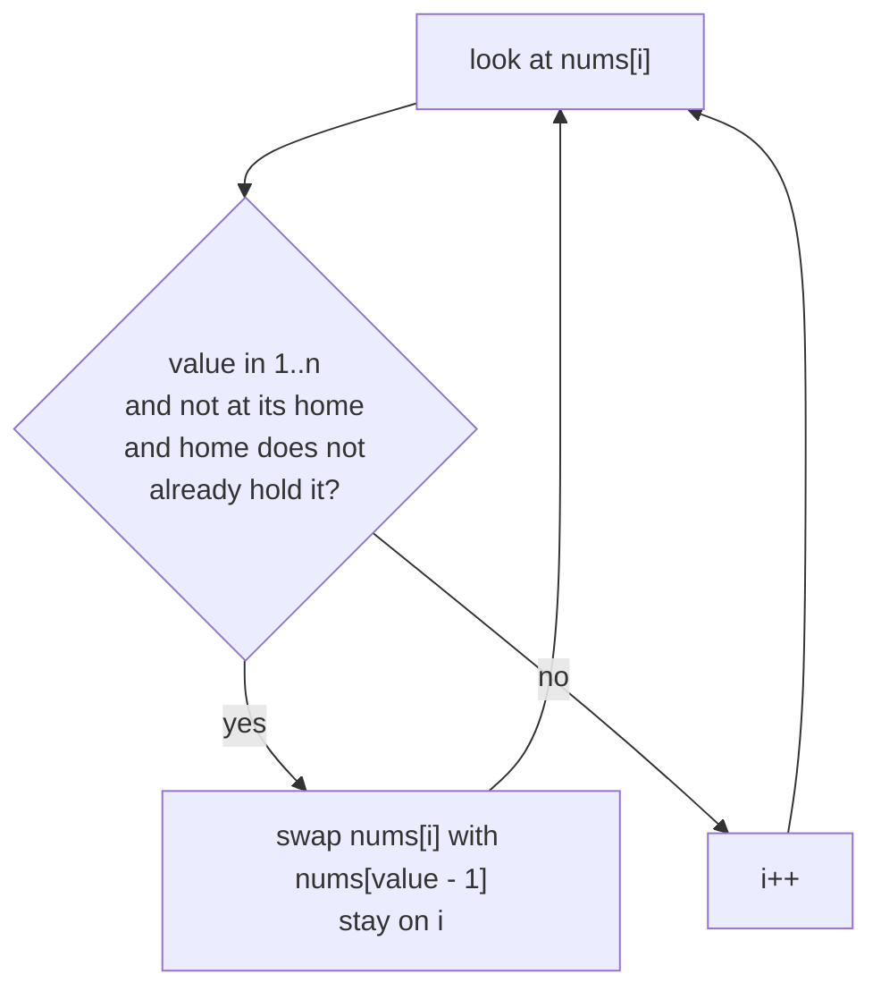

# Cyclic Sort and Awareness Sorts

> **Cyclic sort** is the interview favourite here: numbers in `1..n` sort in `O(n)` by putting each at index `value − 1`. The rest (Tim, Shell, Comb, Pigeonhole, External) you only need to **name and describe**.

#### 1. What Is It?

**Cyclic sort** (🟢): if an array holds numbers from `1` to `n`, the number `x` belongs at index `x − 1`. Swap each number straight to its home. Each swap places one number for good, so the total work is `O(n)`.

**Signals:** "numbers in the range `1..n`", "find the missing / duplicate number", "first missing positive", "`O(1)` extra space and `O(n)` time".

**Awareness sorts** (⚪), one line each:

| Sort | Idea | Why you hear about it |
|---|---|---|
| **Tim sort** | find natural sorted runs, extend short runs with insertion sort, merge runs | what Kotlin/Java/Python use for objects: `O(n)` on sorted data, `O(n log n)` worst, stable |
| **Shell sort** | insertion sort with big gaps first, then smaller gaps | simple speed-up of insertion sort, about `O(n^1.3)` in practice |
| **Comb sort** | bubble sort with a gap that shrinks by 1.3 | removes tiny values stuck at the end ("turtles") |
| **Cycle sort** | places each item straight at its final spot | the fewest memory writes of any sort |
| **Pigeonhole sort** | counting sort for when `k ≈ n` and items are exact keys | names the pigeonhole idea behind Maximum Gap |
| **External sort** | sort chunks that fit in memory, write them out, k-way merge | sorting a file larger than RAM; merge sort at heart |

#### 2. How It Works

**Cyclic sort** on `[3, 1, 2]` (values `1..3`):

```text
i=0: nums[0]=3 belongs at index 2 → swap(0,2) → [2,1,3]
i=0: nums[0]=2 belongs at index 1 → swap(0,1) → [1,2,3]
i=0: nums[0]=1 is home → i=1, i=2 → done
```



**After cyclic sort**, scan once: any index `i` where `nums[i] != i + 1` shows a **missing** number (`i + 1`) and a **duplicate** or out-of-range number sitting there.

**Why `O(n)` even with a loop inside:** every swap puts one value at its permanent place, so there are at most `n` swaps. The pointer `i` only moves when nothing is swapped.

**External sort** in pictures:


#### 3. Brute Force vs Optimized

| Problem | Brute force | Better |
|---|---|---|
| Find all missing numbers in `1..n` | hash set `O(n)` time, `O(n)` space | **cyclic sort `O(n)` time, `O(1)` space** |
| First Missing Positive | sort `O(n log n)` | **cyclic sort `O(n)`** |
| Find duplicates | sort / set | cyclic sort or sign marking |
| Sort a file larger than memory | impossible in memory | external merge sort |

```kotlin
// Brute force for "disappeared numbers": hash set, O(n) extra space
fun findDisappearedBrute(nums: IntArray): List<Int> {
    val seen = nums.toHashSet()
    return (1..nums.size).filter { it !in seen }
}
```

#### 4. Kotlin Code

```kotlin
private fun swap(a: IntArray, i: Int, j: Int) { val t = a[i]; a[i] = a[j]; a[j] = t }

// Cyclic sort for values 1..n (ignores values outside the range, tolerates duplicates)
fun cyclicSort(nums: IntArray) {
    var i = 0
    while (i < nums.size) {
        val v = nums[i]
        if (v in 1..nums.size && nums[v - 1] != v) swap(nums, i, v - 1)
        else i++
    }
}

// Find All Numbers Disappeared in an Array (LeetCode 448)
fun findDisappearedNumbers(nums: IntArray): List<Int> {
    val a = nums.copyOf()
    cyclicSort(a)
    return a.indices.filter { a[it] != it + 1 }.map { it + 1 }
}

// First Missing Positive (LeetCode 41)
fun firstMissingPositive(nums: IntArray): Int {
    val a = nums.copyOf()
    cyclicSort(a)
    for (i in a.indices) if (a[i] != i + 1) return i + 1
    return a.size + 1
}

// Find the Duplicate Number (LeetCode 287) with cyclic placement; values are 1..n in an array of n + 1
fun findDuplicate(nums: IntArray): Int {
    val a = nums.copyOf()
    var i = 0
    while (i < a.size) {
        val v = a[i]
        if (v != i + 1) {
            if (a[v - 1] == v) return v                  // its home already holds it: duplicate
            swap(a, i, v - 1)
        } else i++
    }
    return -1
}

// Shell sort (awareness): insertion sort with shrinking gaps
fun shellSort(a: IntArray) {
    var gap = a.size / 2
    while (gap > 0) {
        for (i in gap until a.size) {
            val key = a[i]
            var j = i
            while (j >= gap && a[j - gap] > key) { a[j] = a[j - gap]; j -= gap }
            a[j] = key
        }
        gap /= 2
    }
}
```

Checks: `cyclicSort` on `[3, 1, 2]` → `[1, 2, 3]`. `findDisappearedNumbers(intArrayOf(4, 3, 2, 7, 8, 2, 3, 1))` → `[5, 6]`. `findDisappearedNumbers(intArrayOf(1, 1))` → `[2]`. `firstMissingPositive(intArrayOf(3, 4, -1, 1))` → `2`. `firstMissingPositive(intArrayOf(1, 2, 0))` → `3`. `firstMissingPositive(intArrayOf(7, 8, 9, 11, 12))` → `1`. `findDuplicate(intArrayOf(1, 3, 4, 2, 2))` → `2`. `findDuplicate(intArrayOf(3, 1, 3, 4, 2))` → `3`. `shellSort` on `[12, 34, 54, 2, 3]` → `[2, 3, 12, 34, 54]`. `findDisappearedBrute(intArrayOf(4, 3, 2, 7, 8, 2, 3, 1))` → `[5, 6]`.

#### 5. Complexity

| | Time | Space |
|---|---|---|
| Cyclic sort | `O(n)` | `O(1)` |
| Shell sort | about `O(n^1.3)` typical, `O(n²)` worst | `O(1)` |
| Tim sort | `O(n)` best, `O(n log n)` worst | `O(n)` |
| External sort | `O((N/B) log(N/M))` disk passes | disk |

#### 6. Common Mistakes

1. **Infinite loop with duplicates**: always check `nums[v − 1] != v` before swapping.
2. **Indexing out of range** for values `<= 0` or `> n`: check `v in 1..n` first.
3. **Advancing `i` after a swap.** The new value at `i` is unchecked.
4. **Using it when values are not bounded by `n`.**
5. **Modifying the input** when the problem forbids it (copy, or say you are modifying it).
6. **Claiming a hash-set answer is `O(1)` space.**

#### 7. Say This in the Interview

1. "The numbers are in `1..n`, so each value has a home index `value − 1`. I swap each into place: `O(n)` time, `O(1)` space."
2. "After that, any index whose value is wrong tells me what is missing."
3. "Production sorts use Tim sort: merge sort with insertion sort on small runs, stable and `O(n log n)`."
4. "For data larger than memory I'd sort chunks and k-way merge them."

#### 8. Quick Check

1. Home index of value 5?
2. Why is cyclic sort `O(n)` despite the `while` loop?
3. What does Tim sort combine?

<details>
<summary>Answers</summary>

1. Index 4.
2. Each swap fixes one value permanently, so at most `n` swaps.
3. Merge sort and insertion sort (plus run detection).

</details>

#### 9. Related LeetCode Questions

| # | Question | Idea |
|---|---|---|
| 268 | [Missing Number](https://leetcode.com/problems/missing-number/) (Easy) | range `0..n`; sum, XOR or cyclic |
| 448 | [Find All Numbers Disappeared in an Array](https://leetcode.com/problems/find-all-numbers-disappeared-in-an-array/) (Easy) | cyclic sort |
| 287 | [Find the Duplicate Number](https://leetcode.com/problems/find-the-duplicate-number/) (Medium) | cyclic placement or Floyd |
| 442 | [Find All Duplicates in an Array](https://leetcode.com/problems/find-all-duplicates-in-an-array/) (Medium) | cyclic sort |
| 41 | [First Missing Positive](https://leetcode.com/problems/first-missing-positive/) (Hard) | cyclic sort |
| 645 | [Set Mismatch](https://leetcode.com/problems/set-mismatch/) (Easy) | duplicate + missing |
