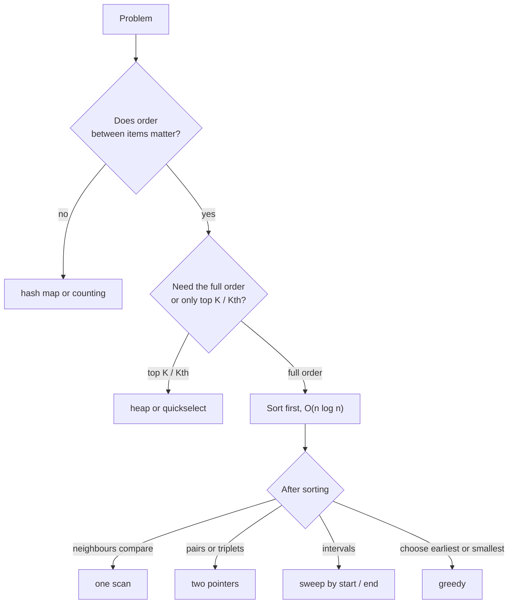

# Sorting Patterns in Interviews

> In most interviews you do not write a sorting algorithm. You **use sorting as a tool**: sort first, then the problem becomes a simple scan, a two-pointer walk, or a greedy choice.

#### 1. What Is It?

| Pattern | Idea | Typical problems |
|---|---|---|
| **Sort, then scan neighbours** | duplicates and close values become adjacent | Contains Duplicate, Minimum Absolute Difference |
| **Sort, then two pointers** | ordered data lets pointers move by comparison | 3Sum, Two Sum II, Container With Most Water |
| **Sort by start time (intervals)** | overlaps become consecutive | Merge Intervals, Meeting Rooms, Insert Interval |
| **Sort + greedy** | process the best/earliest/smallest first | Assign Cookies, Meeting Rooms II, Non-overlapping Intervals |
| **Custom comparator** | define "which goes first" yourself | Largest Number, Reorder Log Files |
| **Merge from the back** | fill from the end to avoid overwriting | Merge Sorted Array |
| **Three-way partition** | sort values from a tiny set in one pass | Sort Colors |
| **Partial sort** | top K / Kth only, not the full order | Kth Largest, Top K Frequent |

**Signals:** "overlapping", "closest", "minimum difference", "pairs/triplets that sum to", "arrange to form the largest", "schedule", "smallest number of ...".

#### 2. How It Works



**Intervals.** Sort by start. Walk through: if the next start is `<=` the current end, they overlap → extend the end; otherwise start a new interval.

```text
[[1,3],[2,6],[8,10],[15,18]] sorted by start
[1,3] and [2,6]: 2 <= 3 → merge → [1,6]
[8,10]: 8 > 6 → new interval
[15,18]: new interval        → [[1,6],[8,10],[15,18]]
```

**Meeting rooms (minimum rooms).** Sort start times and end times **separately**. A meeting that starts before the earliest end needs a new room; otherwise reuse the room that just freed.

**The total cost** of "sort then scan" is `O(n log n)` (the sort dominates). Say so.

#### 3. Brute Force vs Optimized

| Problem | Brute force | Sort-based |
|---|---|---|
| Any duplicate? | all pairs `O(n²)` | sort + neighbours `O(n log n)` (or a set `O(n)`) |
| Merge intervals | compare all pairs `O(n²)` | sort + one pass `O(n log n)` |
| 3Sum | triple loop `O(n³)` | sort + two pointers `O(n²)` |
| Minimum rooms | check every time point | sorted starts/ends `O(n log n)` |
| Largest Number | try all orders `O(n!)` | comparator sort `O(n log n)` |

```kotlin
// Brute force 3Sum count (triple loop)
fun threeSumCountBrute(a: IntArray): Int {
    var count = 0
    for (i in a.indices) for (j in i + 1 until a.size) for (k in j + 1 until a.size)
        if (a[i] + a[j] + a[k] == 0) count++
    return count
}
```

#### 4. Kotlin Code

```kotlin
// Merge Intervals (LeetCode 56)
fun merge(intervals: Array<IntArray>): Array<IntArray> {
    val sorted = intervals.sortedBy { it[0] }
    val out = ArrayList<IntArray>()
    for (cur in sorted) {
        if (out.isEmpty() || out.last()[1] < cur[0]) out.add(cur.copyOf())
        else out.last()[1] = maxOf(out.last()[1], cur[1])
    }
    return out.toTypedArray()
}

// Meeting Rooms (LeetCode 252): can one person attend all?
fun canAttendMeetings(intervals: Array<IntArray>): Boolean {
    val s = intervals.sortedBy { it[0] }
    for (i in 1 until s.size) if (s[i][0] < s[i - 1][1]) return false
    return true
}

// Meeting Rooms II (LeetCode 253): minimum rooms
fun minMeetingRooms(intervals: Array<IntArray>): Int {
    val starts = intervals.map { it[0] }.sorted()
    val ends = intervals.map { it[1] }.sorted()
    var rooms = 0
    var j = 0
    for (i in starts.indices) {
        if (starts[i] < ends[j]) rooms++ else j++        // reuse a freed room
    }
    return rooms
}

// 3Sum (LeetCode 15): sort + two pointers
fun threeSum(nums: IntArray): List<List<Int>> {
    val a = nums.sortedArray()
    val res = ArrayList<List<Int>>()
    for (i in a.indices) {
        if (i > 0 && a[i] == a[i - 1]) continue           // skip duplicate first numbers
        if (a[i] > 0) break
        var l = i + 1
        var r = a.size - 1
        while (l < r) {
            val sum = a[i] + a[l] + a[r]
            when {
                sum < 0 -> l++
                sum > 0 -> r--
                else -> {
                    res.add(listOf(a[i], a[l], a[r]))
                    l++; r--
                    while (l < r && a[l] == a[l - 1]) l++   // skip duplicate second numbers
                }
            }
        }
    }
    return res
}

// Merge Sorted Array (LeetCode 88): fill from the back
fun mergeSortedArrays(nums1: IntArray, m: Int, nums2: IntArray, n: Int) {
    var i = m - 1
    var j = n - 1
    var k = m + n - 1
    while (j >= 0) {
        if (i >= 0 && nums1[i] > nums2[j]) nums1[k--] = nums1[i--] else nums1[k--] = nums2[j--]
    }
}

// Assign Cookies (LeetCode 455): sort + greedy
fun findContentChildren(g: IntArray, s: IntArray): Int {
    val greed = g.sortedArray()
    val cookies = s.sortedArray()
    var child = 0
    for (c in cookies) if (child < greed.size && c >= greed[child]) child++
    return child
}
```

Checks: `merge(arrayOf(intArrayOf(1,3), intArrayOf(2,6), intArrayOf(8,10), intArrayOf(15,18)))` → `[[1,6],[8,10],[15,18]]`; `merge(arrayOf(intArrayOf(1,4), intArrayOf(4,5)))` → `[[1,5]]`. `canAttendMeetings([[0,30],[5,10],[15,20]])` → `false`; `[[7,10],[2,4]]` → `true`. `minMeetingRooms([[0,30],[5,10],[15,20]])` → `2`; `[[7,10],[2,4]]` → `1`. `threeSum(intArrayOf(-1, 0, 1, 2, -1, -4))` → `[[-1,-1,2],[-1,0,1]]`; `threeSum(intArrayOf(0, 0, 0))` → `[[0,0,0]]`; `threeSum(intArrayOf(1, 2))` → `[]`. `threeSumCountBrute(intArrayOf(-1, 0, 1, 2, -1, -4))` → `3` (counts index triples: `(-1,0,1)` twice and `(-1,-1,2)` once). `mergeSortedArrays` with `[1,2,3,0,0,0], 3, [2,5,6], 3` → `[1,2,2,3,5,6]`. `findContentChildren(intArrayOf(1,2,3), intArrayOf(1,1))` → `1`; `findContentChildren(intArrayOf(1,2), intArrayOf(1,2,3))` → `2`.

#### 5. Complexity

| Problem | Time | Space |
|---|---|---|
| Merge Intervals | `O(n log n)` | `O(n)` output |
| Meeting Rooms II | `O(n log n)` | `O(n)` |
| 3Sum | `O(n²)` (sort is `n log n`) | `O(1)` extra (+ output) |
| Merge Sorted Array | `O(m + n)` | `O(1)` |
| Assign Cookies | `O(n log n + m log m)` | `O(1)` |

#### 6. Common Mistakes

1. **Sorting by the wrong key** (intervals by start, not by end, for merging).
2. **Overlap test with `<` vs `<=`**: touching intervals `[1,4],[4,5]` merge in Merge Intervals; for Meeting Rooms they do not conflict.
3. **Not skipping duplicates** in 3Sum.
4. **Mutating shared interval arrays** while merging (copy first).
5. **Sorting when a hash set is `O(n)`** and enough (but sorting may be required for `O(1)` space).
6. **Forgetting the sort cost** in the final complexity.
7. **Comparator that is not consistent** (breaks sorting rules).

#### 7. Say This in the Interview

1. "If I sort by start time, overlapping intervals become adjacent, so one pass merges them. Total `O(n log n)` for the sort."
2. "Sorting costs `O(n log n)`, but it lets me use two pointers for `O(n²)` overall instead of `O(n³)`."
3. "I only need the Kth element, so I'd use a heap or quickselect instead of a full sort."
4. "To avoid overwriting data I merge from the back."

#### 8. Quick Check

1. Which key do you sort intervals by to merge them?
2. Time for 3Sum with sort + two pointers?
3. Why merge two sorted arrays from the back?

<details>
<summary>Answers</summary>

1. The start time.
2. `O(n²)`.
3. The free space is at the end of the first array, so nothing unread is overwritten.

</details>

#### 9. Related LeetCode Questions

| # | Question | Idea |
|---|---|---|
| 217 | [Contains Duplicate](https://leetcode.com/problems/contains-duplicate/) (Easy) | sort, neighbours |
| 455 | [Assign Cookies](https://leetcode.com/problems/assign-cookies/) (Easy) | sort + greedy |
| 252 | [Meeting Rooms](https://leetcode.com/problems/meeting-rooms/) (Easy, premium) | sort by start |
| 88 | [Merge Sorted Array](https://leetcode.com/problems/merge-sorted-array/) (Easy) | merge from the back |
| 56 | [Merge Intervals](https://leetcode.com/problems/merge-intervals/) (Medium) | sort by start |
| 15 | [3Sum](https://leetcode.com/problems/3sum/) (Medium) | sort + two pointers |
| 253 | [Meeting Rooms II](https://leetcode.com/problems/meeting-rooms-ii/) (Medium, premium) | sorted starts and ends |
| 179 | [Largest Number](https://leetcode.com/problems/largest-number/) (Medium) | custom comparator |
