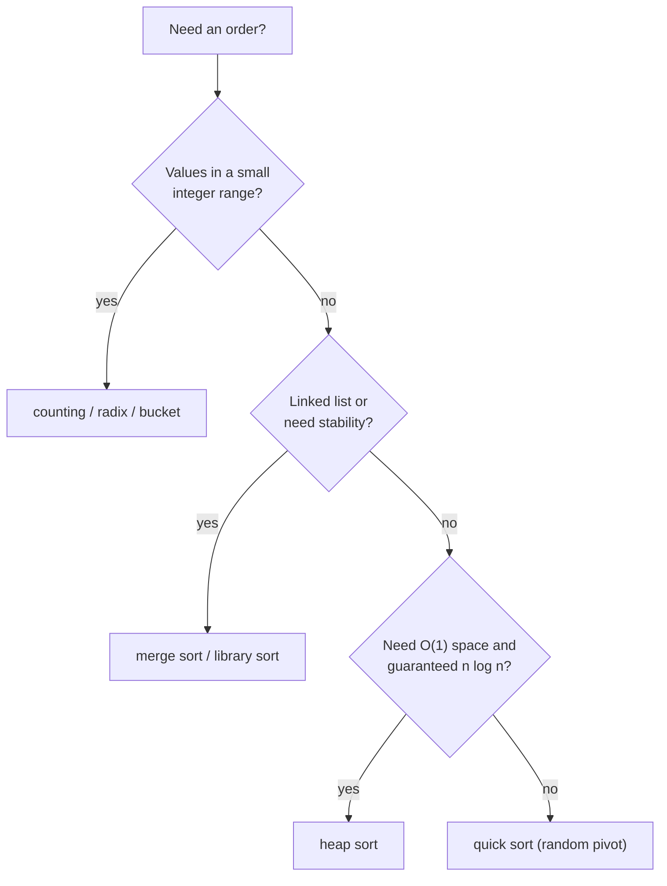

# Sorting Cheat Sheet

> One-page revision for the night before an interview. The full explanations are in notes 01–12.

#### 1. Key Takeaways

1. In interviews, **use the library sort** (`sorted()`, `sortedBy`, `sortWith`) unless asked to write one. State its cost: `O(n log n)`.
2. Comparison sorts cannot beat **`O(n log n)`**. For small integer ranges use **counting / radix / bucket** (`O(n + k)`).
3. **Stable** = equal items keep their order. Stable: bubble, insertion, merge, counting, radix, Tim sort. **Not stable:** selection, quick, heap.
4. **Merge sort**: guaranteed `O(n log n)`, stable, `O(n)` space, best for linked lists and external data.
5. **Quick sort**: fastest in practice, in place, `O(n²)` worst. Use a **random pivot**; use a **3-way partition** for duplicates.
6. **Heap sort**: guaranteed `O(n log n)`, `O(1)` space, not stable. A **heap of size `k`** gives top K in `O(n log k)`.
7. **Insertion sort** is great for small or nearly sorted data (`O(n)` best). Libraries use it for small chunks.
8. Do you need the **full order**? For Kth/top K use **quickselect** or a heap. For numbers in `1..n` use **cyclic sort** (`O(n)`, `O(1)` space).
9. **Sort first, then scan / two pointers / greedy** solves a large share of array problems. Always count the sort in the total.

#### 2. Complexity Table

| Sort | Best | Average | Worst | Space | Stable |
|---|---|---|---|---|---|
| Bubble | `O(n)` | `O(n²)` | `O(n²)` | `O(1)` | yes |
| Selection | `O(n²)` | `O(n²)` | `O(n²)` | `O(1)` | no |
| Insertion | `O(n)` | `O(n²)` | `O(n²)` | `O(1)` | yes |
| Merge | `O(n log n)` | `O(n log n)` | `O(n log n)` | `O(n)` | yes |
| Quick | `O(n log n)` | `O(n log n)` | `O(n²)` | `O(log n)` | no |
| Heap | `O(n log n)` | `O(n log n)` | `O(n log n)` | `O(1)` | no |
| Counting | `O(n + k)` | `O(n + k)` | `O(n + k)` | `O(k)` | yes |
| Radix | `O(d(n + b))` | `O(d(n + b))` | `O(d(n + b))` | `O(n + b)` | yes |
| Bucket | `O(n + k)` | `O(n + k)` | `O(n²)` | `O(n + k)` | yes |
| Cyclic (`1..n`) | `O(n)` | `O(n)` | `O(n)` | `O(1)` | n/a |
| Tim (library) | `O(n)` | `O(n log n)` | `O(n log n)` | `O(n)` | yes |

#### 3. Patterns and How to Identify Them

| Signal in the question | Pattern | Note |
|---|---|---|
| "sort the array" (no limit given) | library sort | 01 |
| "sort a linked list" | merge sort | 05 |
| "in place, `O(n log n)` guaranteed" | heap sort | 07 |
| "values are 0..100 / letters / digits" | counting sort | 08 |
| "large fixed-width integers" | radix sort | 09 |
| "decimals in [0, 1)", "group by frequency" | bucket sort | 10 |
| "numbers in `1..n`, missing / duplicate" | cyclic sort | 11 |
| "Kth largest / smallest" | quickselect or heap | 06, 07 |
| "overlapping intervals" | sort by start, sweep | 12 |
| "pairs / triplets summing to a target" | sort + two pointers | 12 |
| "arrange to form the largest / custom order" | custom comparator | 01, 12 |
| "only 0, 1, 2" | three-way partition | 06 |
| "count inversions / smaller after self" | merge sort with a counter | 05 |
| "sort a file larger than memory" | external merge sort | 11 |



#### 4. Templates to Memorise

**Merge step**

```kotlin
var i = lo; var j = mid; var k = lo
while (i < mid && j < hi) tmp[k++] = if (a[i] <= a[j]) a[i++] else a[j++]   // <= keeps it stable
while (i < mid) tmp[k++] = a[i++]
while (j < hi) tmp[k++] = a[j++]
for (x in lo until hi) a[x] = tmp[x]
```

**Quick sort partition (Lomuto, pivot = last)**

```kotlin
val pivot = a[hi]
var store = lo
for (i in lo until hi) if (a[i] < pivot) { swap(a, i, store); store++ }
swap(a, store, hi)           // pivot is now at its final index `store`
```

**Three-way partition (Sort Colors)**

```kotlin
var lo = 0; var i = 0; var hi = nums.size - 1
while (i <= hi) {
    when (nums[i]) {
        0 -> { swap(nums, lo, i); lo++; i++ }
        2 -> { swap(nums, i, hi); hi-- }       // do not advance i
        else -> i++
    }
}
```

**Heap sort sift-down**

```kotlin
fun siftDown(a: IntArray, start: Int, size: Int) {
    var i = start
    while (true) {
        val l = 2 * i + 1; val r = l + 1
        var big = i
        if (l < size && a[l] > a[big]) big = l
        if (r < size && a[r] > a[big]) big = r
        if (big == i) return
        swap(a, i, big); i = big
    }
}
// build: for (i in n / 2 - 1 downTo 0) siftDown(a, i, n)
// sort:  for (end in n - 1 downTo 1) { swap(a, 0, end); siftDown(a, 0, end) }
```

**Counting sort**

```kotlin
val count = IntArray(max - min + 1)
for (x in a) count[x - min]++
for (i in 1 until count.size) count[i] += count[i - 1]
for (i in a.indices.reversed()) { count[a[i] - min]--; out[count[a[i] - min]] = a[i] }
```

**Merge intervals**

```kotlin
val sorted = intervals.sortedBy { it[0] }
for (cur in sorted) {
    if (out.isEmpty() || out.last()[1] < cur[0]) out.add(cur.copyOf())
    else out.last()[1] = maxOf(out.last()[1], cur[1])
}
```

**Cyclic sort**

```kotlin
var i = 0
while (i < nums.size) {
    val v = nums[i]
    if (v in 1..nums.size && nums[v - 1] != v) swap(nums, i, v - 1) else i++
}
```

**Kotlin library**

```kotlin
nums.sort()                                          // IntArray in place
list.sortedBy { it.score }                           // stable
list.sortedWith(compareBy({ -it.score }, { it.name }))
strings.sortedWith { a, b -> (b + a).compareTo(a + b) }   // Largest Number
```

#### 5. Brute Force to Optimized

| Problem | Brute force | Better |
|---|---|---|
| Any duplicate | all pairs `O(n²)` | set `O(n)` or sort `O(n log n)` |
| Kth largest | full sort `O(n log n)` | quickselect `O(n)` avg / heap `O(n log k)` |
| 3Sum | triple loop `O(n³)` | sort + two pointers `O(n²)` |
| Merge intervals | all pairs `O(n²)` | sort + sweep `O(n log n)` |
| Top K frequent | sort by count `O(n log n)` | buckets by frequency `O(n)` |
| Missing number in `1..n` | hash set `O(n)` space | cyclic sort `O(1)` space |
| Sort ints in `0..100` | `O(n log n)` | counting sort `O(n)` |
| Count inversions | all pairs `O(n²)` | merge sort `O(n log n)` |

#### 6. Common Mistakes and Edge Cases

1. **Quick sort with first/last pivot on sorted input** → `O(n²)`. Use a random pivot.
2. **Merge sort `<` instead of `<=`** → unstable.
3. **Comparator `a − b` overflow.** Use `compareTo`.
4. **Counting sort with negatives or a huge range.**
5. **Radix sort with an unstable pass**, or `exp` overflow.
6. **Cyclic sort infinite loop with duplicates** (check `nums[v − 1] != v`).
7. **Overlap test `<` vs `<=`** in intervals.
8. **Forgetting the sort cost** in the final complexity.
9. **Edge cases:** empty, one item, all equal, already sorted, reverse sorted, negatives, duplicates.

#### 7. What to Say Out Loud

1. "I'll sort first, `O(n log n)`, then one pass, so the total is `O(n log n)`."
2. "Merge sort is `O(n log n)` always and stable, at the cost of `O(n)` space."
3. "Quick sort is `O(n log n)` on average; a random pivot avoids the `O(n²)` worst case."
4. "The values are in a small range, so counting sort gives `O(n + k)`."
5. "I only need the Kth element, so I don't need a full sort: quickselect is `O(n)` on average."
6. "I need stability here, so I'll use merge sort or the library's `sortedBy`."

#### 8. Practice Order (Easy → Medium)

| Level | Question | Pattern |
|---|---|---|
| Easy | [Valid Anagram](https://leetcode.com/problems/valid-anagram/) | sort or count |
| Easy | [Contains Duplicate](https://leetcode.com/problems/contains-duplicate/) | sort, neighbours |
| Easy | [Merge Sorted Array](https://leetcode.com/problems/merge-sorted-array/) | merge from the back |
| Easy | [Height Checker](https://leetcode.com/problems/height-checker/) | counting sort |
| Easy | [Relative Sort Array](https://leetcode.com/problems/relative-sort-array/) | counting + order |
| Easy | [Assign Cookies](https://leetcode.com/problems/assign-cookies/) | sort + greedy |
| Easy | [Find All Numbers Disappeared in an Array](https://leetcode.com/problems/find-all-numbers-disappeared-in-an-array/) | cyclic sort |
| Medium | [Sort Colors](https://leetcode.com/problems/sort-colors/) | 3-way partition |
| Medium | [Sort an Array](https://leetcode.com/problems/sort-an-array/) | merge / heap / quick |
| Medium | [Kth Largest Element in an Array](https://leetcode.com/problems/kth-largest-element-in-an-array/) | quickselect / heap |
| Medium | [Top K Frequent Elements](https://leetcode.com/problems/top-k-frequent-elements/) | buckets |
| Medium | [Merge Intervals](https://leetcode.com/problems/merge-intervals/) | sort by start |
| Medium | [3Sum](https://leetcode.com/problems/3sum/) | sort + two pointers |
| Medium | [Largest Number](https://leetcode.com/problems/largest-number/) | comparator |
| Medium | [Sort List](https://leetcode.com/problems/sort-list/) | merge sort on a list |
| Medium | [Meeting Rooms II](https://leetcode.com/problems/meeting-rooms-ii/) (premium) | sorted starts and ends |
| Hard | [First Missing Positive](https://leetcode.com/problems/first-missing-positive/) | cyclic sort |
| Hard | [Count of Smaller Numbers After Self](https://leetcode.com/problems/count-of-smaller-numbers-after-self/) | merge sort counting |
