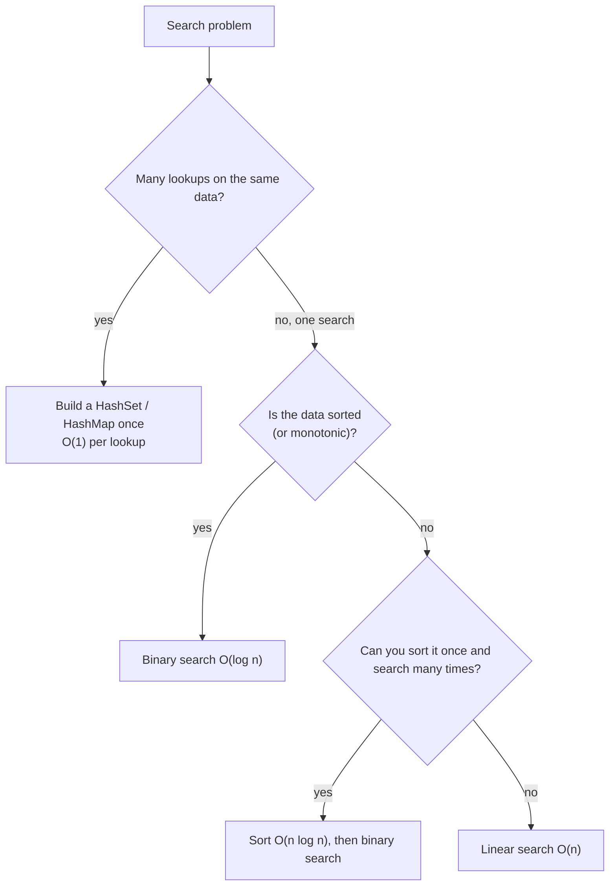

# Searching Fundamentals

> Searching means finding an item (or the place it belongs) in a collection. The method you pick depends on **one question**: is the data sorted, or can you index it?

#### 1. What Is It?

**Searching** answers: "Is `x` in this collection? Where is it?" It is one of the most common operations in programs and interviews.

| Method | Needs | Time per search | Space |
|---|---|---|---|
| **Linear search** | nothing | `O(n)` | `O(1)` |
| **Binary search** | **sorted** random-access data | `O(log n)` | `O(1)` |
| **Hash lookup** (`HashSet` / `HashMap`) | build a hash table first | `O(1)` average | `O(n)` |
| **Tree search** (`TreeMap`, BST) | a balanced tree | `O(log n)` | `O(n)` |
| **Quickselect** | unsorted data, want the Kth smallest | `O(n)` average | `O(1)` |
| **Search on the answer** | a yes/no check that flips once | `O(log range × check)` | `O(1)` |

**Signals:** "find", "does it exist", "first / last position", "smallest value such that ...", "Kth element".

#### 2. How It Works

**Which method? Ask these questions in order.**



**The cost of one search vs many searches** (n = 1,000,000 items, 1,000 searches)

| Strategy | Total work |
|---|---|
| Linear search every time | `1,000 × 1,000,000 = 10⁹` |
| Sort once, binary search each time | `n log n + 1,000 × 20 ≈ 2 × 10⁷` |
| Build a hash set once, `O(1)` each | `n + 1,000 ≈ 10⁶` |

**Beyond "is it there?"** Binary search also answers:

- the **first / last** position of a value (notes 4, 5),
- where to **insert** a value (note 6),
- the **smallest value that works** (search on the answer, notes 11, 15),
- a **peak** or a **pivot** in special shapes (notes 7 to 9).

**Rule:** the data must be **sorted** (or have a *monotonic* yes/no property) for binary search. If you cannot say "everything to the left of here is no, everything to the right is yes", you cannot binary search.

#### 3. Brute Force vs Optimized

| Question | Brute force | Optimized |
|---|---|---|
| Is `x` in a list? (once) | scan `O(n)` | scan `O(n)` (nothing better without structure) |
| Is `x` in a sorted array? | scan `O(n)` | binary search `O(log n)` |
| Is `x` in a collection? (many times) | scan each time `O(n)` | hash set `O(1)` |
| Kth smallest | sort `O(n log n)` | quickselect `O(n)` average |

```kotlin
// Linear search: works on any list
fun linearContains(nums: IntArray, x: Int): Boolean {
    for (v in nums) if (v == x) return true
    return false
}

// Hash lookup: build once, then each query is O(1)
fun makeLookup(nums: IntArray): (Int) -> Boolean {
    val set = nums.toHashSet()
    return { x -> x in set }
}

// Binary search on a sorted array: O(log n)
fun binaryContains(sorted: IntArray, x: Int): Boolean {
    var lo = 0
    var hi = sorted.size - 1
    while (lo <= hi) {
        val mid = lo + (hi - lo) / 2
        when {
            sorted[mid] == x -> return true
            sorted[mid] < x -> lo = mid + 1
            else -> hi = mid - 1
        }
    }
    return false
}
```

#### 4. Kotlin Code

Checks: `linearContains(intArrayOf(5, 3, 9), 3)` → `true`; `(intArrayOf(5, 3, 9), 4)` → `false`. `makeLookup(intArrayOf(5, 3, 9))(9)` → `true`. `binaryContains(intArrayOf(1, 3, 5, 7, 9), 7)` → `true`; `(intArrayOf(1, 3, 5, 7, 9), 4)` → `false`; `(intArrayOf(), 4)` → `false`.

Kotlin library shortcuts:

| Need | Code | Cost |
|---|---|---|
| index of a value | `list.indexOf(x)` | `O(n)` |
| binary search in a sorted `List` | `list.binarySearch(x)` | `O(log n)` |
| binary search in an `IntArray` | `java.util.Arrays.binarySearch(a, x)` | `O(log n)` |
| membership | `x in set` | `O(1)` |

`binarySearch` returns a **negative** number when the value is missing: `-(insertionPoint) - 1`.

#### 5. Complexity

| | Time | Space |
|---|---|---|
| Linear | `O(n)` | `O(1)` |
| Binary | `O(log n)` | `O(1)` |
| Hash lookup | `O(1)` avg, `O(n)` build | `O(n)` |
| Sort then search | `O(n log n)` once | `O(1)` to `O(n)` |

#### 6. Common Mistakes

1. **Binary search on unsorted data.**
2. **Sorting for a single search** (`O(n log n)` is worse than one scan).
3. **Using `list.contains` in a loop** (`O(n²)` total). Build a set.
4. **Ignoring that Kotlin's `binarySearch` result** can be negative for "not found".
5. **Assuming hash lookup is always `O(1)`** (worst case `O(n)`).
6. **Not asking whether the input is sorted.**

#### 7. Say This in the Interview

1. "Is the array sorted? If yes, binary search gives `O(log n)`. If not, one search is `O(n)`, but if I search many times I'd build a hash set."
2. "Sorting first costs `O(n log n)`, so it only pays off for many searches."
3. "Binary search works whenever there's a yes/no condition that flips once, not only on sorted arrays."

#### 8. Quick Check

1. Best way to check 1,000 values against a 1,000,000-item unsorted list?
2. What does `list.binarySearch(x)` return for a missing value?
3. When is linear search the right answer?

<details>
<summary>Answers</summary>

1. Build a `HashSet` of the list once, then 1,000 `O(1)` lookups.
2. A negative number: `-(insertion point) - 1`.
3. A single search on unsorted data, or a tiny collection.

</details>

#### 9. Related LeetCode Questions

| # | Question | Idea |
|---|---|---|
| 704 | [Binary Search](https://leetcode.com/problems/binary-search/) (Easy) | the basic template |
| 217 | [Contains Duplicate](https://leetcode.com/problems/contains-duplicate/) (Easy) | hash set |
| 1 | [Two Sum](https://leetcode.com/problems/two-sum/) (Easy) | hash lookup |
| 35 | [Search Insert Position](https://leetcode.com/problems/search-insert-position/) (Easy) | binary search |
| 278 | [First Bad Version](https://leetcode.com/problems/first-bad-version/) (Easy) | search on a yes/no |
| 215 | [Kth Largest Element in an Array](https://leetcode.com/problems/kth-largest-element-in-an-array/) (Medium) | quickselect |
