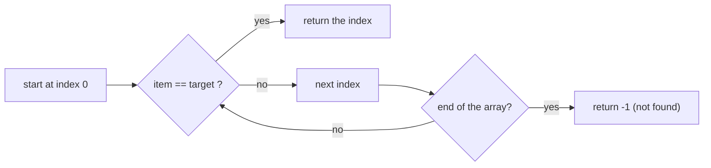

# Linear Search

> Check every item, one by one. Simple, works on anything, and is the right tool for a single search on unsorted data.

#### 1. What Is It?

**Linear search** walks through the collection from the start and stops when it finds the target (or reaches the end).

- Works on **any** order: no sorting, no extra memory.
- Time: `O(n)`. Best case `O(1)` (first item), worst case `O(n)` (last item or missing).
- It is the **brute force** baseline for every searching problem.

**Signals:** unsorted data, a small collection, a one-time search, "find the first element that satisfies a condition".

#### 2. How It Works

```text
nums = [4, 9, 2, 7], target 2
index 0: 4 ≠ 2    index 1: 9 ≠ 2    index 2: 2 = 2  → found at index 2 (stop)
```



**Common variants**

| Variant | Change |
|---|---|
| first match | return at the first hit |
| last match | scan from the end, or keep the latest index |
| all matches | collect every index, no early exit |
| first item satisfying a **condition** | `firstOrNull { condition }` |
| minimum / maximum | one pass, keep the best so far |
| in a 2D grid | two loops, `O(rows × cols)` |

**Sentinel trick.** Put the target at the end of the array so the loop needs no bounds check. It saves a comparison per step (a micro-optimisation, rarely needed).

**Early exit** is the main saving: stop as soon as you know the answer.

#### 3. Brute Force vs Optimized

Linear search **is** the brute force. The optimised alternatives need more structure:

| Situation | Better than linear search |
|---|---|
| Sorted data | binary search `O(log n)` |
| Many lookups | hash set `O(1)` |
| Searching a tree | tree search `O(log n)` |
| Single search, unsorted | nothing: linear is optimal |

```kotlin
// Brute force: find the target in an unsorted array
fun linearSearch(nums: IntArray, target: Int): Int {
    for (i in nums.indices) if (nums[i] == target) return i
    return -1
}
```

#### 4. Kotlin Code

```kotlin
// All indexes of the target
fun findAll(nums: IntArray, target: Int): List<Int> {
    val result = mutableListOf<Int>()
    for (i in nums.indices) if (nums[i] == target) result.add(i)
    return result
}

// Last index of the target
fun lastIndex(nums: IntArray, target: Int): Int {
    for (i in nums.indices.reversed()) if (nums[i] == target) return i
    return -1
}

// First element that satisfies a condition (here: the first negative number)
fun firstNegative(nums: IntArray): Int? = nums.firstOrNull { it < 0 }

// Find Target Indices After Sorting Array (LeetCode 2089): no sort needed, count smaller and equal
fun targetIndices(nums: IntArray, target: Int): List<Int> {
    var smaller = 0
    var equal = 0
    for (x in nums) { if (x < target) smaller++ else if (x == target) equal++ }
    return (smaller until smaller + equal).toList()
}

// Search in a 2D grid
fun searchGrid(grid: Array<IntArray>, target: Int): Pair<Int, Int>? {
    for (r in grid.indices) for (c in grid[r].indices) if (grid[r][c] == target) return r to c
    return null
}
```

Checks: `linearSearch(intArrayOf(4, 9, 2, 7), 2)` → `2`; `(intArrayOf(4, 9, 2, 7), 5)` → `-1`; `(intArrayOf(), 1)` → `-1`. `findAll(intArrayOf(1, 2, 1, 3, 1), 1)` → `[0, 2, 4]`. `lastIndex(intArrayOf(1, 2, 1, 3), 1)` → `2`. `firstNegative(intArrayOf(3, -2, 5, -1))` → `-2`. `targetIndices(intArrayOf(1, 2, 5, 2, 3), 2)` → `[1, 2]`. `searchGrid(arrayOf(intArrayOf(1, 2), intArrayOf(3, 4)), 3)` → `(1, 0)`.

#### 5. Complexity

| | Time | Space |
|---|---|---|
| Linear search | `O(n)` best `O(1)` | `O(1)` |
| Find all | `O(n)` | `O(k)` for `k` matches |
| Grid | `O(rows × cols)` | `O(1)` |

#### 6. Common Mistakes

1. **Returning `0` instead of `-1`** for "not found" (0 is a valid index).
2. **Forgetting early exit.**
3. **Using linear search** in a loop over a large list (`O(n²)`).
4. **Comparing objects with `==` vs `===`** (value vs identity).
5. **Not handling an empty array.**
6. **Floating-point equality** (`0.1 + 0.2 == 0.3` is false).

#### 7. Say This in the Interview

1. "The data isn't sorted and I only search once, so a linear scan is `O(n)` and optimal."
2. "If I needed many searches I'd build a hash set, or sort once and use binary search."
3. "I'll stop as soon as I find the answer."

#### 8. Quick Check

1. Worst case of linear search?
2. What does it return when the target is missing?
3. Why isn't binary search used on unsorted data?

<details>
<summary>Answers</summary>

1. `O(n)`: the target is last or missing.
2. `-1` (by convention).
3. It discards half of the data by comparing with the middle, which only works if order tells you which half to keep.

</details>

#### 9. Related LeetCode Questions

| # | Question | Idea |
|---|---|---|
| 1295 | [Find Numbers with Even Number of Digits](https://leetcode.com/problems/find-numbers-with-even-number-of-digits/) (Easy) | scan |
| 1672 | [Richest Customer Wealth](https://leetcode.com/problems/richest-customer-wealth/) (Easy) | scan rows |
| 2089 | [Find Target Indices After Sorting Array](https://leetcode.com/problems/find-target-indices-after-sorting-array/) (Easy) | count smaller |
| 1 | [Two Sum](https://leetcode.com/problems/two-sum/) (Easy) | linear, then hash |
| 169 | [Majority Element](https://leetcode.com/problems/majority-element/) (Easy) | scan with a counter |
| 54 | [Spiral Matrix](https://leetcode.com/problems/spiral-matrix/) (Medium) | visit a grid |
